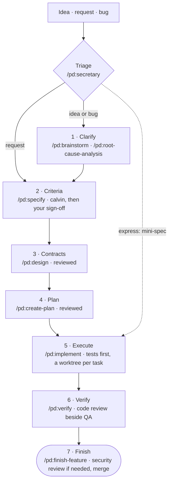

# pd Plugin

> A Claude Code plugin that takes a feature from idea to merge through fixed stages, each checked before the next begins.

## What It Does

- **Fixed stages:** Clarify, Criteria, Contracts, Plan, Execute, Verify, Finish. Each stage hands the next committed work. Criteria through Finish each close only when their exit check (`phase-gate.sh`) passes.
- **State in git:** each feature is a folder of Markdown files, committed with your code.
- **Mechanical checks:** a script checks each stage's hand-off and prints one line per problem. A hook lints the feature files staged by every `git commit` Claude runs; commits you type in a terminal aren't checked.
- **Tests first, proven per task:** each plan task runs in its own worktree, on its own branch. The merger lands a task after checking that its tests failed before the code was written and pass after; a refactor or fixture task marked `proof: green-only` only has to pass. A test that was already passing is named for the review at Verify.
- **Bounded reviews:** at Contracts, Plan and Verify, Codex reviews first when you've enabled it, otherwise a Claude reviewer. Up to three fix cycles follow. Blockers still open after that stop the run, and pd asks you what to do.
- **Unattended runs:** `/goal` drives a feature to a target stage. A Stop hook holds the run until that stage is reached with no open blocker.

## Installation

pd needs Claude Code, git, Python 3, `jq` and `uv`; the Codex plugin is optional. [Installation](docs/user-guide/installation.md) lists what each is for, and how to update.

In a Claude Code session (`#stable` follows releases):

```
/plugin marketplace add clthuang/pedantic-drip#stable
/plugin install pd@pedantic-drip-marketplace
```

Then, once per project:
- **A new project:** run `/pd:init`. It's optional, since pd runs on defaults, but Verify needs the QA commands (`qa_battery`) it proposes. It writes `.claude/pd.local.md` (the artifacts folder, the base branch, your QA commands and the token budgets). It also proposes `.claude/settings.json` entries as a diff. Approve at least `worktree.baseRef: "head"`; without it, each task's worktree starts from the default branch instead of the feature branch. [Installation](docs/user-guide/installation.md) explains each entry.
- **A project used with an older pd** (it has a `docs/features/` folder): run `/pd:adopt`. It shows a dry run, then migrates the project on a `pd-adopt` branch for you to review and merge. Its last step adds `sop: 1` to `.claude/pd.local.md`, which marks the project as adopted.

To check the setup, follow [Check It Works](docs/user-guide/installation.md#check-it-works).

## Quick Start

```
/pd:secretary "add email validation to the signup form"   # triage picks the depth
/pd:create-feature "add email validation"                 # or start a standard feature yourself
```

For a standard feature, run the stages in order (small and express features skip some; see [Workflow](#workflow)):

```
/pd:specify → /pd:design → /pd:create-plan → /pd:implement → /pd:verify → /pd:finish-feature
```

Each command works on the feature whose `feature/<id>` branch is checked out, or the one named with `--feature=<id>`. A finished brainstorm or RCA becomes a feature with `/pd:create-feature --from <its file>`.

## Workflow



**Three depths.** Triage picks one; `/pd:secretary --standard|--small|--express` or `/pd:create-feature --mode` forces it.
- **standard:** the full path, as drawn. A request starts at Criteria.
- **small:** at most three tasks by default (`small_feature_tasks`). Contracts and Plan are written together and reviewed once.
- **express:** a small change on a known pattern, provable by one command. A mini-spec replaces Criteria, Contracts and Plan. Verify runs the proof and your QA commands, and may skip the code review (the skip is recorded with its reason).

Triage always picks standard for security work, migrations, changes across many files and areas new to the codebase. Triage can also send a request straight to a specialist agent or command. A later stage can send a feature back to an earlier one; `log.md` records why and what it invalidates.

**What each stage settles:**

| Stage | Settles | Writes |
|-------|---------|--------|
| 1 · Clarify | Is this the right problem? | a brainstorm PRD or an RCA report |
| 2 · Criteria | What counts as done | `shape.md` `## Requirements` |
| 3 · Contracts | What crosses each module boundary | `shape.md` `## Design` |
| 4 · Plan | Task order, and what proves each task | `plan.md` `## Plan` |
| 5 · Execute | Does the code meet each contract? | code, one branch per task, merged in plan order |
| 6 · Verify | Does the whole change hold together? | review and QA entries in `log.md` |
| 7 · Finish | What this feature taught | a metrics entry; a retro only when `log.md` records a trigger, such as a second move back or a defect after merge |

The full diagram, with every check and review, is the Mermaid source [docs/workflow-canonical.mmd](docs/workflow-canonical.mmd).

## Commands

**Workflow:**

| Command | Purpose |
|---------|---------|
| `/pd:secretary` | Triage an idea, request or bug into a feature, brainstorm, RCA or specialist |
| `/pd:brainstorm [topic]` | Explore an idea into an evidence-backed PRD |
| `/pd:root-cause-analysis` | Find all root causes of a bug or failure |
| `/pd:create-feature <title>` | Create a feature and its branch, or promote a brainstorm, RCA or backlog item |
| `/pd:specify` | Write the criteria in `shape.md`, then sign them off |
| `/pd:design` | Write the contracts and architecture in `shape.md` |
| `/pd:create-plan` | Write `plan.md`: the tasks in order, each with its test cases |
| `/pd:implement` | Run the plan, one task per worktree |
| `/pd:verify` | Review the whole change beside QA, then fix |
| `/pd:finish-feature` | Security review if needed, docs, metrics, retro if triggered, merge into the base branch |
| `/pd:abandon-feature` | Mark a feature abandoned, with your reason, and offer to delete its branch |
| `/pd:wrap-up` | End the session: commit work in progress, write a handoff |

**Setup and upkeep:**

| Command | Purpose |
|---------|---------|
| `/pd:init` | Set a project up for pd |
| `/pd:adopt` | Migrate a project from an older pd |
| `/pd:add-to-backlog <idea>` | Add a line to the backlog |
| `/pd:retrospect` | Run a retrospective for a feature |
| `/pd:generate-docs` | Scaffold or update `docs/user-guide/`, `docs/dev-guide/` and `docs/technical/` |

**Also included** (domain tools that work outside the stages):

| Command | Purpose |
|---------|---------|
| `/pd:create-specialist-team` | Assemble a temporary team of specialist agents for a complex task |
| `/pd:subagent-ras` | Research, analyze and summarize a topic with parallel agents |
| `/pd:promptimize` | Review a prompt and return an improved version |
| `/pd:refresh-prompt-guidelines` | Update the prompt guidelines from current practice |
| `/pd:init-ds-project <name>` | Scaffold a data science project |
| `/pd:review-ds-analysis <file>` | Review a data analysis for statistical pitfalls |
| `/pd:review-ds-code <file>` | Review data science Python for anti-patterns |

## Where State Lives

```
docs/dev_artifacts/            # artifacts_root in .claude/pd.local.md, set by /pd:init
├── features/<id>/             # id: <date>-<slug>
│   ├── README.md              # status, phase, mode (the depth), and ## Now: the work in progress
│   ├── log.md                 # history: decisions, reviews, QA, metrics; added to, never rewritten
│   ├── shape.md               # ## Requirements, then ## Design
│   ├── plan.md                # ## Plan
│   └── retro.md               # only when log.md records a retro trigger
├── brainstorms/               # from /pd:brainstorm
├── rca/                       # from /pd:root-cause-analysis
├── plans/                     # multi-feature plans and their roadmaps
└── backlog.md                 # one line per idea
```

## Reference

pd includes 24 skills and 21 agents. Commands and agents load them; you don't call them directly.
- **Stage playbooks:** brainstorming, root-cause-analysis, specifying, designing, planning, implementing, verifying, finishing-branch, retrospecting, and workflow-transitions, the contract they share.
- **Other skills:** systematic-debugging, structured-problem-solving, researching, promptimize, updating-docs, writing-skills, creating-specialist-teams, and domain knowledge for game design, crypto analysis and data science.
- **Agents:** listed in [plugins/pd/README.md](plugins/pd/README.md#agents).

## For Developers

See [README_FOR_DEV.md](./README_FOR_DEV.md) for component authoring, architecture, validation and releases.
