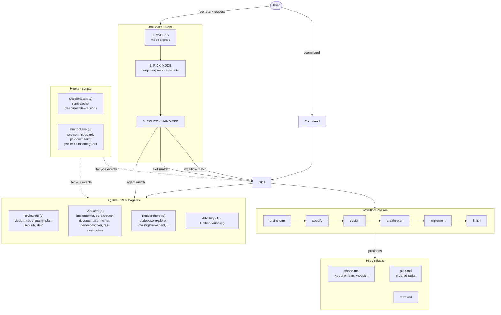

# Developer Guide

This repo uses a git-flow branching model with automated releases via conventional commits.

## Branch Structure

| Branch | Purpose |
|--------|---------|
| `main` | Stable releases only (tagged versions) |
| `develop` | Integration branch (default for development) |
| `feature/*` | Feature branches (created by pd workflow) |

## Single-Plugin Model

One plugin, branch-based separation:

| Branch | Purpose | Version Format |
|--------|---------|----------------|
| `develop` | Active development (dogfood) | X.Y.Z-dev |
| `main` | Stable releases | X.Y.Z |

All plugin code lives in `plugins/pd/`. Development happens on `develop`, releases merge to `main` with a version tag.

## Development Workflow

1. Create feature branch from `develop`
2. Use conventional commits (`feat:`, `fix:`, `BREAKING CHANGE:`)
3. Merge to `develop` via `/pd:finish-feature` or PR
4. Release when ready using the release script

## Version Bump Logic

Version bumps are calculated automatically based on code change volume:

| Change % | Bump | Example |
|----------|------|---------|
| ≤3% | Patch | 1.0.0 → 1.0.1 |
| 3-10% | Minor | 1.0.0 → 1.1.0 |
| >10% | Major | 1.0.0 → 2.0.0 |

The script calculates: `(lines added + lines deleted) / total codebase lines`

## Release Process

### Option 1: GitHub Actions (Recommended)

Trigger from GitHub Actions UI or CLI:

```bash
# Dry run - verify what would happen
gh workflow run release.yml --ref develop -f dry_run=true

# Real release
gh workflow run release.yml --ref develop -f dry_run=false
```

### Option 2: Local Release

From the develop branch with a clean working tree:

```bash
./scripts/release.sh
```

### What the Release Script Does

1. Validate preconditions (on develop, clean tree, has origin)
2. Calculate version from code change percentage since last tag
3. Strip `-dev` suffix from plugin.json and marketplace.json
4. Promote CHANGELOG [Unreleased] entries
5. Commit on develop, push
6. Merge develop → main (no-ff), tag, push
7. Bump develop to next `-dev` version

## Local Development Setup

Clone the repository and install the development plugin:

```bash
git clone https://github.com/clthuang/pedantic-drip.git
cd pedantic-drip
claude
```

In Claude Code:

```
/plugin marketplace add .claude-plugin/marketplace.json
/plugin install pd@pedantic-drip-marketplace
```

After making changes to plugin files, sync the cache from the main checkout:

```
/pd:sync-cache
```

Only a main checkout publishes the plugin cache, or a directory with no `.git` (a `git archive` export). From a linked worktree nothing is published, nor from a `.git` file git cannot answer for (an orphaned worktree); a worktree's plugin edits reach the cache once they reach the main checkout.

## For Public Users

To install the released version:

```
/plugin marketplace add clthuang/pedantic-drip
/plugin install pd
```

## Key Files

| File | Purpose |
|------|---------|
| `scripts/release.sh` | Release automation script |
| `.github/workflows/release.yml` | CI release workflow |
| `.claude-plugin/marketplace.json` | Marketplace configuration |
| `plugins/pd/.claude-plugin/plugin.json` | Plugin manifest with version |

---

## Architecture

Commands invoke Skills; Skills spawn Agents; Hooks fire at lifecycle points. The secretary command is a triage layer, not a pipeline: it picks a mode (deep, express, or specialist fast-path), states the rationale, routes, and hands off. Triage never mutates state — the routed command owns all entity work.



## Design Principles

| Principle | Meaning |
|-----------|---------|
| **Everything is prompts** | Skills and agents are just instructions Claude follows |
| **Files are truth** | Artifacts persist in files; any session can resume |
| **Humans unblock** | When stuck, Claude asks—never spins endlessly |
| **Composable > Rigid** | Phases work independently; combine as needed |

## Skills

Skills are instructions Claude follows for specific development practices. Located in `plugins/pd/skills/{name}/SKILL.md`.

### Workflow Phases
| Skill | Purpose |
|-------|---------|
| `brainstorming` | Guides 6-stage process producing evidence-backed PRDs with advisory team analysis and structured problem-solving |
| `structured-problem-solving` | Applies SCQA framing and type-specific decomposition to problems during brainstorming |
| `specifying` | Creates precise specifications with acceptance criteria |
| `designing` | Creates design.md with architecture and contracts |
| `planning` | Produces plan.md with dependencies and ordering |
| `implementing` | Execution mechanics for the implement phase — inline vs worktree-isolated task dispatch, merge-back |
| `finishing-branch` | Guides branch completion with PR or merge options |

### Quality & Review
| Skill | Purpose |
|-------|---------|
| `promptimize` | Reviews plugin prompts against best practices guidelines and returns scored assessment with improved version |
| `workflow-transitions` | Shared phase-transition contract (engine entry/exit, global YOLO rule, review gate, dispatch hygiene) |

### Investigation
| Skill | Purpose |
|-------|---------|
| `systematic-debugging` | Guides four-phase root cause investigation |
| `root-cause-analysis` | Structured 6-phase process for finding ALL contributing causes |

### Research & Synthesis
| Skill | Purpose |
|-------|---------|
| `researching` | Orchestrates parallel research, analysis, and synthesis into decision-ready summaries |

### Domain Knowledge
| Skill | Purpose |
|-------|---------|
| `game-design` | Game design frameworks, engagement/retention analysis, aesthetic direction, and feasibility evaluation |
| `crypto-analysis` | Crypto/Web3 frameworks for protocol comparison, DeFi taxonomy, tokenomics, trading strategies, MEV classification, market structure, and risk assessment |
| `data-science-analysis` | Data science frameworks for methodology assessment, pitfall analysis, and modeling approach recommendations (brainstorming domain) |
| `writing-ds-python` | Clean DS Python code: anti-patterns, pipeline rules, type hints, testing strategy, dependency management |
| `structuring-ds-projects` | Cookiecutter v2 project layout, notebook conventions, data immutability, the 3-use rule |
| `spotting-ds-analysis-pitfalls` | 15 common statistical pitfalls with diagnostic decision tree and mitigation checklists |
| `choosing-ds-modeling-approach` | Predictive vs causal modeling, method selection flowchart, Rubin/Pearl frameworks, hybrid approaches |

### Specialist Teams
| Skill | Purpose |
|-------|---------|
| `creating-specialist-teams` | Creates ephemeral specialist teams via template injection into generic-worker |

### Maintenance
| Skill | Purpose |
|-------|---------|
| `retrospecting` | Runs data-driven AORTA retrospective using retro-facilitator agent; writes plain-markdown retro.md |
| `updating-docs` | Automatically updates documentation using agents |
| `writing-skills` | Applies TDD approach to skill documentation |

## Commands

Commands are user-invoked entry points. Located in `plugins/pd/commands/{name}.md`. See [README.md](README.md) for the full list. Notable utility commands:

| Command | Purpose |
|---------|---------|
| `generate-docs` | Generate three-tier documentation scaffold or update existing docs |
| `subagent-ras` | Research, analyze, and summarize any topic using parallel agents |
| `promptimize` | Review a plugin prompt against best practices and return an improved version |
| `refresh-prompt-guidelines` | Scout latest prompt engineering best practices and update the guidelines document |

## Agents

Agents are isolated subprocesses spawned by the workflow. Located in `plugins/pd/agents/{name}.md`.

**Reviewers (6):** — only `design-reviewer` and `code-quality-reviewer` sit on the feature workflow's two review moments; the rest are on-demand or non-feature paths.
- `design-reviewer` — Challenges design assumptions and finds gaps (review moment 1 of 2, `/pd:design`)
- `code-quality-reviewer` — Adversarially reviews the branch diff for correctness and maintainability (review moment 2 of 2, `/pd:implement`)
- `security-reviewer` — Reviews implementation for security vulnerabilities; dispatched from `/pd:finish-feature` on security-surface changes. Always an Anthropic-model Task, never routed to Codex
- `plan-reviewer` — Skeptically reviews plans for failure modes and feasibility (Claude Code plan mode, pasted plans)
- `ds-analysis-reviewer` — Reviews data analysis for statistical pitfalls, methodology issues, and conclusion validity; uses WebSearch + Context7
- `ds-code-reviewer` — Reviews DS Python code for anti-patterns, pipeline quality, and best practices; uses Context7 for API verification

**Workers (5):**
- `implementer` — Implements tasks with TDD and self-review discipline
- `qa-executor` — Execution-grounded QA: runs the test battery and drives affected flows, returning commands plus output as evidence. Fixes nothing
- `generic-worker` — General-purpose implementation agent for mixed-domain tasks
- `documentation-writer` — Writes and updates documentation based on research findings
- `ras-synthesizer` — Synthesizes multi-source research findings into thematic analysis with confidence calibration

**Advisory (1):**
- `advisor` — Applies strategic or domain advisory lens to brainstorm problems via template injection

**Researchers (5):**
- `codebase-explorer` — Analyzes codebase to find relevant patterns and constraints
- `documentation-researcher` — Researches documentation state and identifies update needs
- `internet-researcher` — Searches web for best practices, standards, and prior art
- `investigation-agent` — Read-only research agent for context gathering
- `skill-searcher` — Finds relevant existing skills for a given topic

**Orchestration (2):**
- `rca-investigator` — Finds all root causes through 6-phase systematic investigation
- `retro-facilitator` — Runs data-driven AORTA retrospective with full intermediate context

### Advisory Team Architecture
The brainstorm skill dispatches advisory agents alongside research agents in Stage 2.
Advisors are `.advisor.md` template files in `skills/brainstorming/references/advisors/`.
The secretary classifies problems by archetype (from `references/archetypes.md`) and assembles
an advisory team of 2-5 advisors. Domain advisors reference existing domain skill reference files.
New advisors are added by creating a `.advisor.md` file and listing it in the archetypes inventory.

## Hooks

Hooks execute automatically at lifecycle points.

| Hook | Trigger | Purpose |
|------|---------|---------|
| `sync-cache` | SessionStart (startup\|resume\|clear) | Syncs plugin source to Claude cache from a main checkout; publishes nothing from a linked worktree |
| `cleanup-stale-versions` | SessionStart (startup\|resume\|clear) | Deletes cached pd plugin versions older than the active one |
| `pre-commit-guard` | PreToolUse (Bash) | Branch protection and pd directory protection |
| `pd-commit-lint` | PreToolUse (Bash) | Runs `pd-lint --staged` before a `git commit`; a lint error blocks the commit (exit 2) |
| `pre-edit-unicode-guard` | PreToolUse (Write\|Edit) | Non-blocking warning for risky Unicode codepoints in edits |

`pre-edit-unicode-guard.sh` delegates to `pre-edit-unicode-guard.py` — a worker module invoked by the wrapper, not separately registered.

SessionStart hooks match `startup|resume|clear` only -- they do not fire on `compact` events, preserving context window savings from compaction.

Defined in `plugins/pd/hooks/hooks.json`.

### Hook Protection

The `pre-commit-guard` hook warns when committing to protected branches (main/master) and reminds about running tests.

## Workflow Mechanics

Each phase command in `plugins/pd/commands/` is a short **contract** — purpose, inputs, output, steps, constraints — and is the source of truth for its own phase. Read the command file before this section; what follows is only the shared machinery.

**State.** The workflow engine and the entity registry are retired (thin pd, `docs/plans/2026-10-14-thin-pd-native-design.md`); state moves onto committed files, and build task T4.10 rewrites this section.

**Artifact inventory.** Two artifacts carry a feature, plus the retro:

| Artifact | Written by | Contains |
|----------|-----------|----------|
| `shape.md` | `/pd:specify`, then `/pd:design` | `## Requirements` (mechanically checkable success criteria, scope, edge cases), then `## Design` |
| `plan.md` | `/pd:create-plan` | `## Plan` — ordered tasks, each with files touched and the command that proves it done; parallel-safe tasks flagged |
| `retro.md` | `/pd:finish-feature` | AORTA retrospective, written before branch cleanup |

There is no `spec.md`, no `tasks.md`, and no implementation log. Tasks are derived from `plan.md` at dispatch time by the `implementing` skill, which runs parallel-safe tasks as `implementer` agents in `.pd-worktrees/task-{N}` worktrees and merges them back in plan order.

**Mechanical gates (tier 1).** `plugins/pd/scripts/phase-gate.sh <phase> <feature-dir>` runs at every phase boundary with zero dispatch: artifact existence, required sections, duplicate fenced contract blocks across the artifact set, and uncommitted artifacts at implement entry. Each failure prints one line; exit 0 means pass.

**Review moments (tier 2).** Exactly two LLM reviews per deep feature — `pd:design-reviewer` after the design gate, and `pd:code-quality-reviewer` on the full branch diff during implement. Each is one pass plus at most one fix round; still-open blockers escalate to the user rather than looping to a cap. Alongside them, `pd:qa-executor` supplies execution-grounded evidence during implement (runs the suites, drives affected flows, reports without fixing), and `pd:security-reviewer` runs from `/pd:finish-feature` when the branch touches a security surface. Implement carries one circuit breaker for the whole phase: 3 fix cycles total.

**Express mode.** `/pd:create-feature --express` records an inline mini-spec as a `mini_spec` phase event, passes `skipped_phases=["brainstorm","specify","design","create-plan"]` to the engine, and hands straight to `/pd:implement`, where QA and review collapse into one combined pass. `/pd:secretary` picks the lane: any of security surface, schema/data migration, multi-file blast radius, novel domain, or non-mechanical success criteria forces deep mode.

## Knowledge Bank

Inert reference markdown lives in `docs/knowledge-bank/`:

- **constitution.md** — Core principles (KISS, YAGNI, etc.)
- **patterns.md** — Approaches that worked
- **anti-patterns.md** — Things to avoid
- **heuristics.md** — Decision guides

These files are preserved as plain documentation. Memory capture and recall are delegated to Claude Code's native memory or an external memory plugin — pd no longer owns any memory subsystem.

## Creating Components

See [Component Authoring Guide](./docs/dev_guides/component-authoring.md).

All components are created in the `plugins/pd/` directory:

**Skills:** `plugins/pd/skills/{name}/SKILL.md` — Instructions Claude follows
**Agents:** `plugins/pd/agents/{name}.md` — Isolated workers with specific focus
**Commands:** `plugins/pd/commands/{name}.md` — User-invocable entry points
**Hooks:** `plugins/pd/hooks/` — Lifecycle automation scripts

## Validation

```bash
./validate.sh    # Check all components
```

## Error Recovery

When something fails:

1. **Auto-retry** for transient issues
2. **Fresh approach** if retry fails
3. **Ask human** with clear options

**Principle:** Never spin endlessly. Never fail silently. Ask.

## Contributing

1. Fork the repository
2. Create feature branch
3. Run `./validate.sh`
4. Submit PR

## References

- [Component Authoring Guide](./docs/dev_guides/component-authoring.md)
