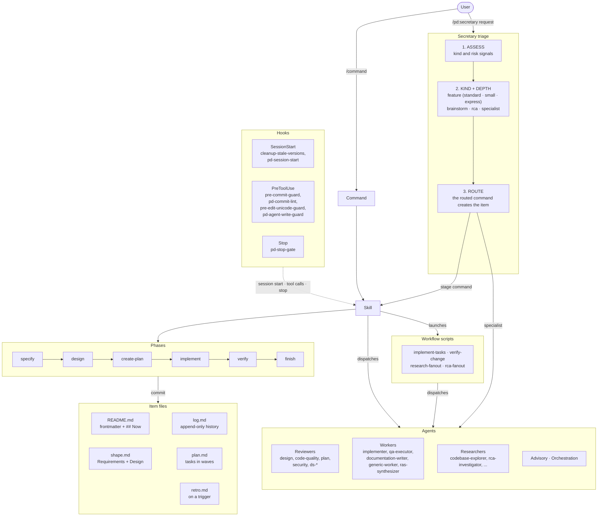

# Developer Guide

All work lands on `main` through pull requests. A script opens each release as a PR; a workflow publishes it once merged.

## Branch Structure

| Branch | Purpose |
|--------|---------|
| `main` | Trunk and GitHub's default; every change lands here through a PR, merged as a merge commit |
| `stable` | Release channel that installs follow; by convention only the Publish workflow moves it, fast-forward only |
| `feature/<id>` | A feature's branch, created by `/pd:create-feature` (`<id>` is `YYYY-MM-DD-slug`) |
| `pd/<id>/task-<n>` | One plan task's branch inside `implement-tasks` |
| `release/vX.Y.Z` | A release PR's branch, opened by `scripts/release-pr.sh` |

GitHub rulesets protect them:
- **`main`:** PR required (0 approvals, merge commits only); the `validate` check must pass and be up to date with `main`; no force push or deletion.
- **`stable`:** no force push or deletion.
- **`v*` tags:** no update or deletion.

All plugin code lives in `plugins/pd/`.

## Development Workflow

1. Create a feature branch from `main`
2. Add your entries under `## [Unreleased]` in `CHANGELOG.md`
3. Open a PR into `main` (or run `/pd:finish-feature`) and merge once CI passes
4. Release when ready using the release script

[docs/dev-guide/contributing.md](docs/dev-guide/contributing.md) covers the checks a change must pass and where new components go.

## Version

One version: `version` in `plugins/pd/.claude-plugin/plugin.json`, plain `X.Y.Z`. `marketplace.json` carries none. Between releases `main` keeps the last released version.

The maintainer chooses the bump at release time (patch, minor or major) by semver. Nothing computes it from change volume or commit prefixes.

`validate.sh` checks the version through `scripts/check-version.sh`: it is `X.Y.Z`, at least the highest `v*` tag, a new version has its `CHANGELOG.md` section, and `marketplace.json` has no version.

Released `CHANGELOG.md` sections are frozen: `scripts/check-changelog.sh` fails a PR that changes them. A forgotten entry goes in the next release.

## Release Process

There is one path.

1. On a clean `main` equal to `origin/main`, with `gh` and `jq` installed:

   ```bash
   scripts/release-pr.sh [patch|minor|major]   # default patch
   ```

   It bumps `plugin.json`, promotes `[Unreleased]` to `[X.Y.Z] - date`, and opens a PR from `release/vX.Y.Z` into `main`. It refuses when:
   - **CI hasn't passed** on that `main` commit;
   - **the previous version isn't published yet** (its tag and `stable`);
   - **`[Unreleased]` is empty** in `CHANGELOG.md`.
2. Merge the PR once CI passes.
3. `.github/workflows/publish.yml` runs `scripts/publish-release.sh`: it tags `vX.Y.Z` on the merge commit and fast-forwards `stable`.
4. Installs pick up the release on their next marketplace update ([Update](docs/user-guide/installation.md#update)).

## Local Development Setup

Clone the repository, then install the released plugin as [Installation](docs/user-guide/installation.md) describes:

```bash
git clone https://github.com/clthuang/pedantic-drip.git
cd pedantic-drip
claude
```

To try plugin changes, start a session with this checkout's plugin in place of the installed one, for that session only:

```bash
claude --plugin-dir plugins/pd
```

The installed copy changes only through a release, which reaches installs through `stable`.

## Key Files

| File | Purpose |
|------|---------|
| `validate.sh` | Validates every component, the version and the docs; CI's first step |
| `scripts/release-pr.sh` | Opens the release PR: bumps the version and promotes the CHANGELOG |
| `scripts/publish-release.sh` | Tags `vX.Y.Z` and fast-forwards `stable`; run by `publish.yml` |
| `scripts/check-version.sh` | The version rules above; run by `validate.sh` |
| `scripts/check-changelog.sh` | Fails a PR that changes a released CHANGELOG section |
| `scripts/check-doc-drift.sh` | Checks the component counts in `README.md` and `plugins/pd/README.md`, and the hooks table below, against the filesystem; fails on retired terms in the living docs; run by `validate.sh` |
| `scripts/test-release.sh` | Tests the release scripts; run by CI |
| `.github/workflows/ci.yml` | The `validate` check on PRs into and pushes to `main` |
| `.github/workflows/publish.yml` | Publishes each release merged to `main` |
| `.github/workflows/claude-review.yml` | Claude Code reviews each same-repo PR into `main` and posts a PR comment. It skips fork PRs and PRs that change only `docs/`, and does nothing until the `CLAUDE_CODE_OAUTH_TOKEN` secret (from `claude setup-token`) is set |
| `.claude-plugin/marketplace.json` | Marketplace configuration |
| `plugins/pd/.claude-plugin/plugin.json` | Plugin manifest with version |

---

## Architecture

Commands invoke skills. A skill dispatches agents directly, or launches a workflow script that dispatches them. Hooks fire on session start, before tool calls and at each stop. The secretary is triage, not a pipeline: it picks the kind of work and, for a feature, its depth, then creates the item through the routed command.



The design principles are in [docs/dev-guide/architecture-overview.md](docs/dev-guide/architecture-overview.md#design-principles), and the full flow with every check is [docs/technical/architecture.md](docs/technical/architecture.md).

## Skills

Skills are instructions Claude follows. Each lives in `plugins/pd/skills/{name}/SKILL.md`; its frontmatter `description` is the canonical summary.

### Stage playbooks
| Skill | Purpose |
|-------|---------|
| `brainstorming` | Clarify for an idea: the brainstorm item, the Clarify questions, the optional `research-fanout`, the PRD, and promotion at Criteria |
| `root-cause-analysis` | Clarify for a bug: the rca item, reproduction, 3+ hypotheses, the `rca-fanout` workflow with its refuters, the causal DAG and the RCA report, then the fix's entry depth |
| `specifying` | Criteria: B-numbered expectations in `shape.md`, calvin cycles, the user's sign-off; also an express feature's mini-spec |
| `designing` | Contracts: `shape.md` `## Design` with its diagram, contracts and test strategy, then the review call |
| `planning` | Plan: `plan.md` task blocks with test cases, then the test-case review |
| `implementing` | Execute: launches `implement-tasks` from `plan.md` and records each task's merge and proof |
| `verifying` | Verify: launches `verify-change` (the code review beside QA, then fix cycles) and records the review and QA entries |
| `finishing-branch` | Finish: security review, docs, metrics, the retro check, replan, merge and cleanup |
| `retrospecting` | On a retro trigger: one `retro-facilitator` dispatch over `log.md` and git, written to `retro.md`, each lesson landing where it acts |
| `workflow-transitions` | The conductor's shared contract: where state lives, phase entry and exit, the review call, caps, workflow and goal runs |

### Other skills
| Skill | Purpose |
|-------|---------|
| `systematic-debugging` | Four-phase root cause investigation |
| `researching` | The dispatch contract for research subagents: one narrow question each, pointers back |
| `promptimize` | Reviews a prompt against the guidelines and returns a scored assessment with an improved version |
| `updating-docs` | The doc-sync checklist for component changes, publishing artifacts to the human docs, and the doc-writer dispatch |
| `writing-skills` | A test-first approach to writing skills |
| `creating-specialist-teams` | Ephemeral specialist teams through template injection into `generic-worker` |
| `structured-problem-solving` | SCQA framing and type-specific decomposition |
| `game-design`, `crypto-analysis`, `data-science-analysis` | Domain frameworks for a brainstorm PRD |
| `writing-ds-python`, `structuring-ds-projects`, `spotting-ds-analysis-pitfalls`, `choosing-ds-modeling-approach` | Data science practice: code, project layout, statistical pitfalls, modeling choice |

`structured-problem-solving` and the three domain-framework skills still describe being loaded by brainstorming's old stages; the current `brainstorming` playbook doesn't load them, so they run only when Claude picks them up from their descriptions.

## Commands

Commands are the user's entry points, in `plugins/pd/commands/{name}.md`. Each stage command is a thin wrapper that invokes its stage skill. The full list is in [README.md](README.md#commands).

## Agents

Agents are subagents, in `plugins/pd/agents/{name}.md`, dispatched by a command, a skill or a workflow script. The full list with descriptions is in [plugins/pd/README.md](plugins/pd/README.md#agents). The groups:

- **Reviewers:** `design-reviewer`, `plan-reviewer` and `code-quality-reviewer` are the Claude fallback for the review call at Contracts, Plan and Verify (Codex goes first unless CLAUDE.md disables it); each preloads its stage skill's `## Review checklist`. `security-reviewer` is dispatched directly at Finish with the `Agent` tool, on Anthropic models, never routed to Codex. `ds-analysis-reviewer` and `ds-code-reviewer` serve the DS commands.
- **Workers:** `implementer` (one plan task in its own worktree, tests first; also the fixer in fix cycles), `qa-executor` (runs the QA battery and drives affected flows; fixes nothing), `documentation-writer`, `generic-worker`, `ras-synthesizer`.
- **Researchers:** `codebase-explorer`, `internet-researcher`, `skill-searcher`, `investigation-agent`, `documentation-researcher`, and `rca-investigator` (in `rca-fanout`, it investigates one hypothesis or tries to refute one cause).
- **Advisory:** `advisor` applies one advisory lens inside `research-fanout`.
- **Orchestration:** `merger` (checks a task's proof with `pd-proof` and lands its branch; no Write or Edit), `calvin-runner` (runs the calvin skill on a feature's criteria; writes only its ledger path), `retro-facilitator`.

### Advisors

Brainstorming's research step (§3) may start the `research-fanout` workflow. Its `lenses` arg carries one `{name, brief}` per advisor, the brief being the text of `plugins/pd/skills/brainstorming/references/advisors/<name>.advisor.md` plus the Clarify answers. Each lens runs as one `pd:advisor` agent beside the codebase, web and skill researchers.

- **Default pair:** `pre-mortem` and `opportunity-cost`.
- **The rest:** 11 more templates sit in that folder.
- **To add an advisor:** add its `.advisor.md` file and name it in brainstorming's `SKILL.md` §3.

## Hooks

Hooks run automatically, registered in `plugins/pd/hooks/hooks.json`. `scripts/check-doc-drift.sh` checks this table against that file.

| Hook | Trigger | Purpose |
|------|---------|---------|
| `cleanup-stale-versions` | SessionStart (startup\|resume\|clear) | Deletes cached pd plugin versions other than the active one, except one a running session still uses (Claude Code's `.in_use/<pid>` marker) |
| `pre-commit-guard` | PreToolUse (Bash) | Reminders only, never a permission decision: on a `git commit` to `main`/`master`, or when the project has test files, it adds a reminder to Claude's context; every other Bash call passes through silently |
| `pd-commit-lint` | PreToolUse (Bash) | Runs `pd-lint --staged` before a `git commit` Claude runs; a lint error blocks the commit (exit 2) |
| `pre-edit-unicode-guard` | PreToolUse (Write\|Edit) | Non-blocking warning for risky Unicode codepoints in edits |
| `pd-agent-write-guard` | PreToolUse (Write\|Edit) | QA writes only under `agent_sandbox/`; `calvin-runner` writes only its recorded ledger path (exit 2 otherwise) |
| `pd-session-start` | SessionStart (startup\|resume\|clear\|compact) | The project's active and blocked items, next ready items and retros owed; offers `/pd:init` or `/pd:adopt`. Firing on `compact` keeps the summary after compaction |
| `pd-stop-gate` | Stop | Holds a `/goal` run until its target is reached with no open blocker and `pd-lint` passing; yields to background workflows; the per-feature token cap |

`pre-edit-unicode-guard.sh` delegates to `pre-edit-unicode-guard.py`, a worker the wrapper calls; it isn't registered on its own. Writing a hook: [docs/dev-guide/hook-development.md](docs/dev-guide/hook-development.md).

## Workflow Mechanics

Each phase command in `plugins/pd/commands/` is a thin entry point: it invokes its stage skill, which is the conductor's playbook for that stage. `workflow-transitions` is the contract every playbook shares. The design is `docs/plans/2026-10-14-thin-pd-native-design.md`.

- **State lives in committed files:** a feature is a folder holding `README.md` (frontmatter and `## Now`), `log.md` (append-only history), `shape.md`, `plan.md` (none in express mode) and, on a trigger, `retro.md`; a plan, brainstorm or rca item is one Markdown file with its own `## Log`. [docs/technical/workflow-artifacts.md](docs/technical/workflow-artifacts.md) gives each file's contents.
- **Everything else is computed** by `plugins/pd/scripts/pd-status`: progress, next ready items, open blockers and assumptions, retros owed.
- **The scripts** in `plugins/pd/scripts/` (`pd-new`, `phase-gate.sh`, `pd-lint`, `pd-status`, `pd-proof`, `pd-review-filter`, `pd-html.py`, `pd-init`, `pd-adopt`, `batch-promptimize.sh`, and the shared `pd_common.py`) are documented in [docs/technical/api-reference.md](docs/technical/api-reference.md).
- **The workflows** (`plugins/pd/workflows/`) are the stages' only fan-outs:
  - **`implement-tasks`:** one implementer per task in its own worktree, the merger landing each wave's parallel-safe tasks, then its sequential ones; up to three fix cycles;
  - **`verify-change`:** the review call beside QA, then up to three fixer cycles;
  - **`research-fanout` and `rca-fanout`:** the Clarify fan-outs.

  Each pins its result schema, restated in `plugins/pd/references/workflow-results.md`; the conductor writes `log.md` from them.
- **Reviews:** one review call per stage that has one (`plugins/pd/references/review-call.md`). Codex goes first with one retry unless CLAUDE.md says `**Codex reviewer: DISABLED**`, else the stage's Claude reviewer. One pass, then up to three fix cycles against runnable checks, then the user. The security review at finish is dispatched directly, on Anthropic models.
- **Long runs:** `/goal` drives a feature. The Stop gate (`pd-stop-gate.sh`) decides whether it may stop, and caps tokens per feature (`feature_token_budget`).

## Knowledge Bank

`docs/knowledge-bank/` is a frozen, read-only archive of lessons from before thin pd; no stage reads or writes it (`/pd:adopt` moves it and rewrites its links). New lessons land where they act: a check, a line in CLAUDE.md, or a skill edit.

- **constitution.md:** core principles (KISS, YAGNI, etc.)
- **patterns.md:** approaches that worked
- **anti-patterns.md:** things to avoid
- **heuristics.md:** decision guides

## Creating Components

All components live in `plugins/pd/`:

- **Skills:** `plugins/pd/skills/{name}/SKILL.md`, instructions Claude follows
- **Agents:** `plugins/pd/agents/{name}.md`, subagents with a specific focus
- **Commands:** `plugins/pd/commands/{name}.md`, user-invocable entry points
- **Hooks:** `plugins/pd/hooks/{name}.sh`, registered in `hooks.json`, with shared code in `hooks/lib/`

The [Component Authoring Guide](docs/dev-guide/component-authoring.md) gives each component's frontmatter and the rules `validate.sh` enforces.

## Validation

`./validate.sh` checks every component. The full list of checks CI runs, and how to run them locally, is [docs/dev-guide/commands-reference.md](docs/dev-guide/commands-reference.md).

## References

- [Component Authoring Guide](docs/dev-guide/component-authoring.md)
- [Hook Development Guide](docs/dev-guide/hook-development.md)
- [Commands Reference](docs/dev-guide/commands-reference.md)
- [Contributing](docs/dev-guide/contributing.md)
