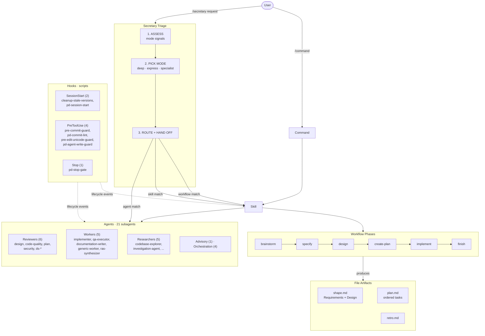

# Developer Guide

All work lands on `main` through pull requests. A script opens each release as a PR; a workflow publishes it once merged.

## Branch Structure

| Branch | Purpose |
|--------|---------|
| `main` | Trunk and GitHub's default; every change lands here through a PR, merged as a merge commit |
| `stable` | Release channel that installs follow; only the Publish workflow moves it, fast-forward only |
| `feature/<id>` | Feature branches (created by pd workflow) |
| `pd/<id>/task-<n>` | One plan task's branch inside `implement-tasks` |
| `release/vX.Y.Z` | A release PR's branch, opened by `scripts/release-pr.sh` |

GitHub rulesets protect them:
- **`main`:** PR required (0 approvals, merge commits only); the `validate` check must pass and be up to date with `main`; no force push or deletion.
- **`stable`:** no force push or deletion.
- **`v*` tags:** no update or deletion.

All plugin code lives in `plugins/pd/`.

## Development Workflow

1. Create a feature branch from `main`
2. Add your entries under `## [Unreleased]` in `CHANGELOG.md`
3. Open a PR into `main` (or run `/pd:finish-feature`) and merge once CI passes
4. Release when ready using the release script

## Version

One version: `version` in `plugins/pd/.claude-plugin/plugin.json`, plain `X.Y.Z`. `marketplace.json` carries none. Between releases `main` keeps the last released version.

The maintainer chooses the bump at release time (patch, minor or major) by semver. Nothing computes it from change volume or commit prefixes.

`validate.sh` checks the version: it is `X.Y.Z`, at least the highest `v*` tag, a new version has its `CHANGELOG.md` section, and `marketplace.json` has no version.

Released `CHANGELOG.md` sections are frozen: `scripts/check-changelog.sh` fails a PR that changes them. A forgotten entry goes in the next release.

## Release Process

There is one path.

1. On a clean `main` equal to `origin/main`, with `gh` installed:

   ```bash
   scripts/release-pr.sh [patch|minor|major]   # default patch
   ```

   It bumps `plugin.json`, promotes `[Unreleased]` to `[X.Y.Z] - date`, and opens a PR from `release/vX.Y.Z` into `main`. It refuses while CI on that `main` commit hasn't passed, or while the previous version isn't published yet.
2. Merge the PR once CI passes.
3. `.github/workflows/publish.yml` runs `scripts/publish-release.sh`: it tags `vX.Y.Z` on the merge commit and fast-forwards `stable`.
4. Installs pick up the release on their next marketplace update.

## Local Development Setup

Clone the repository and install the released plugin:

```bash
git clone https://github.com/clthuang/pedantic-drip.git
cd pedantic-drip
claude
```

In Claude Code:

```
/plugin marketplace add clthuang/pedantic-drip#stable
/plugin install pd@pedantic-drip-marketplace
```

To try plugin changes, start a session with this checkout's plugin in place of the installed one, for that session only:

```bash
claude --plugin-dir plugins/pd
```

The installed copy changes only through a release, which reaches installs through `stable`.

## For Public Users

To install the released version (`#stable` follows releases):

```
/plugin marketplace add clthuang/pedantic-drip#stable
/plugin install pd@pedantic-drip-marketplace
```

## Key Files

| File | Purpose |
|------|---------|
| `scripts/release-pr.sh` | Opens the release PR: bumps the version and promotes the CHANGELOG |
| `scripts/publish-release.sh` | Tags `vX.Y.Z` and fast-forwards `stable`; run by `publish.yml` |
| `scripts/check-changelog.sh` | Fails a PR that changes a released CHANGELOG section |
| `.github/workflows/ci.yml` | The `validate` check on PRs into and pushes to `main` |
| `.github/workflows/publish.yml` | Publishes each release merged to `main` |
| `.github/workflows/claude-review.yml` | Claude Code reviews each PR into `main` (not `docs/`) and posts a PR comment; needs the `CLAUDE_CODE_OAUTH_TOKEN` secret from `claude setup-token` |
| `.claude-plugin/marketplace.json` | Marketplace configuration |
| `plugins/pd/.claude-plugin/plugin.json` | Plugin manifest with version |

---

## Architecture

Commands invoke Skills; Skills spawn Agents; Hooks fire at lifecycle points. The secretary command is a triage layer, not a pipeline: it picks a mode (deep, express, or specialist fast-path), states the rationale, routes, and hands off. Triage never mutates state — the routed command owns all entity work.



## Design Principles

| Principle | Meaning |
|-----------|---------|
| **Everything is prompts** | Skills and agents are just instructions Claude follows |
| **Files are truth** | Artifacts persist in files; any session can resume |
| **Humans unblock** | When stuck, Claude asks—never spins endlessly |
| **Composable > Rigid** | Phases work independently; combine as needed |

## Skills

Skills are instructions Claude follows for specific development practices. Located in `plugins/pd/skills/{name}/SKILL.md`.

### Workflow Phases
| Skill | Purpose |
|-------|---------|
| `brainstorming` | Guides 6-stage process producing evidence-backed PRDs with advisory team analysis and structured problem-solving |
| `structured-problem-solving` | Applies SCQA framing and type-specific decomposition to problems during brainstorming |
| `specifying` | Criteria: B-numbered expectations in `shape.md`, calvin cycles, the user's sign-off |
| `designing` | Contracts: `shape.md` `## Design` with its diagram, contracts and test strategy, then the review call |
| `planning` | Plan: `plan.md` task blocks with test cases, then the test-case review |
| `implementing` | Execute: launches `implement-tasks` from `plan.md` and records each task's merge and proof |
| `verifying` | Verify: launches `verify-change` (the code review beside QA, then fix cycles) and records the review and QA entries |
| `finishing-branch` | Finish: security review, docs, metrics, the retro check, replan, merge and cleanup |

### Quality & Review
| Skill | Purpose |
|-------|---------|
| `promptimize` | Reviews plugin prompts against best practices guidelines and returns scored assessment with improved version |
| `workflow-transitions` | The conductor's shared contract: where state lives, phase entry and exit, the review call, caps, workflow and goal runs |

### Investigation
| Skill | Purpose |
|-------|---------|
| `systematic-debugging` | Guides four-phase root cause investigation |
| `root-cause-analysis` | Structured 6-phase process for finding ALL contributing causes |

### Research & Synthesis
| Skill | Purpose |
|-------|---------|
| `researching` | Orchestrates parallel research, analysis, and synthesis into decision-ready summaries |

### Domain Knowledge
| Skill | Purpose |
|-------|---------|
| `game-design` | Game design frameworks, engagement/retention analysis, aesthetic direction, and feasibility evaluation |
| `crypto-analysis` | Crypto/Web3 frameworks for protocol comparison, DeFi taxonomy, tokenomics, trading strategies, MEV classification, market structure, and risk assessment |
| `data-science-analysis` | Data science frameworks for methodology assessment, pitfall analysis, and modeling approach recommendations (brainstorming domain) |
| `writing-ds-python` | Clean DS Python code: anti-patterns, pipeline rules, type hints, testing strategy, dependency management |
| `structuring-ds-projects` | Cookiecutter v2 project layout, notebook conventions, data immutability, the 3-use rule |
| `spotting-ds-analysis-pitfalls` | 15 common statistical pitfalls with diagnostic decision tree and mitigation checklists |
| `choosing-ds-modeling-approach` | Predictive vs causal modeling, method selection flowchart, Rubin/Pearl frameworks, hybrid approaches |

### Specialist Teams
| Skill | Purpose |
|-------|---------|
| `creating-specialist-teams` | Creates ephemeral specialist teams via template injection into generic-worker |

### Maintenance
| Skill | Purpose |
|-------|---------|
| `retrospecting` | Runs data-driven AORTA retrospective using retro-facilitator agent; writes plain-markdown retro.md |
| `updating-docs` | Automatically updates documentation using agents |
| `writing-skills` | Applies TDD approach to skill documentation |

## Commands

Commands are user-invoked entry points. Located in `plugins/pd/commands/{name}.md`. See [README.md](README.md) for the full list. Notable utility commands:

| Command | Purpose |
|---------|---------|
| `generate-docs` | Generate three-tier documentation scaffold or update existing docs |
| `subagent-ras` | Research, analyze, and summarize any topic using parallel agents |
| `promptimize` | Review a plugin prompt against best practices and return an improved version |
| `refresh-prompt-guidelines` | Scout latest prompt engineering best practices and update the guidelines document |

## Agents

Agents are isolated subprocesses spawned by the workflow. Located in `plugins/pd/agents/{name}.md`.

**Reviewers (6):** — `design-reviewer`, `plan-reviewer` and `code-quality-reviewer` are the Claude fallback for the review call at Contracts, Plan and Verify (Codex goes first); each preloads its stage skill's `## Review checklist`.
- `design-reviewer` — Challenges design assumptions and finds gaps (`/pd:design`)
- `code-quality-reviewer` — Adversarially reviews the whole branch diff, inside `verify-change` (`/pd:verify`)
- `security-reviewer` — Reviews implementation for security vulnerabilities; dispatched from `/pd:finish-feature` on security-surface changes. Always an Anthropic-model Task, never routed to Codex
- `plan-reviewer` — Reviews `plan.md`'s test cases for faithfulness and coverage (`/pd:create-plan`), and pasted plans
- `ds-analysis-reviewer` — Reviews data analysis for statistical pitfalls, methodology issues, and conclusion validity; uses WebSearch + Context7
- `ds-code-reviewer` — Reviews DS Python code for anti-patterns, pipeline quality, and best practices; uses Context7 for API verification

**Workers (5):**
- `implementer` — Implements one plan task in its own worktree inside `implement-tasks`, tests first; also the fixer in fix cycles
- `qa-executor` — Execution-grounded QA: runs the test battery and drives affected flows, returning commands plus output as evidence. Fixes nothing
- `generic-worker` — General-purpose implementation agent for mixed-domain tasks
- `documentation-writer` — Writes and updates documentation based on research findings
- `ras-synthesizer` — Synthesizes multi-source research findings into thematic analysis with confidence calibration

**Advisory (1):**
- `advisor` — Applies strategic or domain advisory lens to brainstorm problems via template injection

**Researchers (5):**
- `codebase-explorer` — Analyzes codebase to find relevant patterns and constraints
- `documentation-researcher` — Researches documentation state and identifies update needs
- `internet-researcher` — Searches web for best practices, standards, and prior art
- `investigation-agent` — Read-only research agent for context gathering
- `skill-searcher` — Finds relevant existing skills for a given topic

**Orchestration (4):**
- `merger` — Checks a task's proof with `pd-proof` and lands its branch on the feature branch; no Write or Edit
- `calvin-runner` — Runs the calvin skill on a feature's criteria; writes only its ledger path
- `rca-investigator` — Finds all root causes through 6-phase systematic investigation
- `retro-facilitator` — Runs data-driven AORTA retrospective with full intermediate context

### Advisory Team Architecture
The brainstorm skill dispatches advisory agents alongside research agents in Stage 2.
Advisors are `.advisor.md` template files in `skills/brainstorming/references/advisors/`.
The secretary classifies problems by archetype (from `references/archetypes.md`) and assembles
an advisory team of 2-5 advisors. Domain advisors reference existing domain skill reference files.
New advisors are added by creating a `.advisor.md` file and listing it in the archetypes inventory.

## Hooks

Hooks execute automatically at lifecycle points.

| Hook | Trigger | Purpose |
|------|---------|---------|
| `cleanup-stale-versions` | SessionStart (startup\|resume\|clear) | Deletes cached pd plugin versions other than the active one, except one a running session still uses (Claude Code's `.in_use/<pid>` marker) |
| `pre-commit-guard` | PreToolUse (Bash) | Branch protection and pd directory protection |
| `pd-commit-lint` | PreToolUse (Bash) | Runs `pd-lint --staged` before a `git commit`; a lint error blocks the commit (exit 2) |
| `pre-edit-unicode-guard` | PreToolUse (Write\|Edit) | Non-blocking warning for risky Unicode codepoints in edits |
| `pd-agent-write-guard` | PreToolUse (Write\|Edit) | QA writes only under `agent_sandbox/`; `calvin-runner` writes only its recorded ledger path (exit 2 otherwise) |
| `pd-session-start` | SessionStart (startup\|resume\|clear\|compact) | The project's active and blocked items, next ready items and retros owed; offers `/pd:init` or `/pd:adopt` |
| `pd-stop-gate` | Stop | Holds a `/goal` run until its target is reached with no open blocker and `pd-lint` passing; yields to background workflows; the per-feature token cap |

`pre-edit-unicode-guard.sh` delegates to `pre-edit-unicode-guard.py` — a worker module invoked by the wrapper, not separately registered.

`cleanup-stale-versions` matches `startup|resume|clear` only; `pd-session-start` also fires on `compact`, so the summary survives compaction.

Defined in `plugins/pd/hooks/hooks.json`.

### Hook Protection

The `pre-commit-guard` hook warns when committing to protected branches (main/master) and reminds about running tests.

## Workflow Mechanics

Each phase command in `plugins/pd/commands/` is a thin entry point: it invokes its stage skill, which is the conductor's playbook for that stage. `workflow-transitions` is the contract every playbook shares. The design is `docs/plans/2026-10-14-thin-pd-native-design.md`.

**State lives in committed files** (no engine, no registry, no MCP server):

| File | Holds |
|------|-------|
| `features/<id>/README.md` | Frontmatter (`status`, `phase`, `mode`, `branch`, `risk`) and `## Now` (next step, `goal:` and `run in flight:` lines) |
| `features/<id>/log.md` | Append-only history: one entry per decision, phase move, review, QA run, gate, workflow run, cap, metrics or defect (`references/log-entries.md`) |
| `features/<id>/shape.md` | `## Requirements` (B-numbered expectations) and `## Design` (architecture diagram, contracts, test strategy) |
| `features/<id>/plan.md` | `## Plan`: waves of task blocks, each with its contract, files, proving command, JUnit path and test cases |
| `features/<id>/retro.md` | Written only when a retro trigger fired |

Everything else is computed by `plugins/pd/scripts/pd-status`: progress, next ready items, open blockers and assumptions, retros owed.

**The scripts** (`plugins/pd/scripts/`, stdlib Python unless noted):

| Script | Role |
|--------|------|
| `pd-new` | Creates a feature, plan, brainstorm, rca or backlog item with a local `YYYY-MM-DD-slug` id |
| `phase-gate.sh` | A phase's exit check: what the phase must hand down |
| `pd-lint` | The artifact checks, run by the commit hook on staged items; also `--isolation`, `--risk`, `--archive`, `--sweep` |
| `pd-status` | The repository's state, computed from its files |
| `pd-proof` | Judges a proving command's JUnit XML for the merger |
| `pd-review-filter` | Drops a scoped re-review's findings outside the diff |
| `pd-html.py` | Markdown to standalone HTML (PEP 723, `uv run`) |
| `pd-init` / `pd-adopt` | Set a new project up; migrate an old-layout one |

**The workflows** (`plugins/pd/workflows/`) are the only fan-outs: `implement-tasks` (one implementer per task in its own worktree, the merger landing each in plan order, up to three fix cycles), `verify-change` (the review call beside QA, then up to three fixer cycles), `research-fanout` and `rca-fanout`. Their results are pinned in `references/workflow-results.md`; the conductor writes `log.md` from them.

**Reviews.** One review call per stage that has one (`references/review-call.md`): Codex first with one retry, else the stage's Claude reviewer; one pass, then up to three fix cycles against runnable checks, then the user. The security review at finish is dispatched directly, on Anthropic models.

**Long runs.** `/goal` drives a feature; the `Stop` gate (`pd-stop-gate.sh`) decides whether it may stop, and caps tokens per feature (`feature_token_budget`).

## Knowledge Bank

Inert reference markdown lives in `docs/knowledge-bank/`:

- **constitution.md** — Core principles (KISS, YAGNI, etc.)
- **patterns.md** — Approaches that worked
- **anti-patterns.md** — Things to avoid
- **heuristics.md** — Decision guides

These files are preserved as plain documentation. Memory capture and recall are delegated to Claude Code's native memory or an external memory plugin — pd no longer owns any memory subsystem.

## Creating Components

See [Component Authoring Guide](./docs/dev_guides/component-authoring.md).

All components are created in the `plugins/pd/` directory:

**Skills:** `plugins/pd/skills/{name}/SKILL.md` — Instructions Claude follows
**Agents:** `plugins/pd/agents/{name}.md` — Isolated workers with specific focus
**Commands:** `plugins/pd/commands/{name}.md` — User-invocable entry points
**Hooks:** `plugins/pd/hooks/` — Lifecycle automation scripts

## Validation

```bash
./validate.sh    # Check all components
```

## Error Recovery

When something fails:

1. **Auto-retry** for transient issues
2. **Fresh approach** if retry fails
3. **Ask human** with clear options

**Principle:** Never spin endlessly. Never fail silently. Ask.

## Contributing

1. Fork the repository
2. Create a feature branch from `main`
3. Run `./validate.sh`
4. Submit a PR into `main`

## References

- [Component Authoring Guide](./docs/dev_guides/component-authoring.md)
