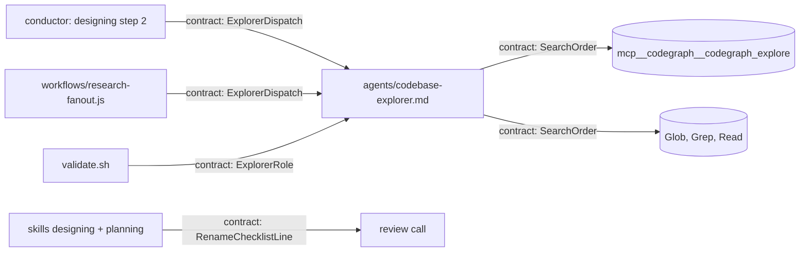

# Shape: codebase-explorer uses CodeGraph

<!-- Requirements (specify), then Design (design). Format: plugins/pd/references/doc-format.md. -->

## Requirements

### Goals

- `pd:codebase-explorer` asks CodeGraph first (`mcp__codegraph__codegraph_explore`) and falls back to Glob, Grep and Read when CodeGraph is unavailable, including in a repository with no index.
- A design or plan that renames something or moves a store carries the list of every surface it touches, built from a call-graph query plus a grep for each old name, with both recorded, so its reviewer can re-run the greps (and the query where its tools allow) and find a missed surface before code (folds backlog #078).

**Why:** the owner's global CLAUDE.md asks for CodeGraph before grep in every indexed repository, and pd's own research agent can't follow that rule today (`codebase-explorer.md:5` has `tools: [Glob, Grep, Read]`). Backlog #078 came from feature 124's retro (R1/A3, 2026-07-14, `docs/dev_artifacts/backlog-manual.md:202`): 9 catches across 15 review rounds were all incomplete enumerations of one table's consumers, each found by a finer literal sweep; the fix it names is to derive the surface from the call graph of the changed symbol, with literal grep as a supplementary net. Done looks like B1 to B7 holding at Verify.

### Non-goals

- Changing any reviewer's tools. The Claude reviewers stay pinned to Read, Grep and Glob (`validate.sh:399`). The review call goes to Codex first (`plugins/pd/references/review-call.md:15`); Codex can't call MCP tools but has a shell, so it can run the `codegraph explore` CLI where it is installed and its read-only sandbox lets it open the index; where it can't, the greps remain.
- Indexing a repository (`codegraph init`): that stays the user's decision.
- CodeGraph in other agents (`investigation-agent`, `rca-investigator`, `implementer`), and the `codegraph explore` CLI route in the explorer (owner ruling `decision@2026-11-03 11:08+08:00`: "Fall back to Grep (Recommended)", no Bash in the explorer).
- `research-fanout`'s schema: on that path the workflow's `FINDINGS` schema (`research-fanout.js:25`, `claim`/`evidence`/`source`) replaces the agent's own output shape, and stays as it is.

### User stories

- As the conductor grounding a design (`designing` step 2), I get callers and call paths from one CodeGraph query through the explorer, instead of a dozen greps.
- As a reviewer of a rename's design or plan, I re-run the recorded greps (and the query where my tools allow), check the recorded hits, and compare with the surface list, so a missed caller is a blocker before code.

### Terms

- **Unavailable:** the tool is missing from the session, returns an error (a timeout included), or answers that the repository has no index. Checked 2026-11-03 in a scratch repository with no `.codegraph/`: the CLI answers "CodeGraph isn't available here — no .codegraph/ index exists", and the MCP tool, from a headless session with the user-scope server connected, "isn't indexed with codegraph (no .codegraph/ directory found walking up from it)". The reason is one of three strings, word for word: `tool not in session` (this one wins, whatever the repository holds), `no index` (any answer saying no `.codegraph/` was found), or `error: <the error's first line>`. When several CodeGraph calls are made, one that answered counts; with none answered, the first call's reason is given.
- **A search call:** a call to `mcp__codegraph__codegraph_explore`, Glob or Grep, or a Read of a file the prompt doesn't name.
- **`search`:** one added top-level field in the explorer's own output, which the explorer writes from its own calls: `codegraph` (a CodeGraph call answered, and no Glob or Grep follows it), `codegraph, then grep` (a CodeGraph call answered, and a Glob or Grep follows it), or `grep (codegraph unavailable: <reason>)`. It tells the dispatcher (the conductor at `designing` step 2) whether call paths were followed or only text matched; on the `research-fanout` path the workflow's schema replaces the output, so it doesn't arrive there. At Verify the conductor checks it against the explorer's transcript; where they disagree, the transcript wins and the expectation fails.
- **A stale index:** CodeGraph's banner names stale files, or says auto-sync is disabled (the whole index frozen). Either way the explorer reads each file a finding rests on before citing it.
- **A store move:** moving where state lives: a file to another path, a config key to another file, a table to files. Its old name is the old path, key or table name.
- **Surfaces:** callers, tests, fixtures, docs, config and CI that name the thing or reach it through a call path.

### Expectations

B1: `./validate.sh` on the repository, under `LC_ALL=C` and under `LC_ALL=en_US.UTF-8`, and in CI's validate step (`ci.yml:23`) -> passes each time, with `codebase-explorer` pinned in role `explorer` (tools only) to exactly Glob, Grep, Read and `mcp__codegraph__codegraph_explore`.
B2: `validate.sh`'s agent-role fixture with `codebase-explorer.md`'s tools set to `[Glob, Grep, Read, Write]` -> `agent_roles_errors` prints one error line naming `codebase-explorer`, and the fixture's expected total becomes 9 (from 8, `validate.sh:427`).
B3: a headless session (`claude -p --plugin-dir <this work tree's absolute path>/plugins/pd --output-format stream-json --verbose < /dev/null`; the work tree's agent loads, not the installed release's: checked 2026-11-03 with a marked copy) started in this repository (it has an index), with the user-scope `codegraph` MCP server connected, dispatching `pd:codebase-explorer` with "who calls `switch_target`?" -> the explorer's first search call is `mcp__codegraph__codegraph_explore`; its `search` starts with `codegraph`, and a finding cites `plugins/pd/hooks/lib/commit_target.py` at the line of the `switch_target(` call inside `main()` as it is at Verify.
B4: a session set up as B3's, started instead in a scratch git repository made with `mktemp -d` (checked before the run: no `.codegraph/` in it or in any directory above it, up to `/`), holding one file, `app.py`, that defines `main()` and a `run()` that calls it, dispatching the explorer with "who calls `main`?" -> its first search call is the CodeGraph call, which answers no index; `"search": "grep (codegraph unavailable: no index)"`; a finding cites `app.py` at the line of the `main()` call.
B5: the same as B4, with MCP servers turned off (`--strict-mcp-config` and no config; such a session starts, checked 2026-11-03) -> the dispatch runs; `"search": "grep (codegraph unavailable: tool not in session)"`; the same finding as B4.
B6: a new session set up as B3's, asking the explorer where a class is defined, named by a name the conductor makes up at Verify and checks first with `grep -rn` over the repository, which finds nothing -> no finding says where that name is defined (`findings` empty with a non-empty `no_findings_reason`, or only findings about other names); `search` starts with `codegraph`; no error.
B7: the `designing` and `planning` skills' `## Review checklist` sections (the author's bar and the reviewer's, per each skill's write step) -> each has one line: a rename or store move lists its surfaces, built from a call-graph query (`codegraph_explore` or `codegraph explore`, when `.codegraph/` exists) plus a grep for each old name; the artifact records the query and grep commands with their hits (file:line), each hit marked as a surface to change or as history left as it is (a released CHANGELOG section, a done or abandoned work item, a retro, an archive; anything else, the open backlog and `[Unreleased]` included, is a surface); the reviewer re-runs the greps, and the query where its tools allow, checks each recorded hit at file:line, and a surface in its output that the list lacks is a blocker; a disputed mark is a finding like any other.

The conductor runs B3 to B6 at Verify, writing each session's stream outside the repository while it runs (so the explorer's searches can't reach it) and copying it under `agent_sandbox/` after, its path in the `qa` entry; the explorer's transcript is that stream's messages carrying the explorer dispatch's `parent_tool_use_id` (its tool calls appear there, checked 2026-11-03). If the `codegraph` server isn't connected at Verify, B3, B4 and B6 can't hold: they are recorded as not run, and the work item stays in Verify while the user is asked to connect it.

### Scope

- **In:** `plugins/pd/agents/codebase-explorer.md` (tools, search order, the `search` field, the fallback); `validate.sh` (`agent_roles_errors`, its fixture and the expected count); the two checklist lines; one `CHANGELOG.md` `[Unreleased]` line saying the explorer asks CodeGraph first and renames record their enumeration.
- **Out:** reviewer tools; other agents; `research-fanout.js`; `codegraph init`; the agent's description, so `plugins/pd/README.md:67`, `README_FOR_DEV.md` and the architecture overview need no sync.

### Edge cases and must-nots

- **The server registered under another name** (another MCP server name, or from a plugin): the pinned tool name isn't in the session, so the explorer reports `grep (codegraph unavailable: tool not in session)`. The pin follows this machine's user-scope `codegraph` server (`~/.claude.json`, checked 2026-11-03).
- **Which index the server answers about:** the session's project directory; B4 shows it, since an answer about another repository's index would fail B4.
- **A query with no symbol in it** ("what testing conventions exist?"): CodeGraph is still asked once; Glob or Grep after it makes `codegraph, then grep`.
- **A caller both the query and the greps miss** (reached only through a string the greps didn't name): outside this work item; the review checklists' other lines still apply.
- **Must not write:** the explorer never gets Write, Edit, Bash, or a tool that creates or rebuilds an index. `codegraph_explore` is a query; the server's own file watcher keeps the index in sync whether or not the explorer runs.
- **Must not fail without CodeGraph:** no dispatcher gets an error, or findings with no `no_findings_reason`, because CodeGraph is absent (B4, B5, B6); that would break `designing` step 2 and `research-fanout` in every repository without an index.
- **Must not change the explorer's output fields** other than adding `search`: `findings[]` with `finding`, `source`, `relevance`, and `no_findings_reason` stay.

## Design

### Architecture

The agent file changes in place; `validate.sh` pins its tools; two skills gain one checklist line each. No new module.



### Contracts

```text
modules: plugins/pd/agents/codebase-explorer.md
ExplorerDispatch (input unchanged): a query and context in the prompt
  -> one JSON object: {"findings": [{"finding", "source": "<path>:<line>", "relevance": "high|medium|low"}],
                       "no_findings_reason": str|null, "search": str}
  search: "codegraph" | "codegraph, then grep" | "grep (codegraph unavailable: <reason>)"
  reason: "tool not in session" | "no index" | "error: <the error's first line>"
SearchOrder (the agent's Research Process):
  1. the first search call is mcp__codegraph__codegraph_explore with the query's symbols or question;
     when the tool isn't in the session, step 1 is skipped and the reason is "tool not in session"
  2. an answer naming no .codegraph/ -> reason "no index"; an error -> "error: <first line>"
  3. Glob, Grep and Read fill what CodeGraph didn't answer (and everything, when it was unavailable)
  4. a stale-index banner (files named, or auto-sync disabled) -> Read each file a finding rests on before citing it
  5. search is written from the calls actually made
Frontmatter: tools: [Glob, Grep, Read, mcp__codegraph__codegraph_explore]; model, description, color unchanged
Invariants: no Write, Edit, Bash or index-building tool; the output fields other than search unchanged
```

```text
modules: validate.sh
ExplorerRole: agent_roles_errors gains the spec codebase-explorer:explorer
  role explorer: tools, sorted with LC_ALL=C, equal "Glob,Grep,Read,mcp__codegraph__codegraph_explore",
    else the line "codebase-explorer: the explorer's tools are Glob, Grep, Read, mcp__codegraph__codegraph_explore (has <tools>)"
  the tools sort in agent_roles_errors runs under LC_ALL=C for every role
  the failing fixture gains: tools of codebase-explorer.md set to [Glob, Grep, Read, Write]; expected count 9
```

```text
modules: plugins/pd/skills/designing/SKILL.md, plugins/pd/skills/planning/SKILL.md
RenameChecklistLine (verbatim, one line in each `## Review checklist`, after "Absence claims are proven" in planning and after "Assumptions checked" in designing):
- **Renames and store moves list their surfaces:** a rename or a store move (a file, config key or table moving where its state lives) lists every surface it touches, from a call-graph query of the changed symbol (`codegraph_explore`, or `codegraph explore` from a shell, when `.codegraph/` exists) plus a grep for each old name; the artifact records the query and grep commands with their hits (file:line), each marked a surface to change or history left as it is (a released CHANGELOG section, a done or abandoned work item, a retro, an archive). The reviewer re-runs the greps, and the query where its tools allow, and checks each recorded hit; a surface in its output that the list lacks is a blocker.
```

### Decisions

- **D1: the MCP tool only, no CLI route in the explorer.** The owner's ruling (`decision@2026-11-03 11:08+08:00`); adding Bash would break the must-not on writing. KISS.
- **D2: a new `explorer` role pinned on tools only.** Rejected folding it into `reviewer`: reviewers also pin `opus/high`, and the explorer runs `sonnet` (`codebase-explorer.md:4`). Single responsibility.
- **D3: `LC_ALL=C` on the tools sort.** `mcp__…` sorts after `Read` in the C locale and before it under `en_US.UTF-8` (lowercase collates with uppercase there), so a locale-dependent sort makes the pin pass on one machine and fail on another (B1; checked 2026-11-03: `Glob,Grep,Read,mcp__codegraph__codegraph_explore` under C, `Glob,Grep,mcp__codegraph__codegraph_explore,Read` under en_US.UTF-8). Applies to every role; the existing pins are all capitalized words, and they sort the same in both locales.
- **D4: the explorer writes `search` itself.** Rejected a hook that derives it from the transcript: the transcript check is Verify's (B3 to B6), and a hook would add a component for a field one dispatcher reads. YAGNI.

### Risks

| Risk | Blast radius | Mitigation |
|---|---|---|
| The agent skips CodeGraph and greps first despite SearchOrder (an instruction, not code). | `search` lies, or call paths are missed | B3 to B6 check the transcript's first search call; the transcript wins over `search` |
| The server is registered under another name on another machine, so `mcp__codegraph__codegraph_explore` isn't in the session. | grep-only answers there | reported as `tool not in session` (B5); the pin follows this machine's user-scope `codegraph` server |
| `LC_ALL=C` changes another role's comparison. | `validate.sh` fails | every other pinned list is capitalized ASCII words, sorting the same under both locales; B1 runs both |
| The checklist line is skipped by an author who never renames anything. | none | it applies only to renames and store moves |

### Test strategy

- **Runner and JUnit option:** `uv run --project plugins/pd pytest <file> --junitxml=<path>`.
- **Fixtures live in:** `plugins/pd/scripts/test_explorer_codegraph.py` itself: `agents_copy` (pytest `tmp_path` holding a copy of `plugins/pd/agents/*.md`), and `agent_roles_errors` run by extracting the function from `validate.sh` (`sed -n '/^agent_roles_errors()/,/^}/p'`) into `bash -c`.
- **Fakes:** none.
- **Real resources tests may touch:** `./validate.sh` run as a subprocess from the repository root (read-only; it makes its own `mktemp` fixture), and the repository's skill and agent files, read.
- **Live dispatches:** B3 to B6 run at Verify by the conductor, as `## Requirements` says; no test in this plan starts a Claude session.
