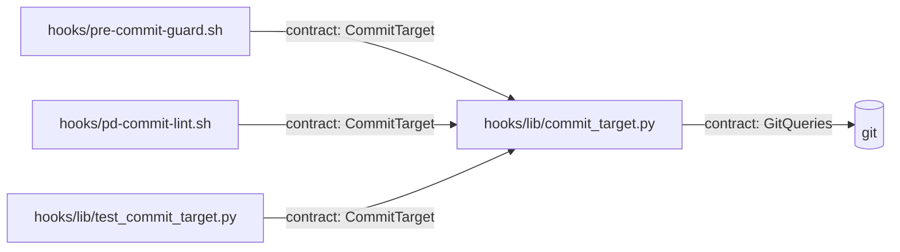

# Shape: commit guard sees wrapped commits

<!-- Requirements (specify), then Design (design). Format: plugins/pd/references/doc-format.md. -->

## Requirements

### Goals

- `plugins/pd/hooks/lib/commit_target.py` sees a `git commit` that runs behind a command wrapper, inside a `-c` shell script, or both, so `pre-commit-guard.sh` reminds about a commit to a protected branch (`main` or `master`, `pre-commit-guard.sh:39`) and `pd-commit-lint.sh` lints the staged files for it.
- A `git checkout <x> --` with no word after the `--` reads as `git checkout <x>`.

**Why:** the PR #29 review found `timeout`, `sudo -u`, `env -u`, `bash -c` and a bare trailing `--` regressions against the old `pre-commit-guard` regex, which caught them. No live commit is known to have slipped past; the cost of a miss is a commit to `main` with no reminder, or a malformed `log.md` landing without `pd-lint`. The owner asked for this round on 2026-11-03. The table's other rows (`nice`, `stdbuf`, the existing prefixes' options) are the same class of miss, added as rows at no extra design cost rather than waiting for a report.

### Non-goals

- Following `&&` / `||` (a switch still counts as run and successful; the shortcut at `commit_target.py:173` stays).
- Seeing inside a script file run by path (`bash ./release.sh`), a shell function, an alias or `eval`. A shell named by path (`/bin/bash -c '…'`) is not this: it counts as that shell.
- Wrappers beyond the table below, and shells other than the five named. A missed one, once reported, gets a `pd-new backlog` line. Forms listed as Out have no pinned result.

### Wrappers and shells

A wrapper word starts a command (where `PREFIXES` count today, `commit_target.py:184`). After it come its options, then the positional words its row names, then the command it runs, which may be another wrapper (`sudo -u alice timeout 30 git commit`). Options are words starting with `-`; `--` ends them. The ones below take a value, as the next word or attached (`-u alice`, `-ualice`, `--user=alice`, `--user alice`); every other option word is a flag. A word bundling short options (`-Eu`) is read letter by letter: a value-taking letter takes the rest of the word, or the next word when it is the last letter. On every wrapper, `--help` and `--version` run no command; an option that runs no command hides every command after it, a switch included (`sudo -l git switch main; git commit` prints an empty branch). A `cd` behind a wrapper runs as a separate program and changes nothing. Every command word is found past wrappers this way, not only `git commit`: `cd`, `git switch` and `git checkout` too.

| Wrapper | Options taking a value | Positional before the command | Options that run no command (not seen) | Changes the directory |
|---|---|---|---|---|
| `timeout` | `-s` `--signal` `-k` `--kill-after` | one duration | none | no |
| `sudo` | `-u` `--user` `-g` `--group` `-C` `--close-from` `-D` `--chdir` `-h` `--host` `-p` `--prompt` `-r` `--role` `-t` `--type` `-T` `--command-timeout` `-U` `--other-user` | none | `-l` `-v` `-K`; `-k` with no command after it | `-D <dir>` |
| `env` | `-u` `--unset` `-C` `--chdir` | any `NAME=value` words | `env` with no command | `-C <dir>` |
| `nice` | `-n` `--adjustment` | none | none | no |
| `stdbuf` | `-i` `--input` `-o` `--output` `-e` `--error` | none | none | no |
| `time` | `-f` `--format` `-o` `--output` | none | none | no |
| `command` | none | none | `-v` `-V` | no |
| `exec` | `-a` | none | none | no |
| `nohup` | none | none | none | no |
| `xargs` | `-I` `--replace` `-n` `--max-args` `-P` `--max-procs` `-L` `--max-lines` `-s` `--max-chars` `-d` `--delimiter` `-E` `--eof` `-a` `--arg-file` | none | none | no |

`sudo`, `env`, `time`, `command`, `exec`, `nohup` and `xargs` are in `PREFIXES` today but none of their options are skipped; `timeout`, `nice` and `stdbuf` are new.

**A `-c` script:** the command word's basename is `bash`, `sh`, `zsh`, `dash` or `ksh`; among the option words before its first non-option word, one starts with a single `-` and has `c` among its letters (`-c`, `-lc`, `-ec`); `-o`, `+o`, `-O` and `+O` take a value, bundled words read letter by letter as for wrappers (`-eo pipefail`), and every other option (`--long` and other `+` words included) is a flag. The script is the first non-option word after those options. It is parsed as a command line of its own, at any depth of nesting.

**State across a boundary:** a `-c` script runs in a child shell, so a `cd` inside it ends with it; a branch switch inside it changes the repository on disk, so it carries to a later commit outside it. A wrapper's directory option (`sudo -D`, `env -C`) applies to the command it runs, a `-c` script included, and ends with it.

### Expectations

Expectations B1 to B9, B11, B14, B15 and B10's first half run `python3 plugins/pd/hooks/lib/commit_target.py` with the hook JSON `{"tool_input": {"command": <cmd>}, "cwd": <cwd>}` on stdin, `<cwd>` the root of a git repository with local branches `main` and `workitem/x` and a `sub/` directory; each exits 0 with empty stderr. "Seen" means it prints `<cwd>\t<branch>`, or `<dir>\t<branch>` where "seen at `<dir>`" says so (branch empty when nothing switched); "not seen" means it prints nothing. B10 and B12 run `pre-commit-guard.sh`, B13 runs `pd-commit-lint.sh`, and B16 runs the two hook test files.

B1: `timeout 30 git commit -m x` and `timeout -s KILL -k 5 30 git commit -m x` -> seen, branch empty.
B2: `sudo -u alice git commit -m x`, `sudo -ualice git commit -m x`, `sudo -Eu alice git commit -m x`, `sudo -E -H git commit -m x` and `sudo -- git commit -m x` -> seen, branch empty.
B3: `env -u FOO git commit -m x` and `env -i PATH=/usr/bin git commit -m x` -> seen, branch empty.
B4: `nice -n 5 git commit -m x`, `stdbuf -oL git commit -m x`, `time -p git commit -m x` and `xargs -I{} git commit -m {}` -> seen, branch empty.
B5: `bash -c 'git commit -m x'`, `sh -c "git commit -m x"`, `zsh -lc 'git commit -m x'`, `/bin/bash -c 'git commit -m x'` `bash -o pipefail -c 'git commit -m x'` and `bash -eo pipefail -c 'git commit -m x'` -> seen, branch empty.
B6: `bash -c 'cd sub && git commit -m x'` -> seen at `<cwd>/sub`; `bash -c 'cd sub'; git commit -m x` and `timeout 30 cd sub && git commit -m x` -> seen at `<cwd>`.
B7: `bash -c 'git switch main && git commit -m x'`, `bash -c 'git switch main'; git commit -m x` and `timeout 30 git switch main && git commit -m x` -> seen, branch `main`.
B8: `timeout 30 bash -c 'git commit -m x'`, `bash -c 'timeout 30 git commit -m x'`, `sudo -u alice timeout 30 git commit -m x` `bash -c "sh -c 'git commit -m x'"`, and `git commit -m x` wrapped in 10 nested `bash -c` levels (each level `bash -c <shlex.quote of the level inside>`) -> seen, branch empty.
B9: `sudo -D sub git commit -m x`, `env -C sub git commit -m x` and `env -C sub bash -c 'git commit -m x'` -> seen at `<cwd>/sub`; `env -C sub true; git commit -m x` -> seen at `<cwd>`.
B10: on branch `workitem/x`, `git checkout main -- && git commit -m t` -> seen, branch `main`; through `pre-commit-guard.sh` -> the "Committing directly to 'main'" reminder.
B11: `git checkout main -- README.md && git commit -m t` -> seen, branch empty (a file restore, as today; already the case at `test-hooks.sh:232`).
B12: on `main`, `timeout 30 git commit -m t` through `pre-commit-guard.sh` -> the "Committing directly to 'main'" reminder.
B13: a staged `log.md` that fails `pd-lint`, committed as `bash -c 'git commit -m x'` through `pd-commit-lint.sh` -> exit 2.
B14: `timeout 30 echo git commit`, `sudo -u alice echo git commit`, `command -v git commit`, `sudo -l git commit`, `timeout --help git commit`, `fish -c 'git commit -m x'`, `bash -c 'echo "git commit"'`, `bash ./commit.sh` and `echo "timeout 30 git commit"` -> not seen.
B15: `timeout 30`, `bash -c`, `env -u` and `bash -c 'echo "unclosed'; git commit -m x` -> no traceback; the first three not seen, the last seen at `<cwd>` (the unparseable script is skipped as a unit, the commands beside it still count).
B16: `bash plugins/pd/hooks/tests/test-hooks.sh` and `bash plugins/pd/hooks/tests/test-pd-commit-lint.sh` -> every existing case passes with its text and expected outcome unchanged, the quoted-prose cases that pin 8.0.2's false-reminder fix included (`test-hooks.sh:230`, `:239`, `:244`).

Already seen today, kept as regression cases: `env FOO=1 git commit -m x`, `sudo git commit -m x`, `exec git commit -m x`.

### Scope

- **In:** `plugins/pd/hooks/lib/commit_target.py`; a direct test of its stdout, stderr and exit code, `plugins/pd/hooks/lib/test_commit_target.py`, run by `uv run --project plugins/pd pytest` locally and by CI's pytest line (the 10c harness records only whether the reminder appears, `test-hooks.sh:260-261`); new cases in `plugins/pd/hooks/tests/test-hooks.sh` (10c) and `plugins/pd/hooks/tests/test-pd-commit-lint.sh`; the CHANGELOG line.
- **Out:** `&&`/`||` semantics, script files, functions, aliases, `eval`, `env -S`, `sudo -i`/`-s` login shells, `ssh host 'git commit'` (another machine), `json.load` of malformed hook input (unchanged; the hooks always send valid JSON).

### Edge cases and must-nots

- **"No word after the `--`"** means the next word is a command separator (`;`, `&&`, `||`, `|`, `&`, a newline, `)`) or the end of the command; redirections are not words (`drop_redirects`, as today). `git checkout <x> --` then reads exactly as `git checkout <x>` does today: a local branch is a switch, another commit is `?`, anything else is no switch.
- **Must not raise or print a traceback** from any path this change adds, deep nesting included: both hooks read stdout only and treat nothing as "not a commit", so a crash would skip lint silently (B15).
- **Must not see quoted prose as a commit** (B14's last case, B16's pinned cases).
- **Must not add subprocesses:** wrapper and `-c` handling is string work; the only `git` calls stay today's: `show-ref` then `rev-parse` for a `git checkout` target (`commit_target.py:157-159`), and `rev-parse --show-toplevel` per repository lookup (`repo_of`).

## Design

### Architecture

One module changes. Both hooks and the new test reach it through the same stdin/stdout contract; it asks git only for checkout targets and repository roots.



### Contracts

```text
modules: plugins/pd/hooks/lib/commit_target.py
CommitTarget (unchanged): stdin {"tool_input": {"command": str}, "cwd": str}
  -> stdout "" when no `git commit` runs, else "<dir>\t<branch>"
     branch: "" (nothing switched) | "<name>" | "?" (a target that can't be known)
  exit 0, stderr empty, on every input: both hooks read stdout only, so a traceback reads as "not a commit"
GitQueries (unchanged): for a `git checkout` target, `git -C <dir> show-ref --verify --quiet refs/heads/<x>`,
  then `git -C <dir> rev-parse --verify --quiet <x>^{commit}`; per repository lookup, `git -C <dir> rev-parse --show-toplevel`
Internal (tests reach it only through CommitTarget):
  WRAPPERS: wrapper name -> value options, positional rule, no-run options, directory options; the ## Requirements table, row for row
  SHELLS = {"bash", "sh", "zsh", "dash", "ksh"}; SHELL_VALUE_OPTIONS = {"o", "O"}: the letters of -o, +o, -O and +O,
    read letter by letter as a bundled option word is (`-eo pipefail`)
  scan(cmd, here, switched) -> (dir, branch) | None
    one command line through shell_text + shlex, as main() does today
    `switched` (repo -> branch) is shared with nested scans: a switch carries; `here` is not: a cd ends
    a -c script -> scan(script.translate(UNMASK), <that command's dir>, switched); a hit there is the answer
      (shell_text masked the script's own `;`, `&&` and `|` as quoted data; UNMASK restores them so they separate again)
    a script that raises ValueError (shlex) or RecursionError -> skipped; the scan goes on after it
  command_start(words, i, here) -> (j, here, wrapped) | None
    skips PREFIXES, NAME=value words, and each wrapper's options and positionals, wrapper after wrapper;
    a directory option sets `here` for that command only; None when a no-run option is present
    wrapped: a wrapper stands before the command, so a `cd` there runs as a separate program and moves nothing
  switch_target(sub, args, at): drops a trailing `--` with no word after it, then applies today's rules
Invariants:
  shell_text: quoted prose, comments and heredoc bodies stay data, at every nesting depth
    a `$'…'` word is decoded as bash's ANSI-C quoting: the escapes `\a \b \e \E \f \n \r \t \v \\ \' \" \?`, octal `\nnn` and hex `\xHH`
      (any other backslash, `\u` and `\c` included, stays as written), and the decoded text is one quoted word at its own level:
      a decoded `'` stays inside the word, and a decoded `;`, `&`, `|`, `(` or `)` is masked as quoted data (QUOTED_PUNCT) like any
      quoted punctuation; a decoded newline is word data there too. Only a `-c` scan of that word (UNMASK, above) reads them as
      syntax, by the inner quoting: `bash -c $'git switch main\ngit commit -m x'` scans as two commands, `echo $'\x3b' git commit` as one
    `$"…"` drops its `$` and is a double-quoted word
  no subprocess besides GitQueries' three calls (`commit_target.py:127`, `:157`, `:159`)
```

### Decisions

- **D1: extend `commit_target.py`; no shell-parser library.** Rejected `bashlex`: a new dependency for a hook that runs on every Bash call under the system `python3`, with no venv (`pre-commit-guard.sh:86`). KISS.
- **D2: a `-c` script goes through the same `scan`.** Rejected a regex over the script text: one parser at every depth keeps quoted prose and heredoc bodies data inside scripts too, where 8.0.2's false-reminder fix lives (`shell_text`). DRY.
- **D3: a table of wrappers.** Rejected per-wrapper branches in the loop: the table mirrors `## Requirements` row for row, so a missed wrapper is one row. Single responsibility.
- **D4: a pytest file for the parser.** Rejected more 10c cases: the 10c harness keeps only reminder yes/no and drops stderr (`test-hooks.sh:260-261`). pytest writes the JUnit that `pd-proof` reads, and CI already runs a pytest line (`.github/workflows/ci.yml:42`).

### Risks

| Risk | Blast radius | Mitigation |
|---|---|---|
| A value option missing from `WRAPPERS` swallows the command word: `nice -n 5 git commit` would read `5` as the command (B4). | lint skipped for that form | a test case per table row (`nohup` and the long spellings included), attached forms in B2 |
| Deep nesting raises `RecursionError`; a traceback reads as "not a commit" in both hooks (`pre-commit-guard.sh:86`). | lint skipped | each level of `bash -c <shlex.quote(inner)>` roughly triples the command (10 levels: 118,171 characters; 12: 1,062,967; measured 2026-11-03), so real input stays far below Python's recursion limit; `scan` catches `RecursionError` per script anyway, and B8's 10-level case runs the deepest realistic input |
| A switch inside a `-c` script that never ran still counts (`false && bash -c 'git switch main'; git commit`). | a false, non-blocking reminder | the documented `&&` shortcut (`commit_target.py:173`); no new code |

### Test strategy

- **Runner and JUnit option:** `uv run --project plugins/pd pytest <file> --junitxml=<path>`.
- **Fixtures live in:** `plugins/pd/hooks/lib/test_commit_target.py` itself: `repo` (pytest `tmp_path`, `git init -b main`, one commit, branch `workitem/x`, a `sub/` directory) and `pd_repo` (an adopted layout with one work item made by `pd-new`, as `test-pd-commit-lint.sh:17-23` builds `$R`).
- **Fakes:** none.
- **Real resources tests may touch:** git in those `tmp_path` repositories; `pre-commit-guard.sh`, `pd-commit-lint.sh` and the two hook test files run as subprocesses.
