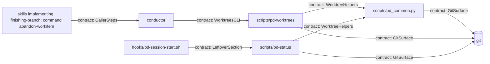

# Shape: worktree management in pd

<!-- Requirements (specify), then Design (design). Format: plugins/pd/references/doc-format.md. -->

## Requirements

### Goals

- One pd script, `pd-worktrees`, lists a work item's task worktrees and the repository's stray `worktree-wf_*` branches, and removes the clean or gone worktrees and the strays that lose no commit, never forcing. Every place pd removes task worktrees calls it instead of its own git commands: Execute after each run, the wrong-test move back to plan, Finish, and `/pd:abandon-workitem`.
- `pd-status` lists leftover worktrees, task branches and stray branches, and session start shows that list, so the next session sees them without running git.

Owner ruling, Clarify (`decision@2026-11-03 11:08+08:00`): "One cleanup script (Recommended), Show leftovers in pd-status (Recommended)". The option chosen named Execute, Finish, abandon and the wrong-test move as the script's callers.

**Why** (the investigation of 2026-11-03):
- **Abandon fails:** `abandon-workitem.md:12` runs `git branch -D` on `pd/<id>/task-*`, which git refuses while a worktree holds the branch, and every Execute run leaves such worktrees.
- **Task worktrees outlive Execute:** implementers commit, and Claude Code removes a subagent's worktree only when it is unchanged; its 30-day sweep keeps any worktree with unpushed commits (https://code.claude.com/docs/en/worktrees, "Isolate subagents with worktrees" and "Clean up subagent and background-session worktrees"). Task branches are never pushed. Both probe runs of 2026-11-01 left theirs (`bake-off.md:181`, F20).
- **Three cleanups, three rules:** Finish removes without `--force` (`finishing-branch/SKILL.md:33`), the wrong-test move with it (`implementing/SKILL.md:30`), abandon not at all.
- **Fix cycles leak branches:** a fixer checks out the task branch in a new worktree (`implement-tasks.js:54`), leaving Claude Code's auto-made `worktree-wf_<run>-<n>` branch behind (`bake-off.md:168`, F9).
- **Nothing lists them:** no pd script reads `git worktree list`.
- **What they cost:** each task worktree is a full checkout on disk (21 MB for this repository, `du -sh .claude/worktrees/thin-pd-release`, 2026-11-03); it holds its task branch, so abandon's delete fails; and `git worktree list` grows with every run.
- **Every removal site:** `grep -rn -E 'worktree remove|branch -D|branch -d' plugins/pd` (2026-11-03) finds the four callers below and the fixer's line in `implement-tasks.js:54`, which stays.
- **Done means:** after a run plus Finish or abandon, no worktree is on a `pd/<id>/task-*` branch and no stray that loses no commit is left, except what the script reported as kept (a `locked` or `main checkout` worktree, a `dirty` one the user chose to keep, or a stray kept for a symbolic branch); anything left shows at session start.

### Non-goals

- Removing worktrees inside the `implement-tasks` workflow, the fixer prompt included (owner ruling: not chosen). The fixer's forced removal of its own failed attempt (`implement-tasks.js:54`) stays as it is.
- This repository's `.pd-worktrees/` remnant and its `.gitignore` comment (not chosen).
- Replacing Claude Code's worktree creation (`WorktreeCreate` hooks, `worktree.*` settings) or its 30-day sweep.
- Clearing a stale `run in flight:` line; that stays the conductor's relaunch rule (`workflow-transitions` "Workflow runs").
- Work items whose directory is only on another, unmerged branch: their worktrees and branches aren't judged (their `## Now` can't be read from here).
- Pushing, or deleting remote branches.

### User stories

- As the conductor at the end of an Execute run, I run one command and the work item's clean task worktrees are gone, while the task branches stay for resume and the retro.
- As the user abandoning a work item, the cleanup deletes its branches instead of failing on a worktree I never saw; a dirty one is shown to me to keep or discard.
- As the user opening a session, I see that two worktrees from last week's run are still on disk, and where, and which command clears them.

### Terms

- **A known work item `<id>`:** its directory `{artifacts_root}/workitems/<id>/` exists in this checkout. Every caller runs where it does: Finish's PR path deletes `workitem/<id>` before cleanup (`finishing-branch/SKILL.md:30`), but the directory is on the base branch by then; abandon calls before switching off the work item's branch.
- **A task worktree of `<id>`:** any worktree of the repository, the main checkout included, wherever it lives, whose branch is `pd/<id>/task-<n>`.
- **Its state,** the first that holds: `main checkout` (it is the repository's main working tree), `locked` (`git worktree list --porcelain` shows `locked`; Claude Code locks a worktree while its agent runs, per the worktrees page above), `gone` (git shows `prunable`: its directory no longer exists), `dirty` (`git status --porcelain` in it prints something), `clean`.
- **A stray branch:** a branch named `worktree-wf_<anything>` (`<anything>` may hold `/`) that no worktree holds: Claude Code's auto-made branch for a Workflow-tool agent's worktree, pd's or another workflow's. Strays belong to the repository, not to one work item. A **symbolic branch** is a branch (a ref under `refs/heads/`) whose ref reads `ref: refs/heads/<another branch>`; no other symbolic ref counts. A branch's **tip** is the commit it resolves to, through its target for a symbolic branch. A stray **loses no commit** when a branch that is neither a stray nor a symbolic branch contains its tip: two strays sharing a tip don't vouch for each other, and a symbolic branch names another branch's commits rather than keeping its own, so it doesn't vouch either (B23). A stray that loses no commit is still **kept for a symbolic branch** when any symbolic branch, a stray or not, points at it, since deleting it would leave that branch dangling: `git branch` then omits it and it resolves to nothing (qa@2026-11-04 16:44+08:00#Q9, git 2.54.0). Which symbolic branches point where is read once, when the run lists the strays, so the order the strays are handled in doesn't change which are kept: a symbolic stray `S` pointing at a stray `T` is judged by its tip like any stray and may be deleted, while `T` is kept for it in that run. A stray that would lose a commit is reported for that, whatever points at it: losing work is the reason that matters more.
- **A run in flight for `<id>`:** any line of `<id>`'s `README.md` `## Now`, in this checkout, starting with `run in flight:`.
- **Leftovers**, for `pd-status`, one line each, by these rules in order; a branch a listed worktree holds isn't listed again:
  - `worktree after its run`: a task worktree of a work item whose directory is in this checkout, with no run in flight;
  - `branch of a done work item` or `branch of an abandoned work item`: a `pd/<id>/task-*` branch whose work item's directory, in this checkout, says `status: done` or `abandoned`;
  - `no work item`: a task worktree or `pd/<id>/task-*` branch whose `<id>` has no directory in this checkout and no `workitem/<id>` branch (one with that branch lives on another branch and isn't judged);
  - `stray branch`: a stray branch.

### `pd-worktrees`

- `pd-worktrees <id>` (list) prints one line per task worktree of `<id>` (`<state> <path> <branch>`) and per stray branch (`stray <branch>`), or `no worktrees for <id>`; it changes nothing; exit 0.
- `pd-worktrees <id> --remove [--task <n>]...` removes each `clean` and `gone` task worktree of `<id>` (only tasks `<n>` when `--task` is given) with `git worktree remove <path>`, which clears a gone worktree's entry alone (checked in a scratch repository, git 2.54.0, 2026-11-03). Without `--task` it also deletes each stray branch that loses no commit. A stray's name doesn't say which work item's run made it, and deleting one that loses no commit loses nothing, so every stray qualifies. It never forces a worktree, never unlocks one, and never deletes a task branch. It prints `removed <path>`, `deleted <branch>`, `kept (<state>): <path>` for a `main checkout`, `locked` or `dirty` worktree, `kept (unique commits): <branch>` for a stray that would lose a commit, and `kept (symbolic branch): <branch>` for a stray kept for a symbolic branch (both by the stray Term's rules).
- `pd-worktrees --strays [--remove]` lists, or deletes, only the stray branches, by the same rule, and needs no work item; exit 0 unless git fails (2).
- **Exit codes:**
  - 0: every task worktree it was asked to remove was removed;
  - 1: one was kept, or a run is in flight for `<id>` (then it removes nothing and prints `run in flight: <line>`);
  - 2: a usage error, an id that isn't a known work item, or git failing unexpectedly: any failure except `git worktree remove` refusing a worktree (its state read again, printed as `kept (<state>)`, exit 1) or `git branch -d` refusing a stray (printed as kept). The message goes to stderr. A usage or unknown-id error changes nothing; on a git failure the lines already printed say what was done.
  - A stray kept, for its unique commits or for a symbolic branch, doesn't change the exit code: exit 1's "one was kept" means a task worktree.

### Callers

Each runs `pd-worktrees <id> --remove` before deleting any branch:
- **Execute** (`implementing` step 5), right after `run in flight:` is cleared and committed, whatever stopped the run, and before step 6; it deletes no branch. Its exit-1 question is asked there, and its exit 2 is a hard stop before step 6, which runs once the user rules.
- **The wrong-test move** (`implementing` step 6), with `--task <n>` for each task to re-run, then `git branch -D pd/<id>/task-<n>` for each. A worktree of such a task that is kept, at step 5 or by this call, whatever its state, stops the move: the work item stays in `implement` and the user decides, since re-running a task whose old branch survives would hand the merger the old tests (`implementing/SKILL.md:30`).
- **Finish** (`finishing-branch` step 9), then its branch deletes with `-d`, as today.
- **Abandon** (`abandon-workitem` step 3), when the user accepts its cleanup offer, on the work item's branch before switching off it, then its branch deletes with `-D`, as today. Step 2 has already overwritten `## Now`, so the run-in-flight check finds nothing; a live run's worktree is `locked` and kept.
- **On exit 1,** the caller asks the user (AskUserQuestion), listing each kept worktree or the run-in-flight line:
  - a `dirty` one: keep it, or discard it (the conductor then runs `git worktree remove --force <path>` and goes on, and its branch is deleted with the others). At the wrong-test move the choices are discard, or stop the move.
  - a `locked` or `main checkout` one: reported with why, and kept. With no `dirty` one in the list, nothing is asked; the caller reports and goes on.
  - a kept worktree's task branch isn't deleted; every other step of the caller goes on.
  - a run in flight: reported; the caller stops, and the user decides.
- **On exit 2,** the caller reports the message and stops: a hard stop for the user.

### Expectations

Each runs in a scratch git repository with an adopted pd layout, a work item `<id>` (directory and `workitem/<id>` branch), and task worktrees made with `git worktree add` under `.claude/worktrees/`.

B1: `pd-worktrees <id>` with task worktrees in each linked state (`clean`, `dirty`, `locked`, `gone`) and a stray branch -> one line each with its state, path and branch, and `stray <branch>`; `git worktree list --porcelain` and `git branch` are the same before and after; exit 0.
B2: `pd-worktrees <id> --remove` with two clean task worktrees -> both directories gone and absent from `git worktree list`; both `pd/<id>/task-*` branches still exist; exit 0.
B3: `pd-worktrees <id> --remove` with one clean and one dirty task worktree -> the clean one removed, the dirty one kept and printed as `kept (dirty): <path>`; exit 1.
B4: `pd-worktrees <id> --remove` with a locked task worktree whose directory is also gone -> printed as `kept (locked): <path>`, still locked; exit 1.
B5: `pd-worktrees <id> --remove` with a task worktree whose directory was deleted by hand, plus a gone worktree on another branch -> the task one's entry is gone from `git worktree list` and its branch then deletes with `git branch -D`; the other gone entry is still listed; exit 0.
B6: `pd-worktrees <id> --remove` with a stray `worktree-wf_r-2` whose tip `workitem/<id>` contains, and a stray `worktree-wf_r-3` with a commit no other branch has -> the first deleted and printed `deleted worktree-wf_r-2`, the second printed as `kept (unique commits): worktree-wf_r-3` and still present; exit 0.
B7: `pd-worktrees <id> --remove` in a repository that also has a worktree on `worktree-thin-pd-release`, one under `.pd-worktrees/` on another branch, and task worktrees of another work item `<other>` -> none of those removed or printed; `<id>`'s are.
B8: `pd-worktrees <id> --remove --task 2` with clean task worktrees for tasks 1 and 2 and a stray that loses no commit -> only task 2's worktree removed; the stray still present.
B9: `pd-worktrees <id> --remove` with `run in flight: implement-tasks session x` in `## Now` (not its first line) -> nothing removed; prints `run in flight: implement-tasks session x`; exit 1.
B10: `pd-worktrees <id> --remove` after `workitem/<id>` was deleted, with the work item directory still there -> removes its clean task worktrees as in B2; exit 0.
B11: `pd-worktrees <id>` with no task worktrees and no stray branches -> prints `no worktrees for <id>`; exit 0.
B12: `pd-worktrees` with neither an id nor `--strays`, with an id whose directory isn't in this checkout (a `pd/<id>/task-1` branch existing), or outside a git repository -> a message on stderr; exit 2; nothing changed.
B13: the main checkout on `pd/<id>/task-1` -> `pd-worktrees <id> --remove` prints `kept (main checkout): <path>`, leaves the checkout as it was; exit 1.
B14: `pd-status` with a leftover of each reason (the `no work item` one a `pd/gone/task-1` branch with no directory and no `workitem/gone` branch) -> a `Leftover worktrees` section, after every other section of the full report, whose first line is ``clear with `pd-worktrees <id> --remove` (a work item's worktrees) or `pd-worktrees --strays --remove`; delete other listed branches by hand``, then one line per leftover: `<id>: <path or branch> — <reason>`, with `-` for the id of a stray; with none, no such section. The early `no items` and unadopted reports stay as they are.
B15: `pd-status` with a task worktree of a work item that has a run in flight, and one of a work item whose directory is only on another branch -> neither is listed.
B16: the session-start hook, on each source (startup, resume, clear, compact), in a repository with a leftover -> its context includes the `Leftover worktrees` section.
B17: `pd-status` outside a git repository, or where `git` fails -> its usual report without the section; exit 0.
B18: the `implementing`, `finishing-branch` and `abandon-workitem` instructions -> each cleanup step runs `pd-worktrees <id> --remove` (the wrong-test step with `--task`, abandon's before switching off the branch) before any branch deletion, and handles exit 1 and exit 2 as Callers says.
B19: `pd-worktrees --strays --remove` in a repository with no work item, a stray `worktree-wf_r-2` whose tip `main` contains, and strays `worktree-wf_r-3` and `worktree-wf_r-4` sharing a tip no other branch has -> the first deleted; the other two printed as `kept (unique commits)` and still present; exit 0.
B20: `pd-worktrees <id> --remove` with a stray `worktree-wf_r-2` whose tip `workitem/<id>` contains and a symbolic branch `saved` pointing at `refs/heads/worktree-wf_r-2` -> prints `kept (symbolic branch): worktree-wf_r-2`; both refs still present and `git rev-parse saved` still resolving; exit 0. With `saved` pointing at `refs/heads/main` instead, the same stray is deleted (`deleted worktree-wf_r-2`).
B21: a stray `worktree-wf_a/b` whose tip `main` contains -> `pd-worktrees <id>` and `pd-worktrees --strays` each print `stray worktree-wf_a/b`, exit 0; `pd-status` lists `-: worktree-wf_a/b — stray branch`; `pd-worktrees --strays --remove`, and separately `pd-worktrees <id> --remove`, each print `deleted worktree-wf_a/b` and delete it, exit 0; `pd-status` exits 0.
B22: `pd-worktrees <id>` and `pd-worktrees --strays`, each with output to print, and `pd-worktrees <id> --remove` with one clean task worktree and a stray `workitem/<id>` contains, each run with stdout a pipe whose read end is already closed -> nothing on stderr; the list runs exit 0; the remove run's worktree and stray are both gone and it exits 0.
B23: `pd-worktrees <id> --remove` with a stray `worktree-wf_r-3` holding a commit no other branch has and a symbolic branch `saved` pointing at it -> prints `kept (unique commits): worktree-wf_r-3`; both still present; exit 0.

### Scope

- **In:** the new `plugins/pd/scripts/pd-worktrees` with its tests; `pd-status`'s new section, its docstring (it now reads live git state, not only committed files) and its self-test; the session-start filter (`pd-session-start.sh`) and its hook test; the cleanup steps in `plugins/pd/skills/implementing/SKILL.md` (steps 5 and 6), `plugins/pd/skills/finishing-branch/SKILL.md` step 9 and `plugins/pd/commands/abandon-workitem.md`; CI's script list (`.github/workflows/ci.yml`); the four docs that list pd's scripts (`README_FOR_DEV.md`, `docs/dev-guide/commands-reference.md`, `docs/technical/architecture.md`, `docs/technical/api-reference.md`, found by grepping for `pd-review-filter`); the CHANGELOG line.
- **Out:** everything under Non-goals; worktrees on other branches, whoever made them; `cleanupPeriodDays`.

### Edge cases and must-nots

- **Two work items share a task number** (`pd/a/task-1`, `pd/b/task-1`): only the named id's are touched (B7).
- **A stray another workflow run just left** while that run continues: deleting it loses nothing, since the run's worktree is on its task branch by then.
- **A lock left by a dead session:** shown as `locked` by both scripts and kept; the user unlocks it by hand, or Claude Code's sweep releases it ("The sweep releases locks left by dead sessions", worktrees page above).
- **Must not force or unlock** inside the script: no `--force`, `-f` or `git worktree unlock`. Only the conductor forces, and only on the user's explicit "discard" for that path, since forcing loses uncommitted work. A stray is deleted only when it loses no commit and no symbolic branch keeps it (the stray Term), so no commit is lost and no branch dangles.
- **Must not delete task branches** inside the script: callers delete them after it (wrong-test and abandon with `-D`, Finish with `-d`). Execute deletes none, because resume and the retro read them (`finishing-branch/SKILL.md:10`).
- **Must not touch other worktrees:** nothing outside a task worktree of the named id and the stray-branch pattern is removed or deleted, so the owner's own worktrees (`.claude/worktrees/thin-pd-release`, `.pd-worktrees/followups-phase-r`) stay; a gone worktree is cleared by its path, never by `git worktree prune`.
- **A stray whose name holds `/`** (`worktree-wf_a/b`): every mode of both scripts treats it like any other stray, so a stray `pd-status` lists is one `pd-worktrees` lists and judges by the same rules (B21).
- **A reader that closes the pipe early** (stdout a pipe its reader has closed, as `| head -c0` can leave it): `pd-worktrees` drops the rest of its output and finishes its work, so `--remove` still removes and deletes what it would have, and exits with the code it would have; the closed pipe puts nothing on stderr, while an exit-2 message still goes there (B22). `pd-status` is out of scope.
- **Must not slow session start noticeably:** `pd-status` adds two git calls in all (`git worktree list --porcelain` and one `git branch --list 'pd/*' 'workitem/*' 'worktree-wf_*'`), not one per work item or per branch; it lists every stray without checking containment.

## Design

### Architecture

One new script and three shared helpers; `pd-status` reads the same helpers for its new section, and the session-start hook passes that section through. The four callers are instructions the conductor follows.



### Contracts

```text
modules: plugins/pd/scripts/pd_common.py
WorktreeHelpers (new, beside git() and sections()):
  TASK_BRANCH = re.compile(r"^pd/(?P<id>[^/]+)/task-(?P<n>\d+)$")
  STRAY_PREFIX = "worktree-wf_"
  worktrees(root) -> list[{"path": str, "branch": str|None, "main": bool, "locked": bool, "prunable": bool}] | None
    one `git worktree list --porcelain -z` (NUL-separated, so a path may hold a newline), read as bytes and decoded
    with `surrogateescape` -- not through git(), whose text mode turns a `\r` into `\n`; the first record is the
    main checkout; `branch` drops `refs/heads/`; None when git fails
  run_in_flight(readme_path) -> str | None
    the first line of the README's `## Now` (sections()) starting with `run in flight:`, or None
  shown(path) -> str: the path with `\`, newline, carriage return and tab written as `\\`, `\n`, `\r` and `\t` (the
    backslash first), so each output line stays one line and reads back unambiguously
```

```text
modules: plugins/pd/scripts/pd-worktrees
WorktreesCLI:
  pd-worktrees <id>                              list: "<state> <shown path> <branch>" per task worktree of <id>,
                                                 "stray <branch>" per stray, or "no worktrees for <id>"; exit 0
  pd-worktrees <id> --remove [--task <n>]...     lines: "removed <shown path>" | "deleted <branch>"
                                                 | "kept (<state>): <shown path>" | "kept (unique commits): <branch>"
                                                 | "run in flight: <line>"
  pd-worktrees --strays [--remove]               the stray lines only
  state, first that holds: main checkout (record 0) | locked | gone (prunable) | dirty (`git -C <path> status --porcelain`
          prints anything) | clean
  --remove order: the run-in-flight check (WorktreeHelpers.run_in_flight on <id>'s README; a hit prints its line,
          removes nothing); then each clean or gone task worktree; then, without --task, each stray
  a worktree git refuses to remove: its state read again and printed "kept (<state>)" -- "kept (clean)" when git
          refuses a clean one (a worktree holding a submodule needs --force, git-worktree(1))
  a stray qualifies when `git for-each-ref --contains <its tip> refs/heads/` (the tip from the stray listing) names a
          branch that isn't a stray; just
          before its delete the worktree list is read again, and a stray a worktree now holds is no longer a stray
          (skipped, not printed); it is deleted with `git update-ref --no-deref -d refs/heads/<stray> <that tip>`:
          --no-deref so a symbolic `worktree-wf_*` ref is removed itself, never the branch it points at; the old
          value so a branch moved since is refused, then "kept (unique commits)", its new tip unchecked; a failed
          update-ref is that refusal when the stray, read again, points elsewhere, is skipped unprinted when it is gone,
          and is otherwise a git failure (exit 2)
  --remove with nothing to remove or delete: "no worktrees for <id>", exit 0
  exit 0: every task worktree asked for was removed (kept strays don't count); --strays always, barring exit 2
  exit 1: a run in flight, or any "kept (<state>)" line
  exit 2, "pd-worktrees: <message>" on stderr: no <id> and no --strays; <id> with --strays; --task without --remove, or with --strays; an <id> that
          is `.` or `..` or holds `/`, or has no directory {artifacts_root}/workitems/<id>/; not in a git repository; any other git failure (the lines
          already printed say what was done)
  every git call runs with cwd = the main checkout (record 0), never the invoking directory, so removing the
          worktree the caller stands in doesn't strand the calls after it; the work item's directory and README are
          read there too ("this checkout" is the main checkout); removals follow the porcelain's record order
GitSurface (pd-worktrees): WorktreeHelpers.worktrees (at start and before each stray delete); git -C <path> status
  --porcelain (per linked task worktree not locked or gone); git for-each-ref --format=%(refname) %(objectname)
  refs/heads/worktree-wf_* (each stray's ref and tip, one call); git for-each-ref --contains <tip> --format=%(refname)
  refs/heads/ (full refs, compared with refs/heads/ dropped: D7); git worktree remove <path>; git update-ref --no-deref -d refs/heads/<stray> <tip>; after a failed
  delete, git rev-parse --verify -q refs/heads/<stray>
  never: --force, -f, worktree unlock, worktree prune, a delete of any pd/* or workitem/* ref
```

```text
modules: plugins/pd/scripts/pd-status
LeftoverSection: report() gains blocks["Leftover worktrees"], the last block, built by leftovers(root, items):
  [first line, *one line per leftover], or [] (no section) when there are none or either git call fails
  first line: clear with `pd-worktrees <id> --remove` (a work item's worktrees) or `pd-worktrees --strays --remove`; delete other listed branches by hand
  leftover line: "<id>: <shown path or branch> — <reason>", "-" for a stray's id; a locked worktree's path is
    followed by " (locked)" (from the porcelain record, no extra call), so a dead session's lock shows here too;
    reasons and their order as ## Requirements' Leftovers
  judged work items: items of type workitem whose directory is in this checkout; status from its frontmatter;
    run in flight from WorktreeHelpers.run_in_flight
  the docstring says pd-status now also reads live git state (worktrees and branches), not only committed files
  the early `run /pd:adopt` and `no items under` returns are unchanged
GitSurface (pd-status): WorktreeHelpers.worktrees(root), and one
  `git branch --list pd/* workitem/* worktree-wf_* --format=%(refname)`, with refs/heads/ dropped (D7); nothing else
```

```text
modules: plugins/pd/hooks/pd-session-start.sh
LeftoverSection (kept): the awk keep test adds `sec == "Leftover worktrees"`; the comment above it and the
  announcement line name leftover worktrees; nothing else changes
```

```text
modules: plugins/pd/skills/implementing/SKILL.md, plugins/pd/skills/finishing-branch/SKILL.md, plugins/pd/commands/abandon-workitem.md
CallerSteps (instructions, per ## Requirements' Callers):
  each runs the script by its plugin path, `${CLAUDE_PLUGIN_ROOT}/scripts/pd-worktrees`, as these files run phase-gate.sh
    and pd-lint: nothing puts it on PATH
  implementing step 5: after "Clear `run in flight:` and commit", run `pd-worktrees <id> --remove`; exit 1 -> the ask;
    exit 2 -> a hard stop before step 6
  the ask, written there once: AskUserQuestion listing each kept worktree; a "dirty" one, or a "clean" one git
    refused, is keep or discard (the conductor then runs `git worktree remove --force <path>`; at Finish and
    abandon its branch is deleted with the others, at Execute, which deletes no branch, it stays); "locked" and "main checkout" ones are reported, not asked; no dirty or refused one ->
    no question; a run in flight -> reported, the caller stops
  implementing step 6 (wrong-test): `pd-worktrees <id> --remove --task <n>` per re-run task replaces the hand-run
    `git worktree remove --force`; a kept worktree of such a task stops the move (the ask offers discard or stop);
    then `git branch -D pd/<id>/task-<n>`
  finishing-branch step 9: `pd-worktrees <id> --remove` replaces the hand-run removal, with the ask of implementing
    step 5; then the -d deletes as today
  abandon-workitem step 3: when the user accepts cleanup, `pd-worktrees <id> --remove` on the work item's branch,
    with the same ask, then switch off it, then the -D deletes as today
```

### Decisions

- **D1: one script with the shared parsing in `pd_common`.** Rejected git commands in each caller's prose: three callers already disagree on `--force` (`finishing-branch/SKILL.md:33`, `implementing/SKILL.md:30`, `abandon-workitem.md:12`). Rejected parsing in `pd-status` alone: both scripts need the same worktree records and run-in-flight rule. DRY.
- **D2: a stray is deleted by compare-and-delete, `git update-ref --no-deref -d refs/heads/<stray> <tip>`.** Rejected `git branch -d`: it measures a branch against `HEAD` (strays have no upstream), so B6's stray, whose tip only `workitem/<id>` contains, would be refused whenever `HEAD` is elsewhere. Rejected `git branch -D` after the check: it deletes whatever the branch points at by then, so a branch moved between check and delete loses its new commit (git-branch(1): `-D` ignores merged status). `update-ref -d` with the old value refuses a moved branch (checked 2026-11-03, git 2.54.0: "is at … but expected …", exit 1). It skips `git branch`'s checked-out check, so the worktree list is read again just before each delete, and `--no-deref` keeps a symbolic ref from deleting its target. The Requirements' "`git branch -d` refusing a stray" reads as this delete refusing, printed as kept. KISS.
- **D3: tests in pytest, not `--self-test`.** The sibling scripts' self-tests print a count, not JUnit (`pd_common.py:412-437`); every plan task needs a JUnit path its command writes (`pd-lint:315-330`). pytest is in CI already, on a line that names files one by one (`ci.yml:42`), so the new test files are added to it.
- **D4: `run in flight:` read with `sections()`, not `pd-lint`'s `RUN_RE`.** The rule is "any `## Now` line starting `run in flight:`" (`## Requirements` Terms); `RUN_RE` (`pd-lint:34`) validates the line's full shape, which a malformed line would fail and so read as no run. YAGNI.
- **D5: the exit-1 ask written once, in `implementing` step 5.** Rejected a new reference file (`references/`): a fourth file to keep in sync for one paragraph, which every caller would still have to name. Rejected restating it in each caller: three copies drift, as the three `--force` rules did (D1's evidence). `implementing` holds it because Execute is the call that runs most often; the other three name it. Single responsibility.
- **D6: git runs from the main checkout.** Rejected the invoking directory (`repo_root()` resolves the current checkout, `pd_common.py:144-146`): a caller standing in a task worktree would have it removed under the later calls. The main checkout is never removed (state `main checkout`).
- **D7: branch names come from full refs, `%(refname)` with `refs/heads/` dropped, never `%(refname:short)`.** When a tag shares a branch's name, `%(refname:short)` prints `heads/<name>` (checked 2026-11-04, git 2.54.0, for `for-each-ref` and `branch --list`), so a stray containing its own tip read as a non-stray branch, vouched for itself and was deleted with its unique commits, and `pd-status` missed it as a stray (Verify's R1). The stray listing already read `%(refname)`. KISS.

### Risks

| Risk | Blast radius | Mitigation |
|---|---|---|
| A worktree turns dirty between the state check and `git worktree remove`. | git refuses; nothing lost | WorktreesCLI re-reads the state and prints `kept (dirty)`, exit 1, and the caller asks |
| A stray branch moves between the containment check and its delete. | its new commit lost under `git branch -D` | D2's compare-and-delete refuses a moved branch (checked: exit 1, branch kept) |
| A worktree checks a stray out between the re-read and the delete (a window of one git call). | that worktree's branch ref deleted under it | no commit lost: the delete only succeeds at the checked tip, which a non-stray branch contains; the re-read closes all but that window |
| A tag shares a branch's name (`worktree-wf_x`, or `pd/<id>/task-1`). | a stray vouching for itself, deleted with its unique commits | D7's full refs; a case with a same-named tag |
| A `worktree-wf_*` name is a symbolic ref to a task or work-item branch. | that branch deleted through it | `--no-deref` (checked 2026-11-03, git 2.54.0: without it the target `workitem/x` was deleted; with it only the alias) |
| `git worktree list -z` needs git 2.36 or later (git-worktree(1) added `-z` in 2.36). | pd-worktrees and the section fail on older git | `pd-worktrees` exits 2 with git's message; `pd-status` omits the section (B17); CI and this machine run 2.54.0 |
| A clean worktree holding a submodule can't be removed without `--force` (git-worktree(1)). | a clean worktree left | WorktreesCLI prints `kept (clean)`, exit 1; CallerSteps' ask treats it like a dirty one |
| A caller's prose drifts from the script's exit codes. | a dirty worktree forced, or a hard stop missed | the cross-file checks below |

Notes: `pd-status`'s cost stays two git calls (must-not); a stray another run's fixer left loses no commit when a non-stray branch contains its tip.

### Test strategy

- **Runner and JUnit option:** `uv run --project plugins/pd pytest plugins/pd/scripts/test_pd_worktrees.py plugins/pd/scripts/test_pd_status_leftovers.py plugins/pd/scripts/test_worktree_callers.py --junitxml=<path>`, the same three files added to CI's pytest line (`ci.yml:42`).
- **Fixtures live in:** `plugins/pd/scripts/conftest.py`: `pd_repo` (pytest `tmp_path`; `git init -b main`; `.claude/pd.local.md` with `artifacts_root: docs/dev_artifacts` and `sop: 1`; one work item made by `pd-new workitem`; committed; branch `workitem/<id>`), and a `task_worktree(n, state)` helper that runs `git worktree add -b pd/<id>/task-<n> .claude/worktrees/task-<n>` and then makes the state (`git worktree lock`, a deleted directory, an untracked file).
- **Fakes:** a `git` script first on `PATH` that logs its arguments and runs the real git (call counts and the must-nots), and one that moves a stray, or checks it out in a worktree, between the containment check and the delete (the compare-and-delete and the re-read).
- **Path fixtures:** task worktree paths holding `\n` and `\r` (distinct records, the transport kept lossless), and a `worktree-wf_*` symbolic ref to `workitem/<id>`.
- **Real resources tests may touch:** git in the `tmp_path` repositories; `pd-worktrees`, `pd-status`, `pd-new` and `pd-session-start.sh` run as subprocesses there; the three caller files and the four docs, read.
- **Cross-file invariants and the cases proving them:**
  - the callers' exit handling matches WorktreesCLI's exits: `test_worktree_callers.py` reads each caller step;
  - the section survives the hook: `test_pd_status_leftovers.py` runs `pd-session-start.sh` on all four sources;
  - both scripts use the shared helpers: `test_pd_worktrees.py` checks that `pd-worktrees` and `pd-status` import `worktrees` and `run_in_flight` from `pd_common` and run no `git worktree list` of their own;
  - CI runs all three files: a case reads `ci.yml:42`'s pytest line.
