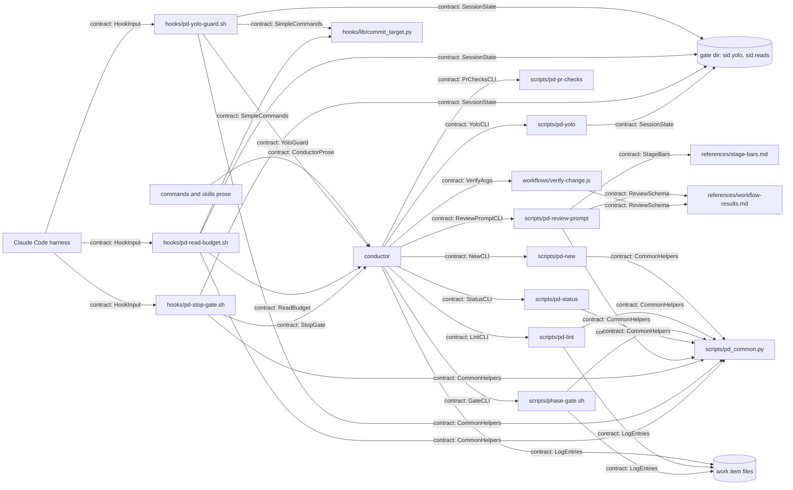

# Shape: Stage, YOLO decisions, secretary entry point, main-session read budget

<!-- Requirements (specify), then Design (design). Format: plugins/pd/references/doc-format.md. -->

## Requirements

### Goals

- **The main session stays lean:** once the owner sets a read budget, raw reads past it are refused, web lookups (WebFetch and WebSearch) are refused outright, and each refusal points to a research agent.
  - **Why this saves tokens:** a read result stays in the main session's context and is re-sent on every later turn. A research agent's reading stays in that agent's context, and only its answer comes back.
  - **How it's judged:** the owner reads a before-and-after cost report and rules (B44; `decision-4@2026-11-26 14:05+08:00`).
- **One entry point:** `/pd:secretary "<request>"` triages, creates the item and, on the owner's yes, carries it to finish as one goal run.
- **YOLO runs unattended:** after the owner confirms it once, the whole session decides on the owner's behalf.
  - **What counts as a decision made for the owner:** every question the conductor would otherwise put to the owner through AskUserQuestion. Each is written as a `decision` entry answered `A (conductor, on the user's behalf):`, with a record: pros and cons, the trade-off, implications and a premortem.
  - **What doesn't count:** the conductor's routine rulings (`A (conductor):`, such as wording) are not decisions made for the owner.
  - **Where the run ends:** it opens a pull request, waits until no check on it is pending, fixes what the checks and the automated review raise, and asks before the merge (B55).
- **A stage changes the trade-offs:** each work item is `mvp` or `production`.
  - **At mvp:** a review finding is a blocker only when, left unfixed, an expectation in `shape.md` fails on the input it names, data is lost or exposed, or a security hole opens. Everything else becomes a harden-later warning: severity `warning`, category `harden-later`, written in its review line as `warning harden-later`. The rules listed under "Never relax at mvp" stay in force at mvp too.
  - **At production:** the bar stays as it is today. Today's bar is what the owner called "too production-considering" (log 13:24 note).
- **Two existing sync problems are fixed:**
  - **The review-call schema exists twice,** in `references/workflow-results.md` and in `workflows/verify-change.js`, with nothing tying them together. Two copies are unavoidable: the workflow script can read no file (its only inputs are `args`, verified 2026-11-26), and the conductor's review call needs the schema inline from markdown. So a test ties the two copies together.
  - **A severity word differs:** three reviewer agents define their lowest severity as `suggestion`, and `retro-facilitator` reads that word, where the workflows say `note`.

### Non-goals

- **No new driver for YOLO:** the existing `Stop` gate drives goal runs.
  - **Not `/goal`:** Claude can't start it (`docs/dev_artifacts/plans/2026-10-14-thin-pd/bake-off.md:120`), and the gate drives goal runs alone (F12, `bake-off.md:177`).
  - **Not `/loop`:** it re-runs a prompt on a timer.
  - **Not a new Workflow script:** workflows were the owner's token-cost complaint (log 13:24 note).
- **No per-code-area stages and no third stage.**
- **No change to the safety rails:** fix-cycle caps, the token budget (`workitem_token_budget`, enforced by the `Stop` gate), the security review for `risk: security`, and blockers `R0` and `QB<n>`. `main_read_budget` is unrelated to the token budget: it is a per-turn count of read calls.
- **The read budget doesn't catch every way to read a file:** reads inside `$(...)`, `eval`, `bash -c`, scripts and interpreters go uncounted.
- **The YOLO hooks bind the conductor's ordinary path, not a determined bypass:** the conductor could run `pd-yolo off` itself. Every such step lands in `log.md` or the transcript, where the owner can see it.
- **A conductor-built review prompt isn't fully bound:** one carrying the right `Stage:` line without the stage paragraph isn't caught. `verify-change`'s check (B13) binds Verify only (owner's default 7 at the cap).
- **No enforcement that research agents return only pointers:** the `researching` skill asks for it, and this change assumes it.
- **No choice of the main session's model:** that stays the owner's `/model` setting.
- **YOLO never merges on its own:** the merge stays the owner's call (`decision-2@2026-11-26 14:05+08:00`, `decision@2026-11-26 14:14+08:00`). After the owner's yes at `Hard stop: ready to merge?`, YOLO turns off and finish's merge and cleanup run as they do today (B55).

### User stories

- As the owner, I type `/pd:secretary --yolo "<request>"`, confirm once, and come back to an open pull request, with its checks settled and every decision made for me recorded in `log.md`.
- As the owner, I set `stage: mvp` once for a new project, so reviews stop blocking on edge cases and consistency. Later I open a production work item to harden what an mvp item shipped.
- As the owner, I set `main_read_budget`, so research reading happens in cheaper agents and only their answers reach my main session.

### Expectations

Each one observable, with a unique id. Plan turns them into test cases. Lines marked **(live probe)** describe the conductor's behaviour in a session. Verify checks them in a headless `claude -p` run where it can, and records the rest, those needing an answered question or a `!` command, as notes for the owner to try later (`decision@2026-11-26 15:55+08:00`).

**Stage: where it lives**

B1: `pd-new workitem "<title>"` with no `--stage`, in a repo whose `.claude/pd.local.md` has `stage: mvp` -> the new README frontmatter has `stage: mvp`
B2: `pd-new workitem "<title>"` with no `--stage` and no `stage:` key in the config, or no config at all -> the README frontmatter has `stage: production`
B3: `pd-new workitem "<title>" --stage mvp` with config `stage: production` -> the README frontmatter has `stage: mvp`
B4: `pd-new workitem "<title>" --stage beta` -> exit 2 with an argparse error naming the allowed values, and no work item directory is created
B5: `pd-new workitem "<title>"` with no `--stage` and config `stage: beta` -> exit 1 with `pd-new: refused: ...` naming the config key and the allowed values, and no work item directory is created
B6: `pd-lint` on a work item whose README has `stage: beta` -> `pd-lint: ERROR <README>:<line>: ...` naming `stage` and `beta`, exit 1
B7: a work item README with no `stage:` key (every work item created before this change) -> `pd-lint` reports no error for it, and `pd-status`, `phase-gate.sh` and `pd-review-prompt` all treat it as `production`
B8: `pd-status` -> every work item row shows its stage. An open work item whose stage differs from the project default (the config's `stage:`, else `production`) shows its stage with a `*`, under a footer line `* stage differs from the project default (<default>)`
B59: `/pd:secretary --stage mvp "<request>"` in a repo whose config has `stage: production` -> the new work item's README frontmatter has `stage: mvp`

**Stage: how it reaches reviewers**

B9: `pd-review-prompt verifying <work item dir>` on a work item with `stage: mvp` -> exit 0. Stdout's first line is `Stage: mvp`, followed by the verifying skill's `## Review checklist` section verbatim, the mvp paragraph of `references/stage-bars.md`, and the review-call schema of `references/workflow-results.md`
B10: the same on a work item with `stage: production` -> stdout's first line is `Stage: production`, and it carries the production paragraph and not the mvp one
B11: `pd-review-prompt designing planning <work item dir>` (a small work item's joint review) -> both skills' checklists, one stage paragraph and one schema
B12: `pd-review-prompt <skill> <dir>` where the skill has no `## Review checklist` section, or the directory has no README -> exit 1, a message on stderr, and nothing on stdout
B13: `verify-change` started with no `stage` in its args, a `stage` other than `mvp` or `production`, or an `args.checklist` whose first line isn't `Stage: <args.stage>` -> it throws an error naming the arg before any agent runs
B14: a finished `verify-change` run -> its result carries `stage`, equal to the `stage` arg it was given
B45: a review call (by the conductor, or inside `verify-change`) -> the reviewer's JSON carries a `stage` field echoing its prompt's `Stage:` line, and the `review` entry's `Stage:` line copies that field
B15: `phase-gate.sh design|create-plan|verify <dir>` -> it takes the latest `review` entry that carries a `Stage:` line. When that line's stage differs from the README's `stage:`, it prints `GATE FAIL [<phase>]: ...` naming both stages, exit 1
B16: `review` entries with no `Stage:` line (calvin cycles, and entries written before this change) -> `phase-gate.sh` skips them. When no `review` entry carries one, the stage check doesn't apply, since today's gates don't require a review before Verify

**Stage: changing it on an open work item**

B17: (live probe) the owner asks to move an open work item from `mvp` to `production` -> a `decision` entry and the README's `stage:` edited. Past `specify`, also a backward move `phase <from> -> specify (back)` with `Invalidates:`. All of it is committed before any other work
B18: (live probe) the owner asks to move an open work item from `production` to `mvp` -> a `decision` entry and the README's `stage:` edited, with no backward move. The next gate requires a review that applied the new stage (B15)
B46: (live probe) the owner asks to change the stage of a work item with `status: done` -> refused, with a reply proposing a new production work item seeded from the backlog line that item's harden-later warnings produced (calvin cycle 1, row 17 ruling: `decision-3@2026-11-26 14:14+08:00`)

**Stage: what mvp relaxes**

B47: Criteria on a work item at `stage: mvp` -> `shape.md`'s edge cases end with a `Deferred:` line (`Deferred: none` when nothing is deferred), and `pd-lint` warns on an mvp work item whose `shape.md` has no such line. Which edge cases stay is judged at the criteria sign-off; under YOLO the conductor judges, with a decision record
B48: `pd-lint` on a plan task with `proof: green-only (mvp)` -> no error on a work item at `stage: mvp`. On one at `stage: production`, today's error `proof: green-only needs a reason`
B49: `phase-gate.sh finish <dir>` on an mvp work item whose `review` entries hold `warning harden-later` lines -> `GATE FAIL [finish]: ...` until `backlog.md` has one line ending `(from: workitems/<id>)` that names each such issue by its reference, `review@<timestamp>#<id>`
B50: `pd-init` (the script) on a repo with no `.claude/pd.local.md` -> the written config has `stage: production`. `/pd:init` (the command) then asks mvp or production through AskUserQuestion and sets the key to the answer

**Risk detection on every depth**

Why: the owner ruled that at mvp only the risk tags force standard depth (`decision-2@2026-11-26 13:24+08:00`). Today only `verify-change` runs `pd-lint --risk`, and express items skip it (`plugins/pd/skills/verifying/SKILL.md:42`). Without this section, that ruling would have no detector on the express path.

B19: `phase-gate.sh verify <dir>` where `pd-lint --risk <base>..HEAD` reports a signal whose tag the README lacks, and no `decision` entry has a line starting `Risk: none (<tag>)` followed by a reason -> `GATE FAIL [verify]: ...` naming the signal and its tag, exit 1. This holds at every depth and in every repo (calvin cycle 1, row 29 ruling: `decision-2@2026-11-26 14:14+08:00`)
B20: the same diff after the README gains the tag, or after such a `decision` entry -> that check passes

**Single entry point**

B21: `/pd:secretary "<feature request>"` without `--yolo` -> after the work item is created, one AskUserQuestion asks whether to run it to finish as a goal run. On yes, `## Now` holds `goal: <id> target finish session <session id>`, committed before Criteria starts
B22: the same, answered no -> no `goal:` line is written, and the work item proceeds as it does today
B23: triage at stage mvp (the config's `stage: mvp`, or `--stage mvp` passed to `/pd:secretary`) for a request with no security or migration signal -> its `phase triage -> <first stage>` entry cites `stage: mvp`, and it applies no standard-depth trigger. The two risk tags, `security` and `migration` (`RISKS` in `pd_common.py:21`), are the only triggers left at mvp

**YOLO: turning it on and off**

B24: `/pd:secretary --yolo "<request>"` -> before any other step, one AskUserQuestion whose question starts with `Hard stop:` asks the owner to confirm YOLO. On yes, YOLO is on for this session from that moment, before any item exists, and `pd-yolo status` prints `on`. The first time the session writes to an item's `log.md`, it first writes a `decision` entry quoting the confirmation, with a `Session: <session id>` line. That holds for every item: the item triage creates, a brainstorm or RCA item, a work item promoted from one, and an existing item (B51). Decisions made before the first item exists are written to that item's log right after the confirmation entry
B25: the YOLO confirmation answered no -> YOLO stays off, and the run continues as in B21
B51: a new session working on an item a YOLO session left unfinished -> YOLO is off for it. `/pd:secretary --yolo` on that item asks the confirmation again (B24), writes the new session's confirmation entry to the item's log, and writes a new `goal:` line for the new session
B60: `pd-yolo off` (what the conductor runs when the owner says to turn YOLO off) -> `pd-yolo status` prints `off`, and AskUserQuestion is allowed again (B28)

**YOLO: what it decides and what it can't**

B26: AskUserQuestion while YOLO is on for this session, with any question that doesn't start with `Hard stop:` -> refused, hook exit 2. Stderr says to decide it and write a decision record carrying `Session:`, `Stage:`, `Pros/cons:`, `Trade-off:`, `Implications:` and `Premortem:`
B27: the same call where every question starts with `Hard stop:` -> allowed
B28: AskUserQuestion in a session where YOLO is off -> allowed, unchanged from today, even when another session on the same item has YOLO on
B29: a `decision` entry answered `A (conductor, on the user's behalf):` that lacks any of `Session:`, `Stage:`, `Pros/cons:`, `Trade-off:`, `Implications:` or `Premortem:` -> `pd-lint: ERROR ...` naming each missing line, exit 1. This holds whatever wrote the entry (a YOLO run or a `claude -p` run), in every repo (calvin cycle 1, row 29 ruling)
B30: `phase-gate.sh specify <dir>` with the sign-off answered `A (conductor, on the user's behalf):` -> passes only when an earlier YOLO confirmation `decision` entry in that item's `log.md` has the same `Session:` line as the sign-off. Otherwise `GATE FAIL [specify]`, exit 1
B52: while YOLO is on for this session, a Bash command line from any caller (main session or agent) containing any of these -> refused, hook exit 2, and stderr says to ask a `Hard stop:` question first:
- `git push` with `--force`, `-f` or `--force-with-lease`;
- `git push --delete`, or `git push <remote> :<ref>`;
- `git push` whose refspec targets the base branch;
- `gh pr merge`;
- `git branch` with `-D`, `-d` or `--delete`;
- `git worktree remove` of a worktree not on a `pd/<id>/task-<n>` branch (pd's task worktrees, which `implement-tasks` removes itself, stay allowed wherever they live: the owner's ruling at the design cap, `decision@2026-11-26 15:43+08:00`);
- `git reset --hard`;
- `git clean` with `-f`;
- `rm` with `-r`, `-R` or `-rf` on a path outside `agent_sandbox/`.
B53: such a refusal -> stderr tells the conductor to show the command in the `Hard stop:` question; on approval the owner runs it with `! <command>`, whose output lands in the session, and the run carries on. An agent refused this way reports the refusal in its result, and the conductor asks the `Hard stop:` question. The hook keeps no allow-once state, so the conductor never runs a refused command itself
B54: while YOLO is on for this session, `git commit`, `git merge --continue`, `git rebase --continue` or `git cherry-pick --continue` while the repo has unmerged paths (a conflicted merge, rebase or cherry-pick) -> refused. Stderr says to ask a `Hard stop:` question naming the conflicted files; the owner resolves them and finishes with `! git commit` or `! git merge --continue`, or turns YOLO off (B60) so the conductor can. `implement-tasks`' merger is unaffected: on a conflict it aborts the merge and never resolves it (`plugins/pd/agents/merger.md:27`)
B55: (live probe) a YOLO run reaching the end of finish -> it does these, in order:
- **It opens a pull request:** it pushes the branch and opens one.
- **It waits for the checks:** until `gh pr checks` shows no pending check on the PR's head, the PR has no checks, or 60 minutes pass. The automated review is one of these checks (`review` beside `validate` on PR #35).
- **It fixes what they raise:** the failing checks and the review comments on the PR, each fix with its decision record, for up to 3 fix cycles. Still failing or still commented after the third: `Hard stop: checks still failing`.
- **It asks:** `Hard stop: ready to merge?`. On yes, it runs `pd-yolo off`, merges that pull request with `gh pr merge`, and finish's cleanup runs as today. On no, it clears the `goal:` line, runs `pd-yolo off`, and the PR stays open.
- **With no remote or no `gh`:** it skips the pull request and asks `Hard stop: branch ready; no remote to open a pull request on`.

**YOLO: the Stop gate**

B31: the `Stop` gate's token-cap and no-progress messages -> each tells the conductor to ask a question that starts with `Hard stop:`, so B26 lets it through
B32: the `Stop` gate finding the goal reached with no open blockers -> its message says to clear the `goal:` line from `## Now` and commit. YOLO stays on for the session until it ends or `pd-yolo off` runs
B56: a brainstorm or RCA item with this session's `goal:` line, and no work item yet promoted from it -> the `Stop` gate holds the stop (exit 2). Once a work item is promoted from it, the gate holds that work item's goal instead (calvin cycle 1, rows 6, 15 and 28 ruling: `decision@2026-11-26 14:05+08:00`)

**Main-session read budget**

B33: no `main_read_budget` key in the config, or a repo with no pd config at all -> the hook allows every call and writes no state
B34: `main_read_budget: 3`, main session (the hook input has no `agent_id`; `agent_type` can't be used, since a session started with `--agent` carries it too): the 4th counted call in one turn -> refused, hook exit 2, and stderr names `pd:codebase-explorer`
B35: `main_read_budget` set, main session: WebFetch or WebSearch -> refused on the first call, and stderr names `pd:internet-researcher`
B36: the same calls from a subagent (the hook input has `agent_id`) -> allowed, and not counted. An Agent tool result reaching the main session is not a read call and is not counted
B37: main session, Read of any file under `artifacts_root` or under the plugin root -> allowed, and not counted
B38: main session with the budget set, a call to Read, Grep or `mcp__codegraph__codegraph_explore`, or a Bash command line in which a simple command's first word is `cat`, `head`, `tail`, `less`, `more`, `sed`, `awk`, `grep`, `egrep`, `fgrep`, `rg`, `find` or `fd` -> counts toward the budget, while Glob, `ls` and every other Bash command do not. The list is the rule; it holds the commands whose output is file content or search hits
B39: a turn starts at each `UserPromptSubmit` event (a typed prompt, or a background agent reporting back) and each time the `Stop` gate holds a stop -> the count goes back to zero at both
B40: a hook failing to run (a crash, unreadable state) -> the read-budget hook and the AskUserQuestion hook allow the call, with one line on stderr naming the hook. The destructive-command and merge-conflict hook refuses a command that matches its lists (B52, B54), with one line on stderr: a wrong refusal costs the owner one `!` command, while a wrong pass could lose work
B57: while this session's `run in flight: <run-name> session <session id>` line (the one the conductor writes before every workflow run, per `workflow-transitions`) is in a work item's `## Now` -> the read budget refuses nothing. The docs don't say whether agents launched by a workflow carry `agent_id`, so a workflow run must never be starved

**Existing sync problems**

B41: a field of the review-call schema, the new `stage` field included, changed in only one of `workflows/verify-change.js` and `references/workflow-results.md` -> `node plugins/pd/workflows/tests/test-workflows.mjs` (a `qa_battery` command) fails, naming both files
B42: in `security-reviewer.md`, `ds-analysis-reviewer.md` and `ds-code-reviewer.md` -> no line matches `blocker | warning | suggestion` or contains the table cell `| suggestion |`, and their severity enums read `blocker | warning | note`; `retro-facilitator.md`'s severity line reads `blocker vs warning vs note`. The fix-text field named `suggestion` in their output schemas is a field name, not a severity, and stays

**Measures (owner-run probes at Verify, judged by the owner)**

B43: Probe: one fixed small request run once at `stage: mvp` and once at `stage: production` -> a `note` entry records each run's blocker findings, fix cycles, harden-later backlog lines and token total (from the `Stop` gate's files). The owner's ruling follows as a `decision` entry
B44: Probe: `claude-mem:agent-cost-report` over one session without `main_read_budget` and one comparable session with it -> a `note` entry records each session's priced main-session tokens: input, cache reads (which count the re-sends) and output, from the report's line items for the main transcript. If the report can't split the main transcript from the subagents', the figures come from the transcripts' usage fields, as the `Stop` gate reads them. The owner's ruling follows as a `decision` entry
B61: `phase-gate.sh finish <dir>` on this work item -> it needs both rulings (B43, B44). A ruling that the stage or the budget missed its goal names the owner's next step in the same entry: a backward move to the stage that owns the fix, or a backlog line

### Scope

- **In:**
  - **Stage:** the `STAGES` vocabulary; the `stage:` config key and frontmatter field; `pd-new --stage` and `/pd:secretary --stage`; changes to `pd-lint`, `pd-status`, `phase-gate.sh` and `pd-init`; the new `pd-review-prompt` script; `references/stage-bars.md`; `verify-change`'s `stage` arg; the `stage` field in the review-call schema and the `Stage:` line on review entries; the mvp forms of `specifying`'s edge-case rule and `planning`'s `proof: green-only` rule; finish turning harden-later warnings into a backlog line.
  - **Risk detection:** `phase-gate.sh verify` runs `pd-lint --risk`.
  - **Entry point:** `/pd:secretary`'s goal-run offer.
  - **YOLO:** `--yolo`; the new `pd-yolo on|off|status` command and the session state it keeps; the AskUserQuestion hook; the destructive-command and merge-conflict hook; the decision-record lines and their `pd-lint` check; the `Hard stop:` prefix in the `Stop` gate's messages and in `workflow-transitions`; the YOLO sign-off rule in `specifying` and `phase-gate.sh specify`; the gate holding brainstorm and RCA goals; finish's pull-request step under YOLO.
  - **Read budget:** the main-session read-budget hook and its reset at the `Stop` gate; the `main_read_budget` config key; loosening `workflow-transitions`' Dispatch line so `codebase-explorer`, `internet-researcher`, `investigation-agent` and `skill-searcher` may be dispatched at any stage. That last change is verifiable only by reading the diff, so its check is specified at Contracts.
  - **Sync fixes:** the review-schema drift test; `note` in the three reviewer agents and in `retro-facilitator`.
  - **Docs sync:** `README.md`, `README_FOR_DEV.md`, `plugins/pd/README.md` (hooks, scripts and counts), `docs/dev-guide/hook-development.md`.
- **Out:**
  - **The user-level codegraph `UserPromptSubmit` hook:** it isn't pd's.
  - **Migrating existing work items:** an item without `stage:` reads as production (B7), so open items in other adopted projects need no edit.
  - **Old YOLO features not brought back:**
    - pausing and resuming after usage limits (`yolo_usage_wait`, `yolo_usage_cooldown`);
    - propagating a `[YOLO_MODE]` flag into dispatched prompts, since agents never ask the owner;
    - the SessionStart secretary-context injection;
    - the `/secretary orchestrate` subcommand, which `--yolo` replaces.
  - **Old YOLO features kept, reshaped:** the hard stops (now enforced by hooks), and deciding for the owner (now with records instead of "pick the recommended option").
  - **Destructive operations outside B52's list:** a single-file `rm`, `find -delete`, deletion inside a script. B52's list is the whole hard-stop set for destructive operations.
  - **Watching the pull request past its checks:** later human comments are the owner's, or `/steward`'s.
  - **Changing how `implement-tasks` executes tasks:** worktrees, the merger and the proof stay as they are.

### Edge cases and must-nots

**Edge cases**
- **An item created before this change:** it has no `stage:` and reads as production (B7). Its review entries have no `Stage:` line, so the gate's stage check skips them (B16).
- **The project default flips while items are open:** the open items keep their own `stage:`, and `pd-status` marks the ones that differ (B8).
- **Two sessions on one work item:** YOLO and `goal:` lines are per session, so one session's YOLO never silences another session's questions (B28).
- **A session ends mid-run:** YOLO ends with it, and the next session confirms again (B51). A stale `goal:` line has no effect on a new session, as today.
- **A YOLO conductor asks in plain text and ends its turn:** the goal run's `Stop` gate holds the stop, so nothing waits for an answer that YOLO should have decided.
- **A repo without pd config:** every new hook leaves on its fast path (B33).
- **A Bash command line that reads through a pipe:** `git log | grep x` is counted, since `grep` starts a simple command. `bash -c "cat f"` is not counted (Non-goals).
- **Several hooks on one call:** matching hooks run in parallel, so each one sees the command line as the model wrote it (code.claude.com/docs/en/hooks).
- **A goal run with no typed prompts:** the `Stop` gate's hold starts a new turn (B39), so a long run is never locked out of reading.
- **A workflow running:** the read budget stands down (B57), and `implement-tasks` may still remove its own task worktrees (B52).
- **The `Hard stop:` prefix used for an ordinary question:** it only lets the question through to the owner; it unlocks nothing. Each answer lands in `log.md` quoted verbatim, so overuse is visible.

**Hard stops that stay in YOLO** (each asked with the `Hard stop:` prefix):
- **The token cap:** a run that overspends never asks otherwise. The thin-pd bake-off logged a 61× overrun (`docs/dev_artifacts/plans/2026-10-14-thin-pd/bake-off.md:182`, F21).
- **No progress:** a stuck run would loop forever.
- **A merge conflict** (B54): a wrong resolution can silently lose work.
- **A destructive operation:** the commands B52 lists other than `gh pr merge` and pushes to the base branch, each hard to undo.
- **The merge itself** (B55, and B52's `gh pr merge` and pushes to the base branch): it is outward-facing, and the owner keeps it.

**Must-nots**
- **Never answer the YOLO confirmation on the owner's behalf:** it is the one consent that turns autonomy on.
- **Never relax at mvp:** the security review for `risk: security`, blockers `R0` and `QB<n>`, the token budget, or validation at trust boundaries. These protect the user from harm, whatever the stage.
- **Never refuse a subagent's read, or the main session's read under `artifacts_root`:** research would stop, or the conductor couldn't work on its own artifacts.
- **Never let a broken read hook block every read:** a crash locking the main session out would stall all work (B40).
- **Never store the stage as a setting anywhere but the config default and the work item's frontmatter:** a third copy would drift. Review entries, decision records and workflow results only record the stage they applied.
- **Never change behaviour in a repo that sets none of the new keys,** except the risk check (B19) and the decision-record lint (B29), which the owner ruled apply everywhere.
  - **Today:** a census of the 20 pd repos on 2026-11-26 found no entry or open express item they affect.
  - **From now on:** they apply to all work in those repos.
  - **Everything else stays as today:** no `stage:` means today's bar, no `main_read_budget` means no read hook, and no YOLO confirmation means questions as today.

## Design

<!-- Design input: agent_sandbox/2026-11-26/pd-stage-yolo-proposal/proposal.md. The mechanism rows deferred from calvin (capped specify, log.md) are answered in "Deferred calvin rows" below. -->

### Architecture

Three new scripts (`pd-yolo`, `pd-review-prompt`, `pd-pr-checks`), one new reference (`stage-bars.md`) and two new hooks, beside existing modules that each gain a narrow change. The conductor is the agent following the prose. Every hook reads the session's state files, and only `pd-yolo` and the hooks write them.



### Contracts

```text
modules: (Claude Code harness; external, read only)
contract: HookInput
The JSON on a hook's stdin (code.claude.com/docs/en/hooks), the fields these hooks read:
  session_id       the session's id. A subagent's calls carry the parent's id: calvin-runner's ledger write
                   passed pd-agent-write-guard.sh, which looks up gate/<session_id>.json (pd-agent-write-guard.sh:28),
                   the file the specifying skill wrote under ${CLAUDE_SESSION_ID} (2026-11-26, this work item)
  agent_id         present only on a subagent's calls; absent = the main session (agent_type can't tell: --agent sets it)
  hook_event_name  PreToolUse | UserPromptSubmit | Stop
  tool_name, tool_input   Bash {command}; Read {file_path}; AskUserQuestion {questions: [{question}]}
  cwd
  background_tasks Stop only, read as pd-stop-gate.sh:122-126 reads it
Exit 2 with stderr refuses a PreToolUse call and hands stderr to the model; exit 0 with no output passes
(docs/dev-guide/hook-development.md:55-56).
Not documented; live probes at Verify: whether a `!` command fires PreToolUse (assumption A1); whether a refused
AskUserQuestion is kept from the owner; whether a workflow's agent() calls carry agent_id.
```

```text
modules: ~/.claude/pd/gate/<session id>.yolo, ~/.claude/pd/gate/<session id>.reads (runtime files beside the
         Stop gate's <session id>.json, whose keys stay untouched)
contract: SessionState
<sid>.yolo   exists = YOLO on for that session; absent = off. Content: one line, the local ISO time it was created.
             Written by pd-yolo (create, unlink). Read by pd-yolo-guard.sh and pd-yolo status.
<sid>.reads  one byte per counted read call in the current turn; the count is the file's size.
             pd-read-budget.sh appends (O_APPEND, one byte per call) and truncates it at UserPromptSubmit;
             pd-stop-gate.sh truncates it whenever it holds a stop (exit 2).
A <sid> not matching [\w.-]+ (as pd-stop-gate.sh:28): nothing is read or written.
Invariants: a session that never runs `pd-yolo on` and a repo without main_read_budget create no file; neither
file holds JSON, so no reader parses one and two parallel calls can't lose each other's write.
```

```text
modules: plugins/pd/hooks/lib/commit_target.py
contract: SimpleCommands
simple_commands(cmd: str, here: str) -> list[tuple[list[str], str]] | None
  Each top-level simple command of cmd, in order, as (words, directory it runs in). words start at the command
  word (past PREFIXES, NAME=value words and WRAPPERS, via command_start), are unmasked (UNMASK) and have their
  redirections dropped (drop_redirects). The directory follows `cd` as scan() does. None when shlex can't split
  the line (an unclosed quote).
  Read as commands (In): separators ; && || | & and newlines, ( … ) groups, single and double quotes, $'…',
  backslash continuations, comments and heredoc bodies dropped (shell_text), the WRAPPERS table, if/then/!/{.
  Not read (Out): the inside of $( … ) and backticks, eval, a shell's -c script (not recursed, unlike scan()),
  aliases, functions, a variable holding a command, scripts.
main() runs only under `if __name__ == "__main__":` so the hooks can import the module (today it runs at
import, commit_target.py:360); pd-commit-lint.sh's `python3 lib/commit_target.py` call and scan() are unchanged.
```

```text
modules: plugins/pd/scripts/pd-yolo
contract: YoloCLI
pd-yolo on --session <sid>       creates <sid>.yolo; prints "on"; exit 0
pd-yolo off --session <sid>      removes it if present; prints "off"; exit 0
pd-yolo status --session <sid>   prints "on" or "off"; exit 0
pd-yolo --self-test
Errors: a <sid> not matching [\w.-]+, an unsubstituted "${CLAUDE_SESSION_ID}" included -> exit 2,
stderr "pd-yolo: bad session id <sid>", nothing written.
Called only from skills (workflow-transitions, finishing-branch), whose ${CLAUDE_SESSION_ID} the harness
substitutes (D3).
```

```text
modules: plugins/pd/hooks/pd-yolo-guard.sh (PreToolUse; matchers AskUserQuestion and Bash)
contract: YoloGuard
Fast path, in bash before any python: no gate/<session_id>.yolo -> exit 0 (B28).
AskUserQuestion:
  any questions[].question not starting "Hard stop:" -> exit 2, stderr: "pd YOLO: decide this yourself: write a
    decision entry answered `A (conductor, on the user's behalf):` with the lines <DECISION_RECORD joined>. Only
    a question starting 'Hard stop:' reaches the owner." (B26)
  every question starting "Hard stop:" -> exit 0 (B27)
  any failure -> exit 0, one stderr line "pd-yolo-guard: check failed; question allowed" (B40)
Bash, each (words, dir) from simple_commands(command, cwd):
  words match DESTRUCTIVE -> exit 2, stderr: "pd YOLO: `<words>` is a hard stop. Ask a 'Hard stop:' question
    showing this command; on a yes the owner runs `! <command>`, or turns YOLO off. Never run it yourself." (B52, B53)
  words are git commit | git merge --continue | git rebase --continue | git cherry-pick --continue, and
    `git <that command's global options> ls-files -u` (its -C, -c, --git-dir, --work-tree and --namespace kept,
    so it reads the guarded command's index) prints anything -> exit 2, stderr naming the unmerged paths and both ways on: the
    owner resolves them and runs `! git commit` (or the --continue), or turns YOLO off (B54, B60)
  any failure past the fast path (an exception, simple_commands returning None, git failing) -> exit 2 with
    "pd-yolo-guard: check failed; command refused while YOLO is on" when the raw command holds $', $( or a
    backtick, or when, with every backslash-newline pair deleted first and then every ', " and \, it holds one of push merge branch worktree reset clean
    rm commit --continue as a whole word (so git p'ush' -f and git pu\<newline>sh -f are caught); otherwise exit 0 (B40)
DESTRUCTIVE (B52), read after git's global options (-C <dir>, -c <k=v>, --git-dir, --work-tree, --namespace,
--no-pager; -C also moves dir):
  git push with -f, --force, --force-with-lease[=…], or a refspec starting "+" (git-push(1)'s per-ref --force)
  git push with --delete or -d, or a refspec ":<ref>"
  git push to the base branch (pc.base_branch): a refspec whose destination (after its last ":", else the whole
    word without a leading "+") is <base>, refs/heads/<base>, or HEAD while on <base>; no refspec while on <base>
    (git-push(1), push.default simple); --all or --mirror. The branch is read with `git symbolic-ref -q HEAD`,
    refs/heads/ dropped (CLAUDE.md gotcha on :short). Value options -o, --push-option, --repo, --receive-pack
    and --exec take the next word when written without "=".
  gh pr merge, with any arguments
  git branch with --delete or a word matching ^-[A-Za-z]*[dD][A-Za-z]*$
  git worktree remove of a path (joined to dir, normalized) that `git -C <dir> worktree list --porcelain`
    doesn't show on a pd/<id>/task-<n> branch (pc.worktrees and pc.TASK_BRANCH, pd_common.py:243-265)
  git reset with --hard
  git clean with --force or a word matching ^-[A-Za-z]*f
  rm with --recursive or a word matching ^-[A-Za-z]*[rR], and an operand (after --, or any non-option word)
    that, joined to dir and normalized, is outside <top>/agent_sandbox/, where <top> is
    `git -C <dir> rev-parse --show-toplevel`; with no repo every operand is outside
Task worktrees are known by their branch, not their path, so a fixer running in its own task worktree
(implement-tasks.js:69-70) may remove its predecessor in any repository layout (review M3 R16).
```

```text
modules: plugins/pd/hooks/pd-read-budget.sh (PreToolUse, matcher
         Read|Grep|Bash|WebFetch|WebSearch|mcp__codegraph__codegraph_explore; UserPromptSubmit)
contract: ReadBudget
Fast path, in bash: no repo, or no line starting "main_read_budget:" in <repo top>/.claude/pd.local.md ->
  exit 0, nothing written (B33).
agent_id present -> exit 0, nothing counted (B36).
UserPromptSubmit -> truncate <sid>.reads; exit 0 (B39).
Run in flight (B57): before either refusal below, the hook looks for `run in flight: <name> session <session_id>`
  in each work item README's `## Now`; found -> exit 0. It reads the READMEs only on the way to a refusal.
WebFetch, WebSearch -> exit 2, stderr: "pd read budget: web lookups go to pd:internet-researcher; dispatch it
  with one narrow question." (B35)
Counted (B38): Read; Grep; mcp__codegraph__codegraph_explore; Bash when some simple command's first word, by
  basename, is in READ_WORDS = cat head tail less more sed awk grep egrep fgrep rg find fd.
  Not counted: Glob, every other Bash command, and a Read whose file_path resolves under
  <repo top>/<artifacts_root>/ or under $CLAUDE_PLUGIN_ROOT (B37).
A counted call appends one byte. When the count then exceeds main_read_budget -> exit 2, stderr:
  "pd read budget: <n> reads this turn (budget <b>). Dispatch pd:codebase-explorer with one narrow question;
  it returns pointers." (B34)
main_read_budget must be a positive integer; any other value -> treated as unset, one stderr line.
Any failure -> exit 0, one stderr line "pd-read-budget: check failed; call allowed" (B40).
```

```text
modules: plugins/pd/hooks/pd-stop-gate.sh
contract: StopGate
Goal items: work items, brainstorms and rca items whose `## Now` holds this session's goal line (GOAL_RE,
  pd-stop-gate.sh:22); today work items only (pd-stop-gate.sh:75, :115).
A brainstorm or rca goal is reached when its status is done or abandoned. Until then the gate holds the stop:
  "pd gate: goal <id> is a <type>; carry it to promotion. Promotion moves the goal line to the new work item." (B56)
Token-cap and no-progress messages (pd-stop-gate.sh:140, :152): "Ask the owner: Hard stop: <question>" (B31).
Goal reached (pd-stop-gate.sh:170) gains: "YOLO stays on until pd-yolo off or the session ends." (B32)
Every exit 2 first truncates <sid>.reads (B39).
Unchanged: token counting, the background-task yield, the work item token budget, the no-progress check.
```

```text
modules: plugins/pd/scripts/pd-pr-checks
contract: PrChecksCLI
pd-pr-checks <pr> [--for <seconds>]       --for defaults to 540, so one call ends inside the Bash tool's 600 s cap
  Polls `gh pr checks <pr> --json name,bucket` every 30 seconds until no bucket is "pending", or --for seconds pass.
  stdout: the last poll's JSON list of {name, bucket}; nothing when the PR has no checks.
  exit 0  every bucket is pass or skipping
  exit 1  some bucket is fail or cancel
  exit 3  no checks: gh exited 1 printing "no checks reported"
  exit 8  still pending when --for ran out
  exit 2  gh failed otherwise (no such PR, auth, network); gh's stderr passed through
pd-pr-checks --self-test
Called only by finishing-branch under YOLO (B55). No existing script waits on remote state; pd-status reads local
files only. The sleeping happens inside the script, so no foreground `sleep` command and no `--watch` run that
outlives a tool call (review M3 R18).
```

```text
modules: plugins/pd/scripts/pd-review-prompt
contract: ReviewPromptCLI
pd-review-prompt <skill> [<skill>] <work item dir>
  stdout, in order:
    line 1: "Stage: <stage>", where <stage> = pc.item_stage(the README's frontmatter)
    each skill's "## Review checklist" section of <plugin root>/skills/<skill>/SKILL.md, heading included, verbatim
    the "## <stage>" section of references/stage-bars.md, verbatim
    the "The review call" json block of references/workflow-results.md, after the line "Return only a JSON
    object matching this schema."
  exit 0 (B9, B10, B11)
Errors: exit 1, stderr "pd-review-prompt: <reason>", stdout empty, when a skill has no such section, the
directory has no README.md, or the stage-bars section or the schema block is missing (B12). Usage errors:
argparse, exit 2.
<plugin root> is the script's parent's parent. pd-review-prompt --self-test.
```

```text
modules: plugins/pd/references/stage-bars.md
contract: StageBars
section "## mvp":         A blocker only when, left unfixed, an expectation in shape.md fails on the input it names, data is
                lost or exposed, or a security hole opens. Anything else is severity warning, category
                harden-later. Never relaxed: the security review for risk: security, blockers R0 and QB<n>, the
                token budget, validation at trust boundaries.
section "## production":  Each checklist item as written (today's bar).
The two headings are the lookup keys; the paragraphs are read only by reviewers.
```

```text
modules: plugins/pd/references/workflow-results.md ("The review call" json block, and the review nested in the
         verify-change result block, workflow-results.md:46-57);
         plugins/pd/workflows/verify-change.js (ISSUE and REVIEW, verify-change.js:23-29)
contract: ReviewSchema
"The review call" block becomes the JSON Schema itself, structurally equal to REVIEW:
{"type": "object", "required": ["approved", "stage", "issues", "summary"],
 "properties": {
   "approved": {"type": "boolean"},
   "stage": {"enum": ["mvp", "production"]},
   "issues": {"type": "array", "items": {"type": "object",
     "required": ["id", "severity", "category", "file", "line", "claim", "evidence"],
     "properties": {"id": {"type": "string"}, "severity": {"enum": ["blocker", "warning", "note"]},
       "category": {"type": "string"}, "file": {"type": "string"}, "line": {"type": "integer"},
       "claim": {"type": "string"}, "evidence": {"type": "string"}}}},
   "summary": {"type": "string"}}}
stage echoes the prompt's first line (B45). category is "harden-later" for a finding the mvp bar demotes.
The verify-change result block gains "stage" at its top level and inside its "review" (VerifyArgs).
Two copies by necessity: a workflow reads nothing but args. test-workflows.mjs compares REVIEW with "The review
call" block, found under its heading rather than by position (test-workflows.mjs:9-10 indexes blocks today):
object keys unordered, "required" as a set, every type and enum compared. A name, type, requiredness or enum
changed on one side fails it (B41).
```

```text
modules: plugins/pd/workflows/verify-change.js
contract: VerifyArgs
args gain stage: "mvp" | "production", required. Before any agent() call it throws, naming the arg, when stage
is missing or another value, or when args.checklist's first line isn't exactly "Stage: <args.stage>" (B13).
REVIEW requires stage (ReviewSchema); the no-usable-review fallback (verify-change.js:84-85) sets stage: args.stage.
RESULT gains stage, equal to args.stage (B14). Its restatement in workflow-results.md (the verify-change block,
:46-57) gains "stage" too, since test-workflows.mjs:93-94 compares RESULT's keys with that block.
```

```text
modules: plugins/pd/scripts/pd-new, plugins/pd/templates/README.md
contract: NewCLI
pd-new workitem "<title>" [--stage mvp|production] …   argparse choices=pc.STAGES; another value -> exit 2 (B4)
  no --stage: load_config(root)["stage"]; a value outside STAGES -> Refused("config stage: <v>; allowed: mvp,
  production"), so "pd-new: refused: …", exit 1, before any write (pd-new:192-194) (B5)
  writes "stage: <s>" from the template line "stage: {{stage}}  # workitems only" (B1, B2, B3)
  --stage on another item type -> Refused, as --mode is (pd-new:130-131)
```

```text
modules: plugins/pd/scripts/pd_common.py
contract: CommonHelpers
STAGES = ("mvp", "production")
CONFIG_DEFAULTS gains "stage": "production". main_read_budget has no default: absent means no budget.
item_stage(fm) -> fm.get("stage") or "production"     a README without the key reads production, whatever the
                                                      config default (B7)
DECISION_RECORD = ("Session:", "Stage:", "Pros/cons:", "Trade-off:", "Implications:", "Premortem:")
ISSUE_RE = ^- (?P<id>[A-Za-z]+\d+) (?P<sev>blocker|warning|note)(?: (?P<cat>harden-later))? (?P<file>\S+?):(?P<line>\d+) — (?P<claim>.+)$
  named groups; open_blockers (pd_common.py:394-397) and its self-test (:502) move to them
base_branch(root, cfg) -> str    cfg base_branch; for "auto", refs/remotes/origin/HEAD's target without
                                 "origin/", else "main" (the rule of pd-session-start.sh:33-34)
risk_signals(root, rng) -> list[tuple[tag, path, line]]   the detection moved out of pd-lint check_risk
                                 (pd-lint:620-640): risk-patterns.md over the added lines of `git diff -U0 rng`,
                                 skipping artifacts_root and test_paths
risk_waivers(entries) -> set[str]   tags of decision lines matching
                                 ^Risk: none \((security|migration)\)[\s:;,.—-]*\w   (B19, B20)
```

```text
modules: plugins/pd/references/log-entries.md
contract: LogEntries
Issue line: - <id> <blocker|warning|note>[ harden-later] <file>:<line> — <claim>
review entry of a review call (not a calvin cycle): a line "Stage: <stage>", copied from the reply's stage (B45)
decision answered "A (conductor, on the user's behalf):": one line starting with each DECISION_RECORD label (B29)
YOLO confirmation, the first entry a YOLO session writes to each item's log (B24, B51):
  ## <ts> decision
  Q: Hard stop: turn YOLO on for this session?
  A (user, verbatim): "<the chosen option, starting Yes>"
  Session: <session id>
Risk waiver: a decision line "Risk: none (<tag>) — <reason>" (B19)
Harden-later backlog line: one backlog.md line per work item ending "(from: workitems/<id>)", naming each issue
  by its reference <review entry ref>#<id>, e.g. review-2@2026-12-01 10:00+08:00#R3 (REF_RE, pd_common.py:38) (B49)
Probe ruling, one per "B<n>: Probe:" expectation (B61):
  ## <ts> decision
  Q: <the probe's question>, asked through AskUserQuestion with the options "Met" and "Missed"
  A (user, verbatim): "<the chosen option, starting Met or Missed>"
  Ruling: B<n>
  Next: none (Met only) | phase <from> -> <to> (back) | backlog <id>
```

```text
modules: plugins/pd/scripts/pd-lint
contract: LintCLI
check_frontmatter: ("stage", pc.STAGES) joins the vocabulary loop (pd-lint:160-163), so "stage: beta" is an
  ERROR naming stage and beta (B6); no key, no error (B7); stage on another item type is an error, as mode is
  (pd-lint:167-169)
check_log: a decision with an "A (conductor, on the user's behalf):" line lacking a line for any DECISION_RECORD
  label -> one ERROR naming each missing label (B29), in every repo and on every item status
shape.md of a stage-mvp work item: "## Requirements" holds a B<n>: line and no line starting "Deferred:" -> WARN (B47)
plan tasks: the green-only reason set gains "mvp" when the item's stage is mvp (pd-lint:333-335); at production
  "green-only (mvp)" keeps today's error (B48)
--risk: check_risk reads pc.risk_signals and drops tags in pc.risk_waivers; its output is otherwise unchanged
```

```text
modules: plugins/pd/scripts/phase-gate.sh
contract: GateCLI
design | create-plan | verify | finish: the latest review entry holding a "Stage:" line; its stage differs from
  item_stage(README) -> "GATE FAIL [<phase>]: the review applied stage <a>; the work item is <b>" (B15).
  No such entry -> no stage check (B16). design and create-plan join the log_checks case for this check only
  (today it skips them, phase-gate.sh:199-206). The check runs only when <phase> equals the README's phase,
  the exit being taken: pd-lint's re-runs of passed gates (pd-lint:363-380) skip it, so the commit of a stage
  change after Contracts passes (B18). At finish, a stage changed since Verify thus needs a review call applying
  the new stage before the work item can close (ConductorProse).
specify: signed_off() (phase-gate.sh:84-89) also passes on "A (conductor, on the user's behalf):" when an
  earlier YOLO confirmation entry (LogEntries) carries the same "Session:" line (B30).
verify: pc.risk_signals(root, "<merge-base of base_branch and HEAD>..HEAD") whose tag is neither in the README's
  risk list nor in risk_waivers -> "GATE FAIL [verify]: <tag> signal <path>:<line>: add risk: <tag> or a
  Risk: none (<tag>) decision" (B19, B20), at every depth.
finish: each shape.md expectation starting "B<n>: Probe:" needs a decision entry with an "A (user, verbatim):"
  line whose quote starts "Met" or "Missed", a line "Ruling: B<n>" and a "Next:" line; after "Missed", Next
  must be a backward move (phase <from> -> <to> (back)) or a backlog id, never "none". Otherwise ->
  "GATE FAIL [finish]: the owner's ruling on B<n> is missing or names no next step" (B61, D8). On a stage-mvp work item, each harden-later issue line's reference must appear on a backlog.md line ending
  "(from: workitems/<id>)" (B49).
```

```text
modules: plugins/pd/scripts/pd-status
contract: StatusCLI
Header "STATUS PHASE TYPE ID STAGE NOW": STAGE after ID, so the self-test's r[3] stays the id (pd-status:228-231).
STAGE is item_stage(fm) for a work item and "-" for other types. An open work item (not done or abandoned) whose
stage differs from the config's stage (default production) shows "<stage>*", and the table is then followed by
"* stage differs from the project default (<default>)" (B8).
```

```text
modules: plugins/pd/commands/secretary.md, plugins/pd/commands/init.md, plugins/pd/scripts/pd-init,
         plugins/pd/skills/{workflow-transitions,specifying,planning,verifying,finishing-branch}/SKILL.md,
         plugins/pd/references/review-call.md
contract: ConductorProse
secretary.md
  argument-hint gains [--yolo] [--stage mvp|production] (secretary.md:3).
  --yolo: before triage, invoke the workflow-transitions skill and follow its YOLO section.
  Stage mvp (config or --stage): the two risk tags are the only standard-depth triggers, and the
  phase triage entry cites "stage: mvp" (B23). --stage passes through to create-workitem (B59).
  After the work item exists: without YOLO, one AskUserQuestion offers a goal run to finish (B21, B22); with
  YOLO, the goal line is written without asking. Either way it is committed before Criteria starts.
workflow-transitions, a new "YOLO" section
  Confirm: an AskUserQuestion "Hard stop: turn YOLO on for this session?". On yes, run
    `pd-yolo on --session ${CLAUDE_SESSION_ID}`, then `pd-yolo status --session ${CLAUDE_SESSION_ID}`, which must print "on" (B24, B25).
  Before the session's first entry in any item's log, write the YOLO confirmation entry (LogEntries), then the
    decisions made before that item existed (B24, B51).
  Every question that isn't a hard stop becomes a decision record (LogEntries, B26). Every hard stop is asked as
    "Hard stop: …" (the hard-stop line, workflow-transitions/SKILL.md:45).
  Promotion moves this session's goal line from the brainstorm or rca to the new work item (B56).
  The owner says off -> `pd-yolo off --session ${CLAUDE_SESSION_ID}` (B60).
  Changing an open item's stage: a decision entry and the README's stage: edited, committed first; mvp to
    production past specify (README phase other than specify) also moves back to specify with Invalidates:;
    production to mvp moves nothing back, and at finish the conductor makes a review call with
    `pd-review-prompt verifying <dir>` before the finish gate; a done item is refused, with a new production item proposed from its
    harden-later backlog line (B17, B18, B46).
  Print mode's decisions carry the same record lines (workflow-transitions/SKILL.md:49; B29).
  Dispatch (workflow-transitions/SKILL.md:52): codebase-explorer, internet-researcher, investigation-agent and
    skill-searcher at any stage.
review-call.md
  The prompt is `pd-review-prompt <skill> <work item dir>`'s output plus the inputs (replacing review-call.md:11-12).
  The review entry copies the reply's stage into "Stage:" (B45).
verifying
  Args gain stage = item_stage; checklist = `pd-review-prompt verifying <dir>`'s output (B13).
specifying
  The edge-case bar's mvp form: a closing "Deferred:" line, judged at sign-off, by the conductor under YOLO (B47).
  Sign-off under YOLO: answered on the owner's behalf, with the record (B30).
planning
  "green-only (mvp)" at stage mvp (B48).
finishing-branch, step 7 under YOLO (B55)
  The PR path's commands (finishing-branch/SKILL.md:30): `git push -u origin workitem/<id>`, then `gh pr create`.
  Wait: `pd-pr-checks <pr>` (PrChecksCLI) as a Bash call with the tool's timeout at 600000 ms, repeated while it
    exits 8, at most 7 times (60 minutes). Exit 0 ends the wait; 3 (no checks) ends it too; 1 hands the failing
    checks it printed to the fix cycles; 2 -> "Hard stop: gh failed: <its stderr>".
  Failing checks and PR review comments get up to 3 fix cycles, each fix with its decision record; still failing
    -> "Hard stop: checks still failing".
  "Hard stop: ready to merge?": yes -> `pd-yolo off --session ${CLAUDE_SESSION_ID}`, `gh pr merge`, then steps 8 and
    9 as today; no -> clear the goal line, the same pd-yolo off; the PR stays open.
  No remote or no gh -> "Hard stop: branch ready; no remote to open a pull request on".
  Before step 6, a stage-mvp item's harden-later issues get their backlog line (B49).
init
  pd-init writes "stage: production" (B50). /pd:init asks mvp or production, then sets the key.
```

### Decisions

- **D1: YOLO state is a marker file, `<sid>.yolo`.**
  - **Rejected a `yolo` key in `<sid>.json`:** the Stop gate rewrites that file on every stop by load, change and replace (`pd-stop-gate.sh:33-45`, `:89-108`). A concurrent writer could lose the flag, and the guard's fast path would need a JSON parse before it could tell YOLO is off.
  - **Rejected an environment variable:** none carries the session id to a Bash command (code.claude.com/docs/en/env-vars).
  - **Serves:** KISS. Absence is the one "off" state, and a bash `[ -e ]` reads it.
- **D2: the read count is an append-only byte file, `<sid>.reads`.** One `write(2)` with `O_APPEND` is atomic, so two parallel tool calls can't lose a count.
  - **Rejected a counter in JSON:** two hooks reading and rewriting it in parallel lose an update, the failure D1 avoids.
  - **Serves:** KISS.
- **D3: `pd-yolo` takes `--session`, and only skills call it** (`workflow-transitions`, and `finishing-branch` for B55's off). Only skills use `${CLAUDE_SESSION_ID}` today (`workflow-transitions/SKILL.md:44`, `specifying/SKILL.md` step 2); no command does.
  - **Rejected calling it from `secretary.md`:** whether a command substitutes the variable is unverified.
  - **Rejected a hook recording "the last session seen":** two sessions in one repo would cross.
  - **Evidence that the hook's `session_id` is that value, subagents included:** HookInput.
- **D4: one guard hook for AskUserQuestion and Bash, separate from the read budget.**
  - **Why one guard:** both checks read the same marker and stop together at `pd-yolo off`.
  - **Rejected a hook per expectation group:** two more `hooks.json` entries, each re-reading the marker.
  - **Rejected folding the checks into `pre-commit-guard.sh` or `pd-commit-lint.sh`:** both fail open by design (`pre-commit-guard.sh:74`, `pd-commit-lint.sh:27`).
  - **Why the read budget is separate:** it has its own config key and its own event (UserPromptSubmit).
  - **Serves:** single responsibility.
- **D5: fail policy per tool, after a fast path on the marker.**
  - **AskUserQuestion fails open.**
  - **Bash fails closed,** but only for a raw command containing one of the list's command words.
  - **What the fast path buys:** a session without YOLO is never refused, even by a crash. That keeps the must-not "never change behaviour in a repo that sets none of the new keys" (C91).
  - **Precedent:** `pd-agent-write-guard.sh:39` fails closed for the narrow set of calls reaching its check, while the shared `install_err_trap` fails open (`lib/common.sh:76`). The guard's python branch is that narrow set.
  - **Rejected failing closed everywhere:** a crash would refuse `git status` in a YOLO session.
- **D6: `simple_commands` goes into `commit_target.py`.** It reuses `shell_text`, `command_start` and `drop_redirects` (`commit_target.py:77-236`).
  - **Rejected a regex on the raw command line:** quoted prose matches (`git commit -m "never rm -rf"`), the failure `commit_target.py` exists to avoid (its docstring, `:1-11`).
  - **Rejected a copy of `scan()`'s loop:** two copies of the parser drift.
  - **Rejected recursing into `-c` scripts:** the read budget's Non-goal leaves `bash -c` uncounted, and one function serves both hooks.
  - **Serves:** DRY.
- **D7: `harden-later` is an optional token in `ISSUE_RE`.** This keeps the signed-off literal `warning harden-later` (Goals, B49).
  - **Who reads issue lines today:** only `open_blockers`, through `ISSUE_RE` (`pd_common.py:39`, `:394`). The format lives at `log-entries.md:12`.
  - **Rejected a claim prefix (`— harden-later: …`):** it rewrites signed-off text.
  - **Rejected a free category word:** one category is read (YAGNI).
  - **What else moves:** the groups become named, so the readers' indexes can't shift.
- **D8: B61 reads the expectations themselves.** The finish gate finds each `B<n>: Probe:` line in `shape.md` (B43 and B44 are the only ones in the repo, by `grep -rlE '^B[0-9]+: Probe:'`, 2026-11-26) and requires that probe's ruling entry: the owner's verbatim answer, `Ruling: B<n>` and `Next:` (GateCLI, LogEntries).
  - **Rejected owed-ruling blocker lines closed by the ruling:** a `qa`, `review` or `capped` entry can close any blocker without the owner (`pd_common.py:366-391`), and a line never written passes (review M1 R6).
  - **Rejected a "required rulings" list in `phase-gate.sh`:** it would put one work item's rule in a script every work item runs.
  - **Rejected a manual finish check:** it would edit signed-off text.
  - **What `Next:` covers:** the follow-up after an adverse ruling. The owner's own answer starts `Met` or `Missed`, so the gate can tell them apart: after `Missed`, `Next: none` fails (review M2 R6).
  - **Serves:** KISS. The signed-off text is the data, so nothing can drift from it.
- **D9: risk detection moves into `pd_common`,** read by `pd-lint --risk` and `phase-gate.sh verify`.
  - **Rejected running `pd-lint --risk` from the gate and parsing its WARN lines:** that makes pd's own message text an API.
  - **Rejected a second copy of the pattern loop:** the copies drift.
  - **Serves:** DRY.
- **D10: `base_branch()` goes into `pd_common`,** following `pd-session-start.sh:33-34`. The verify gate and the guard's push rule need it, and neither sees the session's `{pd_base_branch}`.
  - **Rejected a `--base` argument to `phase-gate.sh`:** every caller would have to resolve the branch itself.
  - **Kept:** the bash copy in `pd-session-start.sh` (Risks note).
- **D11: `pd-review-prompt` is a script.** The stage paragraph and the schema each come from one file, and B13 checks the prompt's first line exactly.
  - **Rejected the conductor copying sections by hand,** as `review-call.md:11-12` asks today: the stage paragraph would vary per call.
  - **Nearest existing script:** `pd-review-filter` filters a review's JSON after the call, a different job.
  - **Serves:** DRY.
- **D12: the bars live in one file, `references/stage-bars.md`.**
  - **Rejected an mvp copy of each stage skill's checklist:** four skills times two copies.
  - **Serves:** DRY.
- **D13: no hash of the bar paragraph** (the owner's default 7 at the cap, `decision@` after `capped@` in `log.md`). The `Stage:` line and B13's first-line check do the binding.
  - **Accepted gap:** a conductor-built prompt missing the paragraph isn't caught (Non-goals).
- **D14: the pull-request wait is a foreground loop of `pd-pr-checks`, a script that polls and stops on its own clock.**
  - **Why foreground:** the Stop gate yields only to workflow and subagent tasks (`pd-stop-gate.sh:121-126`), so a background shell wait would have its stop held. Foreground Bash calls are capped at ten minutes.
  - **Why a script, not `gh pr checks --watch`:** a `--watch` call outliving the tool's timeout is moved to the background, not stopped, and gh ignored a `perl` alarm (both reproduced, Probes of parsed output). A loop of such calls would start a second watcher.
  - **Rejected stock `timeout`:** macOS ships none.
  - **Rejected a background wait with a Stop-gate exception for shell tasks:** the gate leaves shells out on purpose (`pd-stop-gate.sh:121`).
  - **Serves:** KISS. One call is one bounded poll loop with a closed set of exits.
  - **Probed** with gh 2.103.3, 2026-11-26:
    - **No checks:** `gh pr checks 5` prints `no checks reported on the 'feature/010-backlog-to-feature-link' branch` and exits 1.
    - **All passing:** `gh pr checks 35` exits 0.
    - **Already settled:** `--watch` on PR #35 exits 0.
  - **Rejected `/steward` and `claude-mem:babysit`:** the owner starts those, and they watch for days.
- **D15: the STAGE column goes after ID.** The `pd-status` self-test splits each row and reads `r[3]` as the id (`pd-status:228-231`).
  - **Rejected placing it before ID:** that shifts the index.
- **D16: every new test is pytest with `--junitxml`.**
  - **Why:** pd-lint requires each plan task's command to write its JUnit path (`pd-lint:326-330`), and the 2026-11-03 plan proved its tasks this way.
  - **How the hooks are tested:** they run as subprocesses, with JSON on stdin.
  - **How the workflow is tested:** one pytest case runs `node plugins/pd/workflows/tests/test-workflows.mjs` and asserts exit 0. That file prints pass and fail but writes no JUnit.
  - **CI:** its pytest line names files one by one (`ci.yml:42`), so it gains each new file.

### Risks

Written as if the work item had already failed.

| Risk | Blast radius | Mitigation |
|---|---|---|
| A `!` command fires PreToolUse after all (A1). The interactive-mode docs say shell mode runs "without going through Claude" and say nothing of hooks (code.claude.com/docs/en/interactive-mode). | B53 and B54 dead-end: the owner's own `! git commit` is refused | Every YoloGuard refusal also names the YOLO-off way (B60), and `pd-yolo` itself is never refused. Live probe at Verify. |
| A refused AskUserQuestion still reaches the owner. Exit 2 "blocks the tool call", but the docs don't say a blocked question stays hidden (code.claude.com/docs/en/hooks). | YOLO keeps asking (B26 fails live) | Live probe at Verify. Fallback in the same hook: `permissionDecision: deny` with the same reason (`docs/dev-guide/hook-development.md:67-69`). |
| A workflow's agent() calls carry no `agent_id`, so the read budget counts them as the main session. Not documented (hooks docs). | a workflow run starved of reads | B57's stand-down while this session's `run in flight:` line exists. Test: a counted call over budget, and a WebFetch, each pass with that line present. |
| `${CLAUDE_SESSION_ID}` isn't substituted where `pd-yolo on` runs. Only skills use it today (D3). | YOLO silently off: the owner is asked as usual | `pd-yolo` refuses a non-id (exit 2), the YOLO section checks `pd-yolo status` prints `on` (B24), and the live probe runs B24. |
| Parallel hooks lose a write. The Stop gate rewrites `<sid>.json` by load, change and replace (`pd-stop-gate.sh:33-45`, `:89-108`). | a lost read count, or YOLO flipped off | D1 and D2: a marker file and an append-only byte file. Test: 20 parallel counted calls leave a 20-byte file. |
| Widening `ISSUE_RE` shifts the positional groups `open_blockers` reads (`pd_common.py:394-397`). | blockers misread: the wrong file, or a claim taken for the line | Named groups. Test: a blocker line and a `warning harden-later` line, parsed from one review entry. |
| `test-workflows.mjs` finds the json blocks by position (`test-workflows.mjs:9-10`). | the drift test (B41) compares the wrong block and passes vacuously | It finds "The review call" block by its heading. Non-vacuity test: a field removed from the markdown copy only makes it fail. |
| The guard refuses pd's own commands in a YOLO run: the implement-tasks fixer's `git worktree remove --force` (`implement-tasks.js:54`), finish cleanup's `git branch -d` (`finishing-branch/SKILL.md:34`). | Execute or finish stalls | a worktree on a `pd/<id>/task-<n>` branch is exempt, wherever it lives, and B55 runs `pd-yolo off` before the merge and cleanup. Tests: removing a worktree on a `pd/<id>/task-1` branch passes while YOLO is on, from the main checkout and from a sibling task worktree, while a worktree on another branch is refused; in a `--separate-git-dir` checkout, `rm -rf <store>/agent_sandbox/x` is refused (review M2 R16, M3 R16). The other callers stay hard stops on purpose (`grep -noE 'git (branch -D\|worktree remove[^`]*)'` over skills/ and commands/, 2026-11-26): `implementing/SKILL.md:27` removes a kept task worktree, on its task branch, so it is exempt; `implementing/SKILL.md:33` (`git branch -D` after a wrong test) and `abandon-workitem.md:12` (`git branch -D`) each delete a branch, which is the owner's call. |
| `phase-gate.sh design` and `create-plan` now run log checks they skipped (`phase-gate.sh:199-206`). | existing work items fail their design or plan gate | Only the stage check runs at those phases, and only when the phase is the README's own (GateCLI). Tests: a work item written before this change, with no `Stage:` lines, passes `design`; a work item at implement whose design review applied production, after a move to mvp, passes `pd-lint` (B18, review M1 R1); a stage changed at finish fails the finish gate until a review applies it (review M2 R17). |
| B29 now applies everywhere, and print mode already writes `A (conductor, on the user's behalf)` decisions (`workflow-transitions/SKILL.md:49`). | an old item's entries fail pd-lint in another repo | The census of 20 pd repos on 2026-11-26 found no such entry. The print-mode line gains the record lines in the same change. |

Notes:
- **Base branch rule, two copies:** `base_branch()` repeats `pd-session-start.sh:33-34`'s auto rule in Python, and the copies could drift.
- **A pull request's checks may not be registered yet** right after `gh pr create`. If so, the wait reads "no checks" and ends early. The `Hard stop: ready to merge?` question still comes before any merge.
- **An `rm -r` in the session scratchpad is refused under YOLO,** since the scratchpad is outside `agent_sandbox/`.

### Test strategy

- **Runner and JUnit option:** `uv run --project plugins/pd pytest <files> --junitxml=<path>`, with each new file added to CI's pytest line (`ci.yml:42`). Each plan task owns its test files, so tasks in one wave share none:
  - **`plugins/pd/scripts/test_pd_common_stage.py`:** CommonHelpers, and `pd-lint --risk` reading them.
  - **`plugins/pd/hooks/lib/test_commit_target.py`:** existing; gains the `simple_commands` cases.
  - **`plugins/pd/scripts/test_pd_yolo.py`:** YoloCLI.
  - **`plugins/pd/scripts/test_pd_pr_checks.py`:** PrChecksCLI, with `--for` set to a few seconds.
  - **`plugins/pd/scripts/test_severity_note.py`:** B42's searches.
  - **`plugins/pd/hooks/tests/test_pd_yolo_guard.py`:** YoloGuard.
  - **`plugins/pd/hooks/tests/test_pd_read_budget.py`:** ReadBudget.
  - **`plugins/pd/hooks/tests/test_pd_stop_gate_goals.py`:** StopGate's changes.
  - **`plugins/pd/scripts/test_stage_new_status.py`:** pd-new, pd-status and pd-init.
  - **`plugins/pd/scripts/test_stage_lint_gate.py`:** pd-lint and phase-gate.sh.
  - **`plugins/pd/scripts/test_pd_review_prompt.py`:** ReviewPromptCLI and StageBars.
  - **`plugins/pd/workflows/tests/test_workflows_node.py`:** one case running `node plugins/pd/workflows/tests/test-workflows.mjs`, which gains the VerifyArgs and ReviewSchema cases.
  - **`plugins/pd/scripts/test_yolo_prose.py`:** ConductorProse. Each prose surface is read, and its required lines are checked.
  - **`plugins/pd/scripts/test_registration_docs.py`:** `hooks.json`, CI and the docs.
  - **Existing suites that write no JUnit** (the scripts' `--self-test`, the bash suites, `test-workflows.mjs`, `validate.sh`, `check-doc-drift.sh`): each task's test file runs the ones its own files touch, one case each, asserting exit 0.
- **Fixtures live in:**
  - **`plugins/pd/scripts/conftest.py`:** its existing `pd_repo`.
  - **A new `plugins/pd/hooks/conftest.py`,** above both `hooks/lib/` and `hooks/tests/`:
    - **`gate_home`:** a `tmp_path` HOME holding `.claude/pd/gate/`.
    - **`run_hook(script, payload)`:** pipes HookInput JSON into the hook with `HOME` and `CLAUDE_PLUGIN_ROOT` set, and returns the exit code and stderr.
- **Fakes:**
  - **The Workflow runtime:** `test-workflows.mjs` stubs `agent`, `parallel`, `pipeline`, `budget`, `log` and `phase` (`test-workflows.mjs:26-36`).
  - **The reviewer, QA and fixer agents:** canned replies stand in for them (`test-workflows.mjs:86-90`).
  - **What the stubs can prove:** the arg checks (B13), which throw before any recorded `agent` call, and the result's `stage` (B14).
  - **What needs a real reviewer:** whether it echoes the stage (B45's reviewer half), left to the live probes.
  - **GitHub:** for `test_pd_pr_checks.py`, a `gh` script first on PATH replays each probed output (pass, fail, pending, no checks, no such PR) and the pending-then-pass sequence.
  - **Everything else is real:** git, node and python, in temporary repos, against a temporary HOME.
- **Real resources tests may touch:**
  - **Temporary repos:** git, and the scripts and hooks run as subprocesses inside them.
  - **Read only:** the prose files named in ConductorProse, `stage-bars.md` and `workflow-results.md`.
  - **Not touched by pytest:** the network and the real `~/.claude`. The live probes below use the model, and B55 uses GitHub.
- **New paths beside fallbacks:** each test asserts a fact true only on the new path.
  - **A read-budget refusal:** its stderr names `pd:codebase-explorer`, and `<sid>.reads` holds the counted bytes.
  - **A YoloGuard refusal:** it quotes the refused simple command.
  - **A stage gate failure:** it names both stages.
  - **The drift test:** it fails when one field is removed from one copy.
- **Cross-file invariants and their proofs:**
  - **The review schema's two copies agree:** `test-workflows.mjs` (B41).
  - **DECISION_RECORD's labels match everywhere:** `test_yolo_prose.py` checks that the labels in `log-entries.md`, workflow-transitions' YOLO section and the guard's stderr all match `pc.DECISION_RECORD`.
  - **The new hooks are registered and documented:** `hooks.json` registers both, and `bash scripts/check-doc-drift.sh` checks the `README_FOR_DEV.md` hooks table against `hooks.json` (`README_FOR_DEV.md:213`).
  - **Plugin components are valid:** `./validate.sh` passes.
- **Live probes at Verify, headless where possible** (the owner's ruling, `decision@2026-11-26 15:55+08:00`). Each run is `claude -p --plugin-dir plugins/pd --session-id <a fresh uuid> --output-format stream-json --verbose` in a scratch repo `pd-init`ed under `agent_sandbox/<date>/<id>/probe-repo`, so the branch's plugin runs and the installed release doesn't.
  - **Headless:** B17, B18 and B46 (stage-change requests on prepared items); B23 and B59 (`/pd:secretary --stage mvp`); a refused AskUserQuestion reaching the model as a refusal (B26, with the marker made for the run's `--session-id`); and whether a workflow's agents carry `agent_id` (a one-agent Workflow run under a PreToolUse hook, passed with `--settings`, that logs each call's `agent_id`).
  - **Notes for the owner to try later:** `claude -p` answers no AskUserQuestion and takes no `!` command (code.claude.com/docs/en/hooks#tools-that-require-user-interaction). So A1 (`! git branch -d <a throwaway branch>` with YOLO on), B21, B22, B24, B25, B51's re-confirmation, and whether a refused question stays hidden from the owner each go into a `note` entry with the steps to run them.
  - **B55** runs on this work item's own pull request, at its finish, in the owner's session.
  - **Evidence:** each headless run's stream-json path and the lines showing its outcome go into a `qa` entry.
  - **Owner-run probes:** B43 and B44, each with its ruling entry (LogEntries, B61).

### Probes of parsed output

Each output a contract parses, the variants probed, and what came back. Git 2.54.0 (Apple Git-157) and gh 2.103.3, run 2026-11-26 in scratch repos under the session scratchpad, except where a PR number is named.

| Command | Variant | Result | Read by |
|---|---|---|---|
| `git ls-files -u` | clean index | empty, exit 0 | YoloGuard (B54) |
| `git ls-files -u` | a conflicted `git merge` | 3 lines for one file (stages 1-3); `git diff --name-only --diff-filter=U` prints `f` | YoloGuard (B54) |
| `git symbolic-ref -q HEAD` | on a branch | `refs/heads/main`, exit 0 | YoloGuard (push to base) |
| `git symbolic-ref -q HEAD` | detached HEAD | empty, exit 1 (read as "not on the base branch") | YoloGuard |
| `git symbolic-ref -q refs/remotes/origin/HEAD` | no remote | empty, exit 1 (`base_branch` falls back to `main`) | CommonHelpers |
| `git symbolic-ref -q refs/remotes/origin/HEAD` | a clone | `refs/remotes/origin/main` | CommonHelpers |
| `git rev-parse --show-toplevel` | inside `.claude/worktrees/w1` | the worktree's own path | YoloGuard (`rm` operands) |
| `git rev-parse --path-format=absolute --git-common-dir` | inside `.claude/worktrees/w1` | the main checkout's `.git` | not used (review M3 R16) |
| `git diff -U0` headers | a path with a space | `+++ b/sp ace.txt`, unquoted | CommonHelpers `risk_signals` |
| `git diff -U0` headers | a non-ASCII path | `+++ "b/caf\303\251.txt"`, quoted, so it is skipped, as `pd-lint:627-628` skips it today | CommonHelpers `risk_signals` |
| `gh pr checks <pr>` | no checks (PR #5) | `no checks reported on the 'feature/010-backlog-to-feature-link' branch`, exit 1 | PrChecksCLI (B55) |
| `gh pr checks <pr>` | all passing (PR #35) | exit 0; `--json name,bucket` gives `[{"bucket":"pass","name":"validate"},{"bucket":"pass","name":"review"}]` | PrChecksCLI (B55) |
| `gh pr checks <pr> --watch` | already settled (PR #35) | exit 0 | PrChecksCLI (B55) |
| `gh pr checks <pr>` | no such PR (99999) | exit 1, no "no checks" line: "Hard stop: gh failed" | PrChecksCLI (B55) |
| `gh pr checks <pr>` | one failing check (cli/cli PR 14927, public) | exit 1; `--json name,bucket` buckets fail=1, pass=11, skipping=8 | PrChecksCLI (B55) |
| `gh pr checks <pr> --watch` | settled with a failure (cli/cli PR 14927) | exit 1 | PrChecksCLI (B55) |
| `gh pr checks <pr>` | 9 pending checks (ductura/Institution_server PR 826, public, found by `gh search prs --checks pending`) | exit 8; `--json name,bucket` gives pending=9 | PrChecksCLI (B55) |
| `gh pr checks <pr> --watch` under the Bash tool's 120 s timeout, inside `perl -e 'alarm 15; exec @ARGV'` | the same pending PR | Claude Code moved it to the background at 120 s ("moved to the background"); the alarm didn't stop gh. Hence PrChecksCLI (review M3 R18) | not used |
| `git symbolic-ref -q HEAD` | a tag named like the branch (`main`) | `refs/heads/main`: a full ref, unaffected | YoloGuard |
| `git symbolic-ref -q HEAD` | a `/` in the name (`feature/x`) | `refs/heads/feature/x`; dropping `refs/heads/` gives `feature/x` | YoloGuard |
| `git symbolic-ref -q HEAD` | a chain, HEAD -> alias -> main | `refs/heads/main` (it follows the chain; `--no-recurse` gives `refs/heads/alias`). A push reaching main through an alias counts as a push to main, so the guard reads the followed form | YoloGuard |
| `git rev-parse --path-format=absolute --git-common-dir` | `git init --separate-git-dir=<store>/store.git` | `<store>/store.git`, whose parent isn't the checkout, and `git worktree list --porcelain` names `store.git` as the main record; linked records still carry their path and branch | YoloGuard reads only the linked records' branches |

### Rename surfaces: suggestion to note

B42 renames a severity value, so its surfaces come from `grep -rnE 'suggestion' plugins/pd docs/dev-guide README.md README_FOR_DEV.md`, with lines using `suggestion` as the fix-text field name left out (2026-11-26). Markdown carries no symbols for a call-graph query.

| Hit | Mark |
|---|---|
| `agents/security-reviewer.md:50` (severity enum), `:69` (table cell) | change |
| `agents/ds-analysis-reviewer.md:110`, `:119` (enums), `:142` (table cell) | change |
| `agents/ds-code-reviewer.md:116` (enum), `:134` (table cell) | change |
| `agents/retro-facilitator.md:61` (`blocker vs warning vs suggestion`) | change |
| `commands/review-ds-code.md:153` ("List suggestions"), in the severity list at `:148-153` | change, to notes |
| `commands/review-ds-analysis.md:165` ("List suggestions"), in the severity list at `:160-165` | change, to notes |
| `agents/design-reviewer.md:79`, `agents/plan-reviewer.md:79` ("Feature suggestion", prose, not a severity) | left as is |
| `skills/creating-specialist-teams/references/code-analyzer.template.md:43` (`{suggestion}` fix text) | left as is |
| `docs/dev_artifacts/` work items and retros | history, left as is |

### Expectations to contracts

| Expectations | Contract | Test kind |
|---|---|---|
| B1-B5, B59 | NewCLI, CommonHelpers (B59 also ConductorProse) | script, `test_stage_new_status.py` (B59: prose and headless probe) |
| B6, B7 | LintCLI, CommonHelpers `item_stage` | script, `test_stage_lint_gate.py`, `test_pd_common_stage.py` |
| B8 | StatusCLI | script, `test_stage_new_status.py` |
| B9-B12 | ReviewPromptCLI, StageBars | script, `test_pd_review_prompt.py` |
| B13, B14, B45 (verify-change half) | VerifyArgs, ReviewSchema | workflow, `test-workflows.mjs` |
| B45 (conductor half) | ConductorProse (review-call.md), LogEntries | prose, `test_yolo_prose.py` |
| B15, B16 | GateCLI | script, `test_stage_lint_gate.py` |
| B17, B18, B46 | ConductorProse (workflow-transitions) | prose, `test_yolo_prose.py`; headless probe |
| B19, B20 | GateCLI, CommonHelpers `risk_signals` and `risk_waivers` | script, `test_stage_lint_gate.py`, `test_pd_common_stage.py` |
| B21-B23 | ConductorProse (secretary.md) | prose and live probe |
| B24, B25, B51, B60 | YoloCLI, SessionState, ConductorProse | script, `test_pd_yolo.py`; live probe |
| B26-B28 | YoloGuard | hook, `test_pd_yolo_guard.py`; live probe for the AskUserQuestion refusal |
| B29 | LintCLI, LogEntries, CommonHelpers `DECISION_RECORD` | script, `test_stage_lint_gate.py` |
| B30 | GateCLI | script, `test_stage_lint_gate.py` |
| B31, B32, B56 | StopGate | hook, `test_pd_stop_gate_goals.py` |
| B33-B39, B57 | ReadBudget, SimpleCommands, SessionState, StopGate (B39's reset at a held stop) | hook, `test_pd_read_budget.py`, `test_pd_stop_gate_goals.py` |
| B40 | YoloGuard, ReadBudget | hook: a corrupt or unreadable input per hook |
| B41 | ReviewSchema | workflow, `test-workflows.mjs` |
| B42 | the surfaces in "Rename surfaces: suggestion to note" (wording only) | prose, `test_severity_note.py` searches |
| B43, B44 | owner-run probes | live, judged by the owner |
| B47, B48 | LintCLI | script, `test_stage_lint_gate.py` |
| B49 | GateCLI, LogEntries | script, `test_stage_lint_gate.py` |
| B50 | ConductorProse (pd-init, init.md) | script (pd-init) and prose |
| B52-B54 | YoloGuard, SimpleCommands | hook, `test_pd_yolo_guard.py`, `test_commit_target.py` |
| B55 | ConductorProse (finishing-branch), PrChecksCLI | script, `test_pd_pr_checks.py` (a fake `gh` on PATH); prose and live probe |
| B61 | GateCLI (finish's probe rulings), LogEntries | script, `test_stage_lint_gate.py`; this work item's own finish |

B42 edits wording in six files and touches no interface, so it has no contract block.

### Deferred calvin rows

The mechanism rows deferred at the specify cap (`agent_sandbox/2026-11-26/2026-11-26-stage-yolo-decisions-secretary-entry/calvin-cycle-3.md`):

| Row | Answered by |
|---|---|
| C22 | D13: no hash. Non-goals names the gap |
| C78 | D3, YoloCLI, SessionState, HookInput (`session_id`) |
| C79 | Expectations to contracts: the "live probe" column |
| C83 | SimpleCommands: the lexical forms In and Out |
| C84 | YoloGuard's DESTRUCTIVE push rules |
| C85 | Risks: the guard refusing pd's own commands, with each caller the grep found |
| C91 | D5: an absent marker means YOLO off, checked before any python |
| C92, C93 | D13: no hash, so nothing to re-review when a paragraph changes |
| C94, C95, C112 | B58 was removed at the cap |
| C97 | D7: `ISSUE_RE` is the only reader |
| C98 | LogEntries: references carry the entry's `-n` suffix (REF_RE, `pd_common.py:38`) |
| C99 | D8 |
| C101, C102 | B44's probe records input, cache-write, cache-read and output tokens. Its fallback prices them at the report's own per-kind prices (Verify) |
| C103 | Note: an owner-requested `pd-yolo off` lands in the transcript. The conductor also writes it as a `note` entry when an item exists |
| C104 | Every owner ruling is already a `decision` entry quoted verbatim (`log-entries.md:19-26`) |
| C105 | Resolved at the cap: the merge hard stop |
| C108 | Both cite `decision-2@2026-11-26 14:14+08:00`, the row 29 ruling |
| C109 | Note: a YOLO session that writes to no item (a specialist route) leaves its decisions in the transcript only |
| C110 | `risk_waivers`' pattern |
| C111 | ConductorProse: "past specify" means the README's phase is anything but specify |
