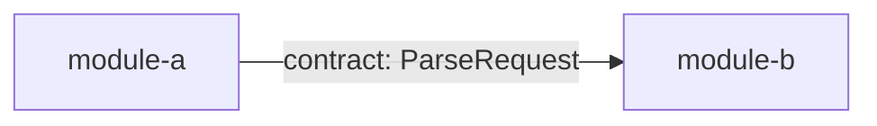

# Shape: {{title}}

<!-- Requirements (specify), then Design (design). Format: plugins/pd/references/doc-format.md. -->

## Requirements

### Goals

- <what this work item achieves>

### Non-goals

- <what it deliberately leaves out>

### User stories

- As <who>, I <do what>, so that <why>.

### Expectations

Each one observable, with a unique id. Plan turns them into test cases.

B1: <input or action> -> <observable outcome>

### Scope

- **In:** <…>
- **Out:** <…>

### Edge cases and must-nots

- <edge case, or a thing the change must never do>

<!-- Express only: replace the sections above with one B-line and one task block in plan.md's task format. -->

## Design

### Architecture

Modules, the data flowing between them, and the contract on each edge. Every edge carries a contract below; every contract sits on an edge.



### Contracts

One code block per module: its `modules:` line first (the paths it owns), then its schema and interface, then its invariants. Signatures live only here.

```text
modules: src/<pkg>/<module_a>.py
<interface: names, inputs, outputs, errors>
<invariants>
```

### Test strategy

- **Runner and JUnit option:** <runner> with <its JUnit option, e.g. pytest --junitxml=PATH>.
- **Fixtures live in:** <fixture_paths entry>.
- **Fakes:** <fake> stands in for <real resource>.
- **Real resources tests may touch:** none.
